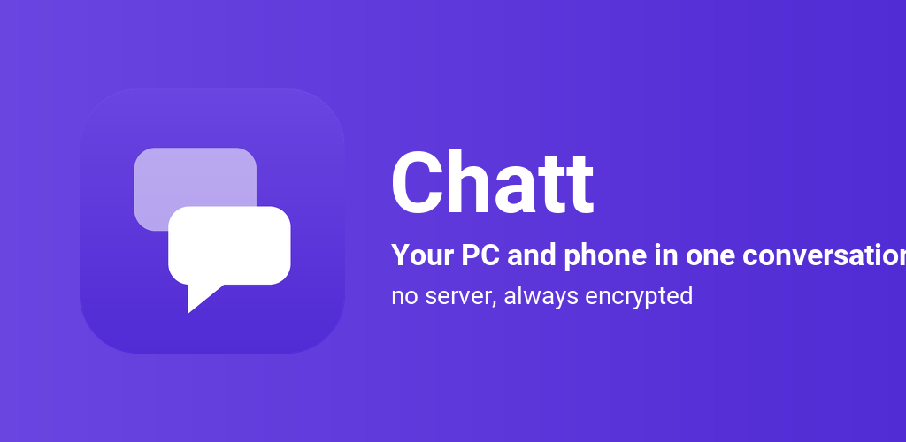
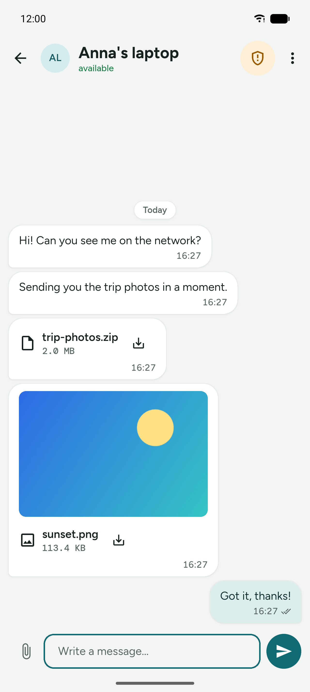
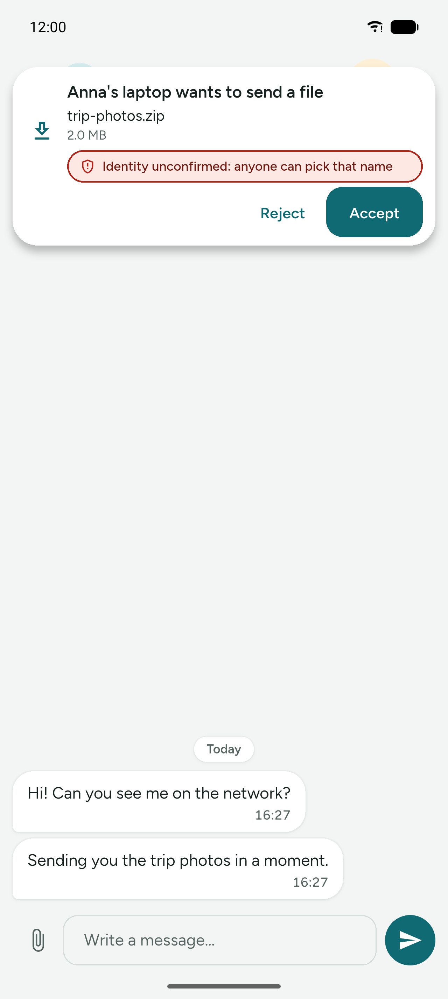
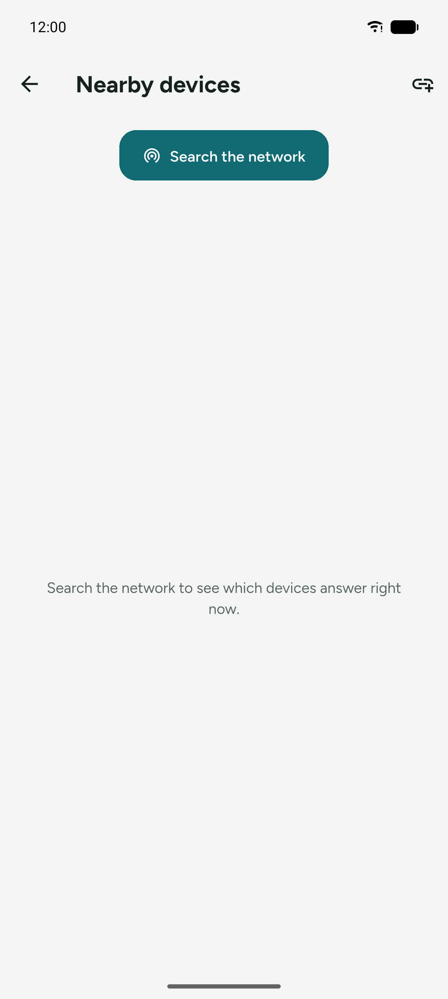
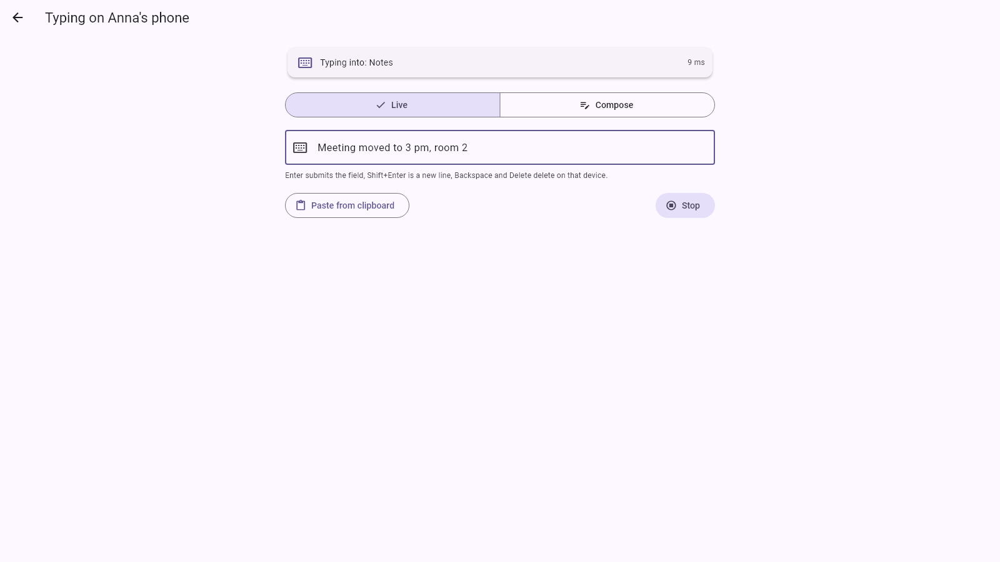
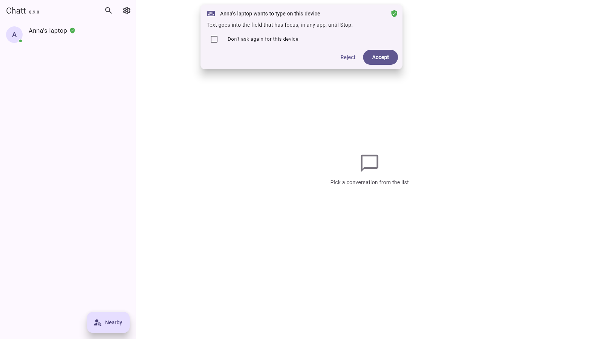

<p align="center">
  
</p>

<p align="center">
  Your PC and your phone in one conversation. Messages and files go straight
  from one device to the other over your local Wi-Fi.
  <br>
  <b>No server, no account, no cloud, always encrypted.</b>
</p>

<p align="center">
  <a href="LICENSE"></a>
  <a href="https://github.com/Mysttic/Chatt/releases"></a>
  <a href="https://github.com/Mysttic/Chatt/actions/workflows/testy.yml"></a>
</p>

<p align="center">
  <i>Wersja polska: <a href="README.pl.md">README.pl.md</a></i>
</p>

---

| Conversation | File request | Nearby devices |
|---|---|---|
|  |  |  |

## Why another one

Sending a link from your phone to your PC through a chat app, or emailing a
photo to your own address, routes your stuff through someone else's server.
LocalSend moves files and keeps no conversation. KDE Connect joins a phone to
a desktop for notifications, the clipboard and remote control, Phone Link
drives the whole phone with a mouse, and Input Leap shares one keyboard and
mouse between PCs. Chatt fills the gap between them:

- **A conversation with history.** It stays, it is searchable, and both
  devices see the same thing.
- **Always encrypted.** Every connection negotiates its own key; the first
  message to an unknown device is protected exactly like the hundredth to a
  paired one. Recorded traffic cannot be decrypted after a
  device is stolen (forward secrecy).
- **Nothing leaves your network by itself.** No server, no telemetry, no ads.
  The app works with no internet at all. Exactly two things can reach outside,
  and both stay switched off until you switch them on: a question to GitHub
  about a newer release, and previews for links in messages.
- **A keyboard for the device that has none.** An add-on lets the PC's
  keyboard type into the field you point at on a phone, a tablet or a PC run
  by touch. Only a keyboard, encrypted, with no account, between devices that
  already confirmed each other, and only after consent on the device being
  typed on.

## What it does

- **Finds devices by itself**: one UDP broadcast and the devices see each
  other. When a router isolates clients, add the other device by IP address.
- **Messages with delivery status**: saved locally → delivered → acknowledged.
  Failed ones retry with one tap; if the other device changes IP, it is found
  again by its identity.
- **Files with consent**: the recipient sees name, size and checksum first,
  bytes flow only after accepting. Interrupted transfers resume where they
  stopped and are verified with sha256. Several files at once, on the PC also
  by dragging them onto the window.
- **Encrypted at rest**: conversation history lives in an encrypted database
  with the key held by the OS (Android Keystore, Windows DPAPI). Clear history
  or auto‑delete messages older than N days.
- **Identity confirmation**: scan a QR code from the other screen or compare
  six digits. Anyone can type any device name; nobody can fake the key.
- **Works in the background**: the phone receives with the window closed and
  the screen off; on Windows the app sits in the tray and can start with the
  system.
- **Links with a preview**: a link in a message shows a card with the page's
  title, description and image, and clicking one always asks first, showing
  which server it really goes to. The preview is text and an image, nothing
  else: no page is opened and no script from it runs. It is off by default,
  because fetching it means connecting to an address someone else chose.
- **Comfort**: image thumbnails, one‑tap save to Pictures/Downloads, search,
  per‑message delete, two‑pane layout on wide windows, backgrounds, light and
  dark themes, English and Polish.

## Add-ons

Features most people never need, each behind its own switch in Settings, off
from the start. An add-on that is off shows on no other screen and starts
nothing.

- **Bluetooth**: the same messages and files over the radio, with no router
  and no shared network, for devices within some ten metres. A short message
  comes back as fast as over Wi-Fi; files are tens of times slower.
- **Keyboard from a PC**: the PC's keyboard types into the field that has the
  focus on an Android phone or tablet (through a Chatt keyboard with no keys)
  or on another Windows PC, in any app. A session starts only after consent
  on the device being typed on (a card each time, or "Don't ask again" for one
  confirmed device), and a bar with Stop stays there for as long as it lasts. Text, Backspace, Delete, Enter and the PC's clipboard travel;
  shortcuts and the mouse stay home.

| Typing on a phone from a PC | The consent card |
|---|---|
|  |  |

Both are described in the [user guide](docs/guide.md); the keyboard has a
page of its own, step by step with pictures from both systems:
[Keyboard from a PC](docs/keyboard.md).

Platforms: **Windows** and **Android**. Both devices must be on the same
network, or within radio range with the Bluetooth add-on. There is no internet
mode, and there will not be one: the whole point is that nothing leaves your
network.

## Download

Releases ship three files: an Android APK, a Windows installer and a portable
Windows zip. See the [Releases](../../releases) page. Chatt is not in any app
store: both of them want the account maintained over time, which for an app
given away for free is a cost with no return.

The Windows installer is not code‑signed, so SmartScreen shows a warning on
first run ("More info" → "Run anyway"). A signing certificate would change
nothing about what the program does.

## How it works, in five lines

Every device is both client and server: a small HTTP server plus a UDP
responder, the same shape as LocalSend. Identity is an X25519 key pair and the
device ID is derived from the public key, so an ID cannot be claimed without
the matching private key. Each connection runs a Noise‑KK‑style handshake and
gets a session key that lives an hour, in memory only. Messages travel in
AES‑GCM envelopes, file streams in AES‑CTR with a sha256 announced inside the
encrypted offer. The database is SQLite3MultipleCiphers with the key wrapped
by the platform keystore.

The full threat model, protocol and decisions are in
[docs/architecture.md](docs/architecture.md).

## Documentation

Everything is in [docs/](docs/README.md), starting with the
[user guide](docs/guide.md). For working on the code: how to build and release
in [building.md](docs/building.md), the protocol and the threat model in
[architecture.md](docs/architecture.md), the test suite in
[testing.md](docs/testing.md), and how to send a change in
[CONTRIBUTING.md](docs/CONTRIBUTING.md).

The release history is in [CHANGELOG.md](CHANGELOG.md).

## Development

```
cd app
flutter test        # 387 tests: database, discovery, messages, files, identity, encryption, attacker on the wire, Bluetooth framing, the remote keyboard
flutter analyze
```

Layout of `app/lib/`:

- `core/`: device identity, cryptography, platform channels
- `data/db.dart`: the SQLite schema (drift) and queries
- `network/`: the protocol, UDP discovery, HTTP server and client
- `services/`: `AppServices`, the root that ties everything together, plus Riverpod providers
- `ui/screens/`: conversations, chat, nearby devices, settings

Device scenarios in `app/tool/` are described in
[docs/testing.md](docs/testing.md).

## Licence

Apache License 2.0, see [LICENSE](LICENSE) and [NOTICE](NOTICE). The components
that ship inside the app are listed in
[third-party notices](docs/THIRD-PARTY-NOTICES.md).

Found a security issue? Please read [SECURITY.md](docs/SECURITY.md) first; it
asks you to report it privately.
