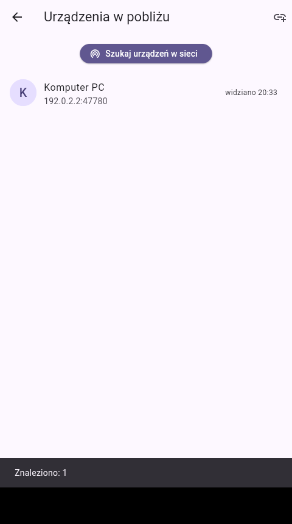
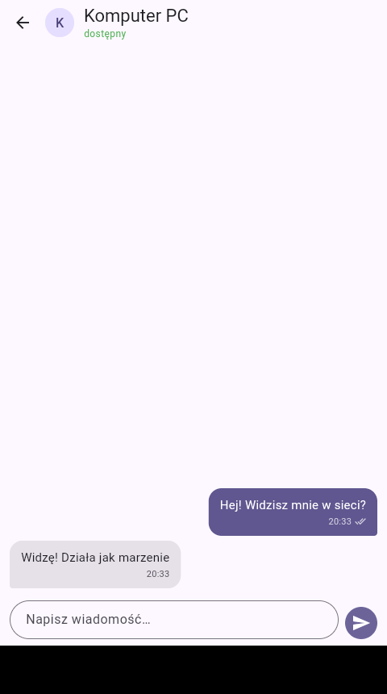
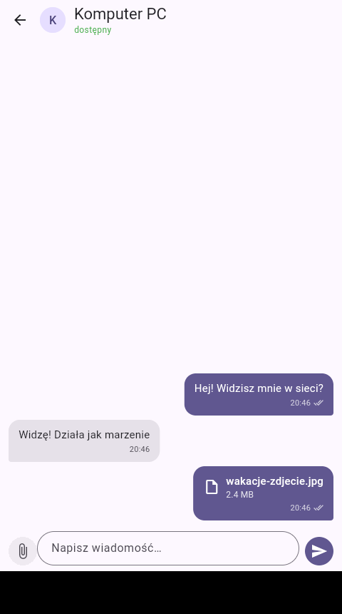

# Chatt

Komunikator P2P dla urządzeń w jednej sieci Wi‑Fi (PC ⇄ telefon z Androidem):
wiadomości i pliki przesyłane **bezpośrednio między urządzeniami**, bez
żadnego serwera pośredniczącego.

Aplikacja jest napisana we **Flutterze** i mieszka w katalogu [`app/`](app/).
Wcześniejsze podejście w .NET MAUI zostało usunięte po osiągnięciu parytetu
funkcji; jest w historii gita, a makiety i diagramy z tamtego etapu leżą
w [`docs/makiety/`](docs/makiety/). Plan prac i stan projektu:
[ROADMAP.md](ROADMAP.md).

## Jak to działa

- Każda instancja ma trwały **GUID**, nick i wiadomość powitalną.
- **Discovery**: broadcast UDP na porcie 47777 — jedno zapytanie, urządzenia
  odpowiadają tożsamością; jeden skan uczy obie strony nawzajem. Gdy broadcast
  nie przechodzi (izolacja AP, emulator), jest ręczne „Dodaj po adresie IP".
- **Wiadomości i pliki**: każda instancja hostuje mały serwer HTTP
  (`GET /info`, `POST /message`, `POST /file-offer`, `POST /file`) na porcie
  47780 (konfigurowalny; zajęty ⇒ próbowane są kolejne). Wysyłka: zapis
  lokalny → dostarczenie → potwierdzenie; nieudane można ponowić jednym
  dotknięciem.
- **Pliki**: nadawca najpierw wysyła zapowiedź (nazwa, rozmiar, sha256),
  a odbiorca widzi ją na każdym ekranie i decyduje: „Akceptuj" albo „Odrzuć".
  Dopiero potem lecą bajty — streamingiem, w dowolnym rozmiarze, z paskiem
  postępu po obu stronach. Przerwany transfer zostaje na dysku jako część
  i kolejna próba **dokłada tylko brakujący kawałek**; po złożeniu całości
  sprawdzana jest suma kontrolna. Odebrane pliki lądują w katalogu dokumentów
  aplikacji i otwierają się kliknięciem w dymek (przytrzymanie: pokaż folder,
  kopiuj ścieżkę).
- **Parowanie i szyfrowanie**: w rozmowie jest tarcza. Kliknięcie losuje
  sześciocyfrowy kod i pokazuje go na ekranie; przepisujesz go na drugim
  urządzeniu. Sam kod nie idzie przez sieć — obie strony uzgadniają klucz
  (X25519 + HKDF z kodem jako solą), a przez sieć leci tylko skrót
  potwierdzający jego znajomość. Od tej pory wiadomości i zapowiedzi plików
  jadą w kopercie AES-GCM, a treść plików strumieniem AES-CTR (żeby wznawianie
  dalej działało); integralności pilnuje suma sha256 z zaszyfrowanej
  zapowiedzi. Od sparowanego urządzenia przyjmowany jest **wyłącznie** ruch
  zaszyfrowany, więc zielona tarcza nie obiecuje niczego na wyrost.
  Z niesparowanymi rozmawiamy dalej jawnym tekstem — dlatego prośba o plik od
  takiego urządzenia ostrzega, że jego nazwę każdy może sobie ustawić dowolnie.
- **Baza**: SQLite (drift) — rozmówcy, konwersacje, wiadomości ze statusami
  dostarczenia i licznikiem nieprzeczytanych.

| Skan sieci | Rozmowa | Wysłany plik |
|---|---|---|
|  |  |  |

*Zrzuty z automatycznego testu E2E: dwie instancje aplikacji znajdują się
przez UDP i rozmawiają ze sobą po HTTP.*

Interfejs jest po polsku i po angielsku (`app/lib/l10n/*.arb`); domyślnie idzie
za językiem systemu, ale w ustawieniach można go wymusić — tak samo jak motyw
jasny/ciemny. Oba wybory siedzą w bazie, więc przeżywają restart.

## Uruchomienie u siebie (Windows)

1. Zainstaluj [Flutter SDK](https://docs.flutter.dev/get-started/install/windows)
   i sprawdź `flutter doctor`.
2. ```
   cd app
   flutter run -d windows
   ```
   (albo `flutter build windows` i uruchom
   `app\build\windows\x64\runner\Release\chatt.exe`).

**Dwie instancje na jednym komputerze** (do testów bez drugiego urządzenia) —
druga musi dostać własny katalog danych; port znajdzie sobie sama:

```powershell
$env:CHATT_DATA_DIR = "$env:TEMP\chatt-b"
$env:CHATT_INSTANCE_NAME = "Instancja B"
.\build\windows\x64\runner\Release\chatt.exe
```

## Android

Telefon z włączonym debugowaniem USB: `flutter run -d <urządzenie>` albo
`flutter build apk --debug` i zainstaluj APK.

Odebrane pliki lądują w `files/Chatt/received` w katalogu aplikacji i otwierają
się kliknięciem w dymek — plik wychodzi do innych aplikacji przez FileProvider
jako `content://` (własny kanał `chatt/files` w `MainActivity.kt`, bez wtyczek
z pub.dev). Przytrzymanie dymka daje „Udostępnij" i „Kopiuj ścieżkę".

**Emulator Androida**: nada się do pracy nad UI i — z ograniczeniami — do
wiadomości, ale **automatyczne wykrywanie nie zadziała** (emulator siedzi za
NAT-em, broadcast UDP nie przechodzi w żadną stronę). Obejście dla wiadomości:

- w aplikacji na emulatorze dodaj PC ręcznie jako `10.0.2.2:47780`
  (tak emulator widzi hosta);
- żeby PC mógł wysyłać do emulatora: `adb forward tcp:47781 tcp:47780`
  i na PC dodaj ręcznie `127.0.0.1:47781`.

Jest na to gotowy, automatyczny scenariusz — instancja hosta rozmawia
z aplikacją na urządzeniu przez tunele adb (wiadomość, plik z akceptacją,
odmowa, zrzuty ekranu do `docs/screenshots/android/`):

```
cd app
flutter test tool/android_e2e_test.dart
```

Wymaga uruchomionej aplikacji na urządzeniu; instancja hosta stoi na porcie
47790, bo `adb reverse` nie wstanie na 47780 zajętym przez aplikację.

Pełny test discovery i realne warunki Wi‑Fi wymagają fizycznego telefonu
w tej samej sieci co PC.

## Development i testy

```
cd app
flutter test        # dane, discovery, E2E dwóch stosów w jednym procesie
flutter analyze
dart run build_runner build   # po zmianach schematu bazy (lib/data/db.dart)
```

Struktura `app/lib/`:

- `core/` — tożsamość urządzenia, nadpisania środowiskowe
- `data/db.dart` — schemat SQLite (drift) i zapytania
- `network/` — protokół, discovery UDP, serwer HTTP, klient
- `services/` — `AppServices` (korzeń łączący wszystko) i providery Riverpod
- `ui/screens/` — konwersacje, czat, urządzenia w pobliżu, ustawienia

Na Linuksie jest też scenariusz E2E na żywym UI (dwie instancje pod Xvfb,
sterowane xdotool, ze zrzutami ekranu): `app/tool/ui_e2e.sh` — tego używa
sesja chmurowa do samodzielnego testowania aplikacji.
