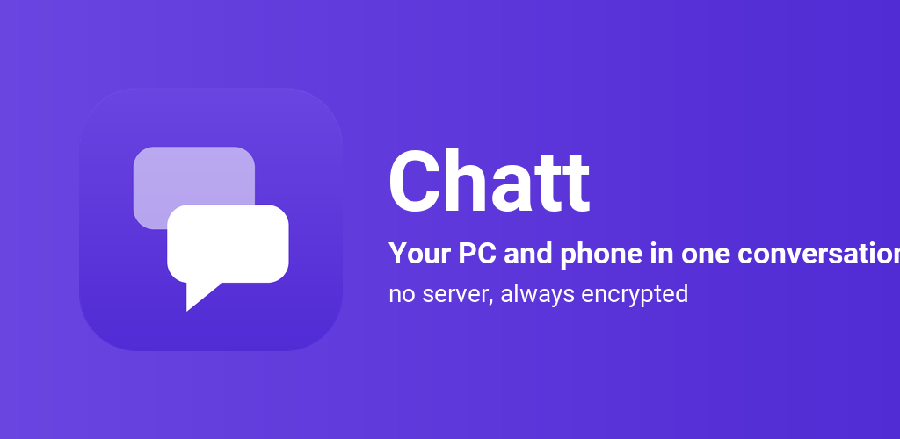
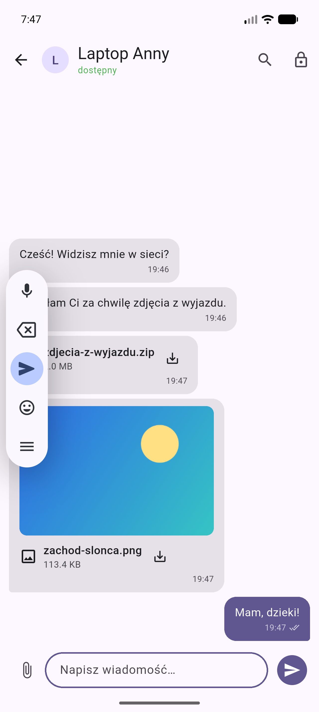
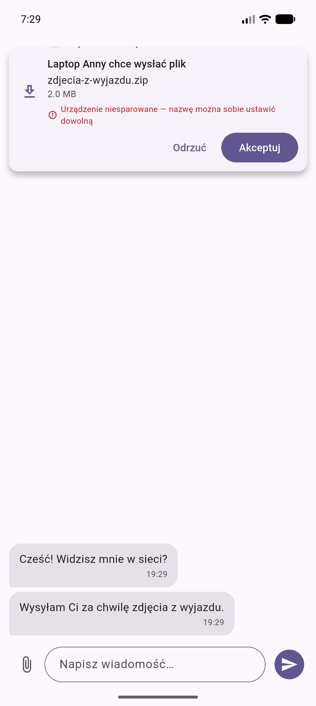
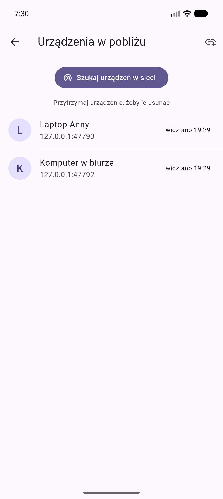
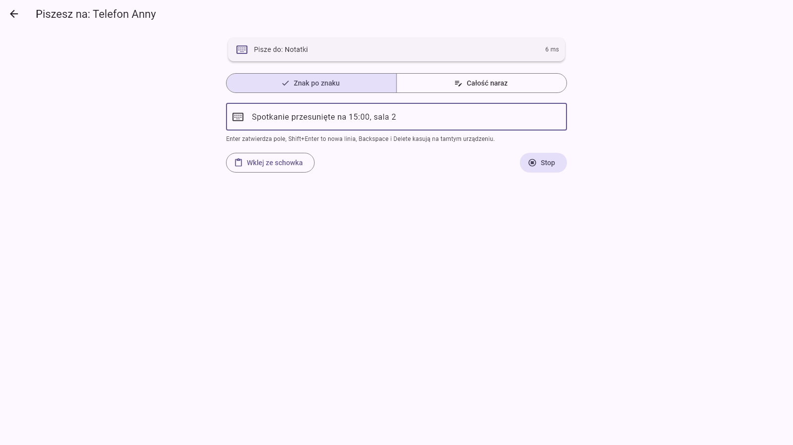
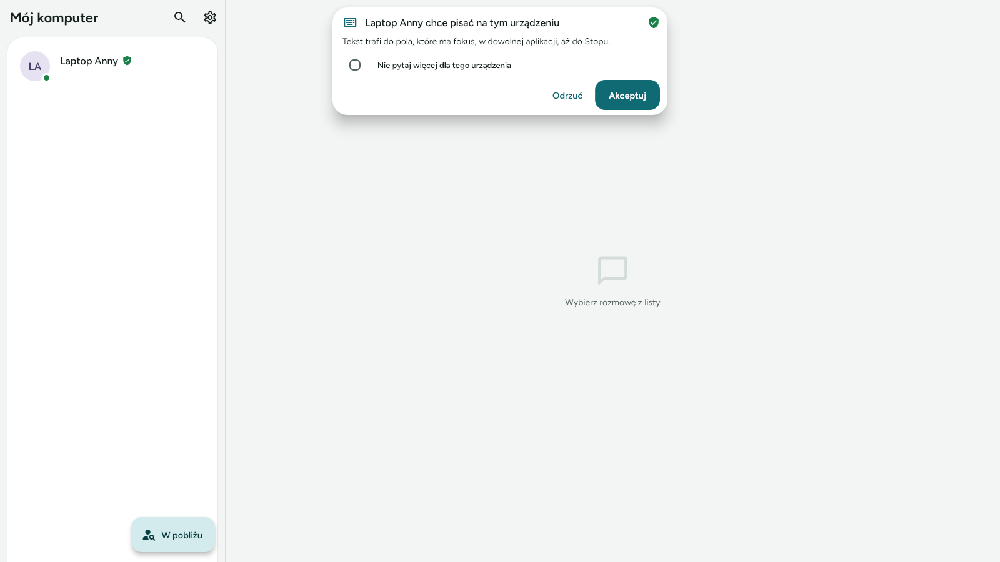

<p align="center">
  
</p>

<p align="center">
  Komputer i telefon w jednej rozmowie. Wiadomości i pliki idą prosto
  z jednego urządzenia na drugie po sieci lokalnej.
  <br>
  <b>Bez serwera, bez konta, bez chmury, zawsze zaszyfrowane.</b>
</p>

<p align="center">
  <a href="LICENSE"></a>
  <a href="https://github.com/Mysttic/Chatt/releases"></a>
  <a href="https://github.com/Mysttic/Chatt/actions/workflows/testy.yml"></a>
</p>

<p align="center">
  <i>English version: <a href="README.md">README.md</a></i>
</p>

---

| Rozmowa | Prośba o plik | Urządzenia w pobliżu |
|---|---|---|
|  |  |  |

## Co to potrafi

- **Znajduje samo**: jedno rozgłoszenie UDP w sieci i urządzenia widzą się
  nawzajem. Gdy router izoluje klientów, zostaje ręczne dodanie po adresie IP.
- **Wiadomości z potwierdzeniem**: zapis lokalny → dostarczenie → potwierdzenie.
  Nieudane można ponowić jednym dotknięciem, a gdy rozmówcy zmieni się IP,
  aplikacja sama go odnajdzie po identyfikatorze.
- **Pliki z pytaniem o zgodę**: odbiorca najpierw widzi nazwę, rozmiar i sumę
  kontrolną, dopiero potem lecą bajty. Przerwany transfer wznawia się od
  miejsca przerwania, a całość jest weryfikowana sumą sha256.
- **Udostępnianie z innych aplikacji** (Android): odnośnik z przeglądarki,
  zdjęcie z galerii, dokument z menedżera plików. Chatt jest w systemowym
  oknie „Udostępnij", cztery ostatnie rozmowy stoją tam jako osoby (Android 10
  i nowszy), a rozmowa otwiera się z tekstem w polu i plikami nad nim. Nic nie
  wychodzi przed „Wyślij".
- **Szyfrowane zawsze**: klucz sesji uzgadniany na każde połączenie, jawnego
  tekstu w protokole nie ma. Nagrany dziś ruch nie odszyfruje się po
  późniejszej kradzieży urządzenia.
- **Potwierdzanie tożsamości**: kodem QR albo porównaniem sześciu cyfr.
  Szyfrowanie działa i bez tego; potwierdzenie odpowiada na pytanie „czy po
  drugiej stronie jest ta osoba, o której myślę".
- **Historia zaszyfrowana na dysku**, klucz w schowku systemowym (Android
  Keystore, Windows DPAPI). W tej samej bazie leżą historia pisania i dziennik
  aplikacji. Do tego „wyczyść historię" i kasowanie wiadomości starszych niż
  wybrana liczba dni.
- **Twoje dane w jednym pliku**: **Eksportuj dane** zapisuje ZIP z rozmowami,
  urządzeniami i ustawieniami, historią pisania, dziennikiem aplikacji i, na
  życzenie, odebranymi plikami, w JSON-ie dla programów i w tekście do
  czytania. Nie trafia do niego żaden klucz prywatny, klucz sesji ani klucz
  bazy, a plik nie jest zaszyfrowany, co mówi też README w środku.
- **Dziennik aplikacji na wypadek awarii**: 30 dni tego, co aplikacja robiła
  i co się nie udało (połączenia, parowanie, pliki, Bluetooth, błędy),
  w zaszyfrowanej bazie i nigdy z treścią wiadomości, wpisywanym tekstem ani
  kluczami. Sam dziennik da się wyeksportować i dołączyć do zgłoszenia błędu.
- **Nasłuch w tle na Androidzie**: wiadomości dochodzą przy zamkniętym oknie
  i zgaszonym ekranie, z powiadomieniem.
- **Na Windowsie ikona w zasobniku**: krzyżyk chowa okno, nasłuch działa
  dalej, a aplikacja może wstawać razem z systemem.
- **Wygoda**: wiele plików naraz (także przeciągniętych na okno), miniatury
  obrazków, zapisanie odebranego pliku do Zdjęć/Pobranych jednym dotknięciem,
  szukanie w rozmowach, kasowanie pojedynczych wiadomości.
- **Dwa panele na szerokim oknie** (lista obok rozmowy) i tła do wyboru.
- **Odnośniki z podglądem**: pod adresem w wiadomości pojawia się karta
  z tytułem, opisem i obrazkiem strony, a kliknięcie w odnośnik zawsze pyta
  i pokazuje, do jakiego serwera naprawdę prowadzi. Podgląd to sam tekst
  i obrazek: żadna strona się nie otwiera i żaden skrypt z niej nie działa.
  Domyślnie wyłączone, bo pobranie podglądu znaczy połączenie pod adres
  wybrany przez kogoś innego.
- **Polski i angielski**, motyw jasny/ciemny/systemowy, jedno i drugie zapisane
  w bazie.

## Dodatki

Funkcje, których większość osób nie potrzebuje, każda za własnym
przełącznikiem w Ustawieniach, wyłączonym od początku. Wyłączony dodatek nie
pokazuje się na żadnym innym ekranie i niczego nie uruchamia.

- **Bluetooth**: te same wiadomości i pliki przez radio, bez routera i bez
  wspólnej sieci, dla urządzeń w promieniu około dziesięciu metrów. Krótka
  wiadomość wraca równie szybko jak przez Wi‑Fi; pliki idą kilkadziesiąt razy
  wolniej.
- **Internet** (eksperymentalny): rozmowa z potwierdzonym urządzeniem w innej
  sieci, na przykład komputer w domu i telefon na danych komórkowych.
  **Wiadomości i pliki idą prosto z jednego urządzenia na drugie i nigdy nie
  są przechowywane na żadnym serwerze**: Chatt żadnego nie ma. Urządzenia
  odnajdują się przez zaszyfrowaną skrzynkę w publicznym DHT BitTorrenta
  i przebijają się przez NAT swoich routerów prosto do siebie; każdy pakiet
  jest szyfrowany, a w środku wiadomości i pliki mają to samo szyfrowanie co
  przez Wi‑Fi. Publiczne serwery STUN i węzły DHT widzą adres IP urządzenia
  i moment połączenia. Treści nie widzi żaden z nich. Pierwsza wiadomość po
  dłuższej ciszy idzie do około minuty, sieć, która to blokuje (symetryczny
  NAT, odfiltrowany UDP), zostaje poza zasięgiem, a przekaźnika w zapasie nie
  ma. Zdjęcie 7,7 MB szło od 11 do 13 sekund w każdą stronę między
  komputerem w domu a telefonem na LTE. Jak to działa, krok po kroku z diagramami, i pomiary:
  [Rozmowy przez internet](docs/internet.pl.md).
- **Klawiatura z PC**: klawiatura komputera pisze w polu z fokusem na
  telefonie albo tablecie z Androidem (przez klawiaturę Chatt bez klawiszy)
  albo na innym komputerze z Windows, w dowolnej aplikacji. Sesja zaczyna się
  dopiero po zgodzie na urządzeniu, na którym się pisze (karta za każdym razem
  albo „Nie pytaj więcej” dla jednego potwierdzonego urządzenia), a pasek ze
  Stopem stoi tam do jej końca. Przechodzi tekst, Backspace, Delete, Enter i schowek
  komputera; skróty i mysz zostają w domu. Tylko klawiatura, szyfrowana, bez
  konta, między urządzeniami, które już się nawzajem potwierdziły. Oba
  urządzenia prowadzą historię pisania każdej sesji (co wpisano, gdzie i czy
  dotarło), a tekst do pól haseł zapisują jako liczbę znaków; przełącznik na
  karcie dodatku wyłącza ją na danym urządzeniu.

| Pisanie z komputera na telefonie | Karta zgody |
|---|---|
|  |  |

Wszystkie trzy opisuje [instrukcja obsługi](docs/guide.pl.md). Klawiatura ma
własną stronę, krok po kroku, z obrazkami z obu systemów:
[Klawiatura z PC](docs/keyboard.pl.md), a internet swoją:
[Rozmowy przez internet](docs/internet.pl.md).

Platformy: **Windows** i **Android**. Oba urządzenia muszą być w tej samej
sieci, z dodatkiem Bluetooth w zasięgu radia, a z dodatkiem Internet w dowolnych
dwóch sieciach z dostępem do internetu, gdy już się nawzajem potwierdziły. Nic
samo nie wychodzi poza Twoją sieć. Wyjątki są trzy i wszystkie stoją
wyłączone, dopóki sam ich nie włączysz: pytanie do GitHuba o nowsze wydanie,
podglądy stron pod odnośnikami w wiadomościach i dodatek Internet.

## Szybki start

```
cd app
flutter run -d windows
```

Na telefonie: `flutter build apk --release` i zainstaluj APK. Oba urządzenia
muszą być w tej samej sieci, a na Windows trzeba przepuścić ruch przychodzący,
gdy zapyta o to zapora.

Szczegóły: [instrukcja obsługi](docs/guide.pl.md) ·
[budowanie i wydawanie wersji](docs/building.md)

## Dokumentacja

Po polsku są dwa pliki: ten i instrukcja obsługi. Reszta jest po angielsku,
żeby istniała w jednej wersji i nie rozjeżdżała się przy każdej zmianie
w kodzie. Sama aplikacja mówi po polsku i po angielsku.

Spis całej dokumentacji jest w [docs/](docs/README.md). Dla użytkownika:
[instrukcja obsługi](docs/guide.pl.md). Dla pracujących nad kodem:
[budowanie i wydawanie](docs/building.md), [architektura](docs/architecture.md),
[testy](docs/testing.md) i [jak wysłać zmianę](docs/CONTRIBUTING.md).

Historia wydań jest w [CHANGELOG.md](CHANGELOG.md).

## Development

```
cd app
flutter test        # 795 testów: baza, discovery, wiadomości, pliki, tożsamość, szyfrowanie, Bluetooth, zdalna klawiatura, wspólna historia, style i ich ruch, historia pisania, dziennik, eksport, udostępnianie do Chatta, droga internetowa (STUN, DHT, przebicie dziury)
flutter analyze
```

Struktura `app/lib/`:

- `core/`: tożsamość urządzenia, kryptografia, kanały platformowe
- `data/db.dart`: schemat SQLite (drift) i zapytania
- `network/`: protokół, discovery UDP, serwer HTTP, klient, transporty (HTTP, Bluetooth i eksperymentalna droga internetowa: STUN, DHT, przebicie dziury)
- `services/`: `AppServices` (korzeń łączący wszystko) i providery Riverpod
- `ui/screens/`: rozmowy, czat, urządzenia w pobliżu, ustawienia

Scenariusze na żywym sprzęcie (`app/tool/`) opisuje
[docs/testing.md](docs/testing.md).

## Licencja

Apache License 2.0, patrz [LICENSE](LICENSE) i [NOTICE](NOTICE). Komponenty,
które jadą razem z aplikacją, wymienia [lista licencji](docs/THIRD-PARTY-NOTICES.md).

Znalazłeś błąd bezpieczeństwa? Najpierw przeczytaj [SECURITY.md](docs/SECURITY.md);
prosi o zgłoszenie prywatne.
