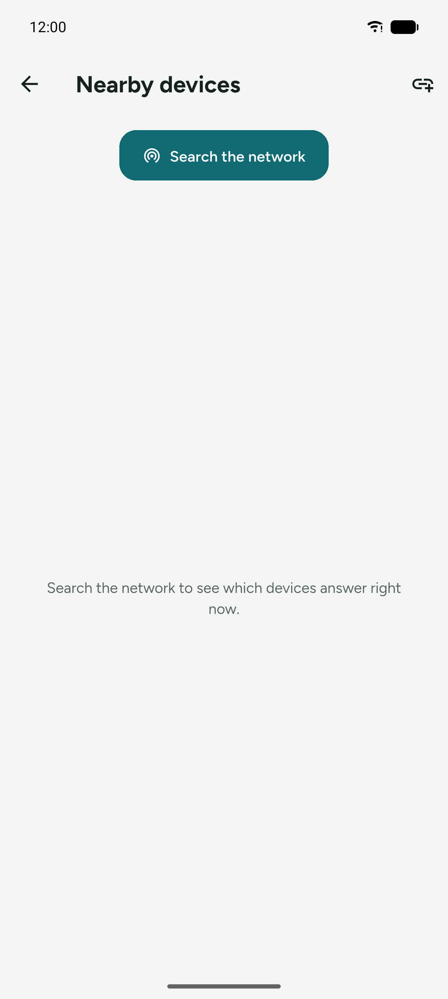
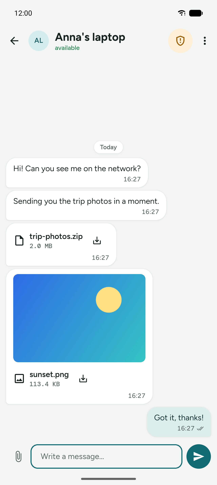
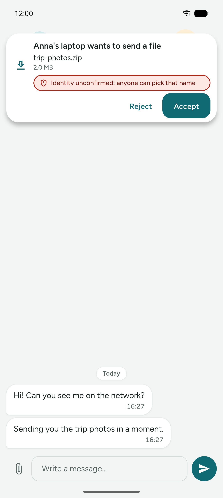
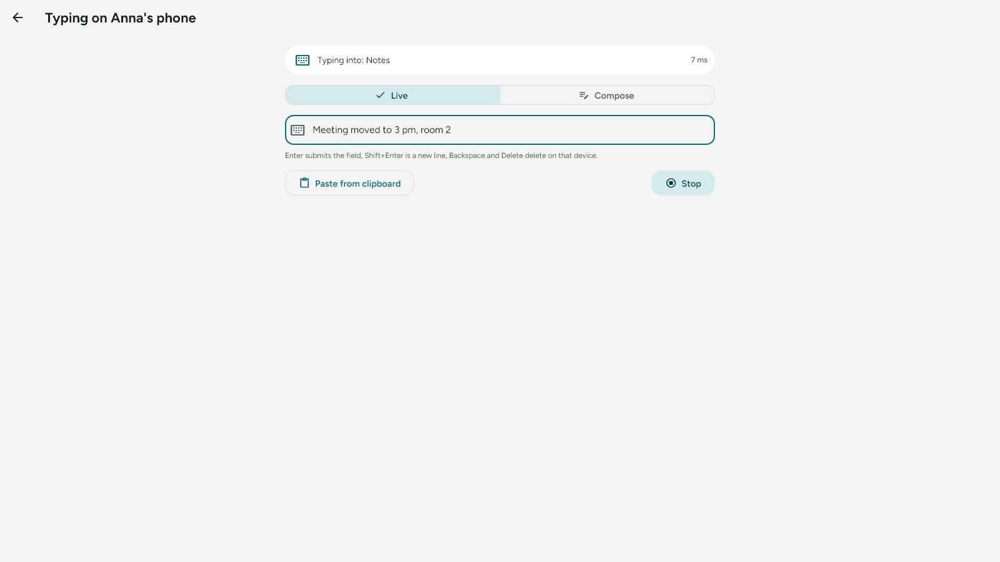
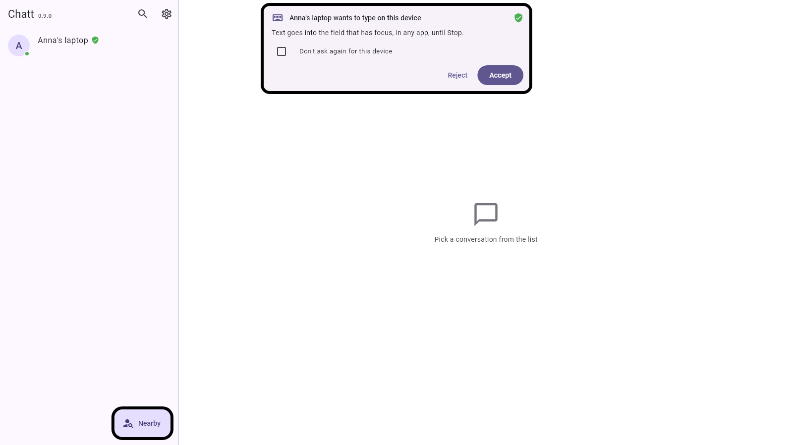
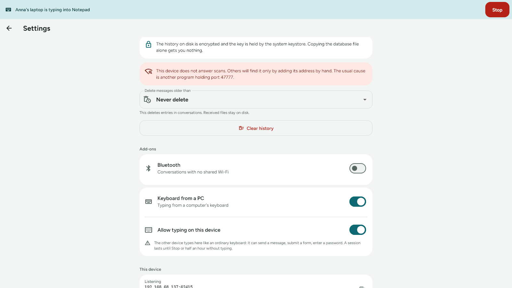

# User guide

*Wersja polska: [guide.pl.md](guide.pl.md)*

Chatt joins two devices on the same Wi-Fi network: a Windows PC and an Android
phone. There is no account, no login and no server in the middle. Messages and
files go straight from one device to the other.

Two add-ons, both off until you turn them on, go further: **Bluetooth** carries
the same conversation over the radio with no shared network, and **Keyboard
from a PC** lets the PC's keyboard type into a field on the phone or on another
PC.

## First run

1. Start Chatt on both devices and put them on **the same Wi-Fi network**. The
   PC may sit on a cable, as long as it is in the same subnet as the phone.
2. On Windows the firewall asks about incoming traffic the first time. Tick the
   private network and allow it: without that the other device has no way in.
3. Open **Settings** and set the nickname that identifies this device in the
   other side's list.

The top of the conversation list carries this device's name. The version
number is in Settings, under **Updates**. At the very bottom of Settings the
**This device** panel gathers the addresses the device listens on, its
Bluetooth address (with the add-on on, when the system reports it), the
identifier and the key fingerprint. The button next to each value copies it.
Worth having at hand when reporting a problem or adding a device by IP
address.

## Finding the other device

**Nearby** button, then **Search for devices on the network**. A scan sends one
query across the network and collects answers for two seconds. One scan teaches
both sides: the device that answered also remembers the one that asked.

The screen opens with no list. What appears is what the last scan answered, so
it describes the network as it is right now.



When a scan finds nothing:

- check that both devices really are on the same network (not: the phone on
  mobile data);
- some routers and guest networks isolate clients from each other. Broadcasts
  do not get through and the device has to be added by hand;
- **Add by IP address**: the address and port of the other device are in its
  Settings, under "This device".

Long-pressing an entry in the list removes that device. The "Clear unused
devices" button in Settings sweeps out entries that have no messages and have
not been seen for an hour.

## Messages

Tapping a device opens the conversation. Under the name you can see whether it
is reachable right now.

Entries on the conversation list carry two marks: a green dot on the avatar
while the device is answering on the network, and a green shield next to the
name once its identity has been confirmed. The list asks every known device
every 30 seconds, and only while it is on screen.

On a phone the conversation's header holds only the shield and the **⋮**
menu. The shield sits on a background in the colour of its state: green with a
confirmed identity, the warning colour without one. Search and the keyboard
from a PC are in the menu. A wide window keeps both buttons in the header next
to the shield.



Status shown on a sent message:

| Icon | Meaning |
|---|---|
| clock | saved on your side, still on the way |
| double check | the other side confirmed receipt |
| "Not delivered, retry" | the attempt failed, tap to try again |

A message is never lost on the way: it is saved locally first and only then
sent. If the other device changed its IP in the meantime, the app searches the
network for its identity and retries at the new address.

**Selecting text.** On a PC drag the cursor across a message, or across
several at once, and copy with Ctrl+C. On a phone that gesture is taken by the
menu, so selection lives inside it: long-press a bubble, then "Select text".

**Long-press a bubble** for a menu: copy the whole message, select part of it,
delete it. On a PC the same menu also opens with a right click. Deleting
works on your side only. The protocol has no way to make the other side forget
something it already received, and the app says so.


**Search this conversation** (the magnifier in the bar on a wide window, the
**⋮** menu on a phone) searches the open conversation: the list keeps only
matching messages and the hit is highlighted. The same magnifier on the
conversation list filters it by name and last message.


Bubbles show only the time. The first message of each day gets the date above
it: "Today", "Yesterday", or the full date.

## Getting a conversation's history back

A conversation lives on both devices. When yours loses it (a reinstall, a new
phone, **Clear history**, automatic deletion), the other side can hand its
copy back. The **⋮** menu in the conversation has two items:

- **Share history**, on the device that has it: everything or since a date,
  with files or without, and the counts before anything goes;
- **Ask for history**, on the device that lost it: a card on the other device
  asks whether to share, with files, without them, or not at all.

The receiving side always gets a card first: who sends, how many messages and
files, the date range, a warning when that device's identity is not
confirmed, and a note when automatic deletion would skip older messages.
Messages deleted here on purpose come back too, and the card says so. An answer
to your own **Ask for history** goes in without a second card.

Restored messages keep their original times and directions, arrive already
read, and raise no notification. Each one carries a small history icon next to
the time, with the restore date in its tooltip: the other side's copy is their
word, and nothing signs a message.

Files ride after the messages. Both sides see a progress bar above the input
field, each with **Stop**. A file whose bytes the other side no
longer has arrives as "File not available"; a received file that is still on
your disk is linked without travelling again. Sharing a second time resumes:
nothing is duplicated and the missing files arrive.

**After a reinstall or on a new phone** the identity comes from a new key, so
the other side sees a new device and the old conversation stays under the old
entry. Once that new device has a green shield, the share dialog there offers
**From**: this conversation or an older one with another entry. Pick the old
one and, if you like, **Merge that conversation into this one here**: after
the share the two become one on the sharing side, and the old entry stays on
the device list. Without the shield only this conversation can go, so nobody
who borrows a friend's name gets the friend's conversation with you.

Both devices need this version; an older Chatt is reported as such.

## Links in messages

An address in a message becomes a **link you can tap**, but nothing opens on
its own. A tap raises a card asking whether you really want to go there, and
that card shows the **server name on its own line**, above the full address,
because that name is the only part that decides whose page it is. Below it come
warnings where they apply: an `@` in the address (what you see before it is not
the server name), letters from outside the Latin alphabet in the server name,
a connection with no encryption, and an address on your own local network.
"Copy address" is there too, for when you would rather look at it first.

Only `http` and `https` addresses become links. Anything else — `javascript:`,
`data:`, `file:` — stays plain text, because tapping it would mean "run
something" rather than "show a page". The same links also appear in the bubble
menu (long press, or right click on a PC), which is the reliable route on a PC,
where the tap belongs to text selection.

**Link previews** are separate, and off by default. Turned on in Settings under
**Links**, a card appears under the message with the page's title, description
and image, the way other messengers do it. Two things are worth knowing:

- Fetching a preview means **connecting to that page**, so its server sees this
  device's IP address and the moment the message arrived. The address is chosen
  by whoever sent the message, not by you. That is why the switch starts off.
- A preview is **text and one image, nothing more**. The app does not open the
  page, does not run any script from it, and never fetches previews from
  addresses on your local network, so a message cannot make Chatt visit your
  router. Only the first link in a message gets a card.

Turning the switch back off stops the fetching at once and drops the previews
already fetched.

## Files

The paperclip next to the text field opens the system file picker, and
**several files can be selected at once**. On a PC you can also **drag files
onto the conversation window**. The recipient **is asked first** whether to
take the file; bytes flow only after that.

**Several files are one question.** The card names every file in the batch and
gives the total size, and one "Accept all" covers the lot; the files still
travel one after another, each with its own progress. A refusal refuses the
whole batch, and the rest is not even announced. Two things follow from that,
and both are on purpose: the acceptance cannot be taken back once the files
start arriving, and a file that turns out not to match what was announced (it
grew in the meantime, or it was never on the list) is asked about separately.
More than a hundred files at once arrive as batches of a hundred, each with its
own question.

**Pasting.** Whatever sits on the clipboard can go straight into the
conversation, without picking it out of a folder first. On a PC that is
**Ctrl+V** on the conversation screen: a file copied in Explorer, a screenshot
taken with Win+Shift+S, a picture copied on a web page. A file copied in
Explorer goes exactly as it lies; an image that has no file of its own is
written out as a PNG in the temporary folder, and that is the copy that
travels.

Text pastes into the message field as it always did, and text wins: a range of
cells copied in Excel, or a paragraph from Word, carries a picture of itself
on the clipboard as well, and Chatt leaves it alone rather than sending the
other side a screenshot nobody asked for. Ctrl+V while you are typing in the
search box is the search box's own, so it pastes text there and nothing else.

When there is something to paste, the paperclip asks which of the two you
meant; when there is not, it opens the file picker straight away, as before.

On a phone there is no Ctrl+V, so the paperclip is the way in. The keyboard is
the other one: Gboard's own picture and GIF buttons now send straight into the
conversation.



- A refusal means zero bytes transferred. The sender sees "not delivered" and
  can try again later.
- No answer within two minutes counts as a refusal.
- An interrupted transfer (Wi-Fi dropped, phone asleep) stays on disk as a
  part file. The next attempt **sends only the missing piece**, and once the
  whole file is together the app checks the checksum. If anything does not
  match, the file is rejected.
- A retry after a lost confirmation does not ask a second time and does not
  transfer a single byte: the recipient answers "already have it".

Received files land in the app directory. Tapping the bubble opens the file;
long-pressing gives "Show folder", "Share", "Copy path" and "Delete message".
On Windows an image also gets **"Copy image"**, which puts it on the clipboard
both as a picture (paste it into a document or an image editor) and as a file
(paste it into Explorer).

The down arrow on a received file **saves a copy where you will look for it**:
on Android images go to `Pictures/Chatt` (the gallery picks them up) and
everything else to `Downloads`; on a PC the system save dialog opens. Without
that the file sits in the app directory, which no file manager shows and which
disappears when the app is uninstalled.

Images get a **thumbnail** in the conversation, but only once the file has been
accepted. Decoding an image from a stranger is attack surface, so the decoder
only ever sees what you agreed to and what already lies on disk.


**Tapping a thumbnail opens the picture full screen.** Pinch or scroll to zoom,
drag to move around, double-tap to zoom in on a spot and again to fit it back;
the button in the corner turns it by ninety degrees at a time. Turning affects
what you are looking at, never the file, which stays exactly as it arrived. The
same actions as in the conversation are in the top bar, so you can save or
share the picture without going back first, and Esc closes it on a PC.

The picture is drawn by Chatt itself and never handed to another app, so it
opens whether or not the system has anything installed that shows images.
Other files still open with whatever the system associates with them.

## Talking over Bluetooth

Everything above assumes the two devices share a network. Often they do not: a
guest network that isolates its clients from each other, the phone on mobile
data while the laptop hangs off someone else's Wi-Fi, a room with no router in
it. Bluetooth is the second road. It carries the same messages and the same
files with no router, no address and no shared network, as long as the two
devices are within some ten metres of each other.

Both roads can be on at once, and the app picks between them by itself: the
network first, because it is tens of times faster, and the radio when the
network does not answer. Whichever worked last is tried first next time. There
is no switch to flip per conversation.

**Turning it on.** Bluetooth is an add-on. Settings has an **Add-ons** section
with a **Bluetooth** switch, off from the start. While it is off, Bluetooth does
not exist anywhere else in the app: no other screen mentions it, nothing listens
on the radio, and the local network is the only road.

Chatt asks Android for the nearby devices permission when the add-on goes on,
and again only from the add-on's card if the permission is later taken away.
The card shows the rest: what stands in the way (the radio turned off in the
system, and on Android a missing permission, with an **Open settings** button
next to it), this radio's own address where the system gives it out, and a
**Local network** switch for when the radio should be the only road. With the
network off and the radio not running, the card warns that this device reaches
nobody. A radio turned on later in the system, or a permission granted later,
brings Bluetooth up by itself within about ten seconds.

On Windows the add-on also makes the PC discoverable to anything nearby, and the
card says so outright. Without that it is visible only while the system's "Add
device" window stands open. The add-on off, the visibility goes with it.

**Finding the other device.** The **Nearby** screen asks **Where to look**
before it searches: **Network** or **Bluetooth**. The question is there only
with the add-on on, and the Bluetooth choice opens up once the radio is running
on this device. A search over the radio takes up
to a minute and a half and slows open conversations down while it runs, which
is why it happens only when you ask for it.

The radio itself cannot say which of the devices around runs Chatt. The app
connects to each one it finds and asks, the way it does when a device is added
by IP address by hand; whatever does not answer drops off the list. Computers
and phones are asked first and headphones last, and a device lands on the list
the moment it answers, so the computer next to you usually shows up within
half a minute, while the rest of the search is still going.

**A phone has to show itself.** Android is visible over the radio only while
the pairing screen in its Bluetooth settings stands open, so a search does not
find a phone by itself. On the phone that is to be found, open **Nearby**, pick
**Bluetooth** and tap **Show this phone nearby**. Android asks in a prompt of
its own; after that the phone is visible for about two minutes and a note
stands where the button was. Start the search on the other device during that
time. A PC needs none of this: the add-on keeps it visible.

On Android the search needs location services switched on. Chatt never asks
where you are, but without them Android hands out no search results at all;
the Nearby screen says so and offers a **Turn location on** button. When that
is not an option, **Add by radio address** (the link icon in the bar) goes
straight to an address such as `70:D8:C2:64:D9:B1`, which the other device
shows in its Bluetooth settings. A PC also shows its own on the add-on's card in
Chatt's Settings.

On Android 11 and older the search needs the location permission as well, and
Chatt does not ask for it. There the other device is added by its radio
address.

**System pairing is not needed** and gives nothing here. The link goes up
without it.

One leftover pairing does get in the way: a phone that still remembers the PC
from an earlier system pairing which the PC has since forgotten. Android then
asks to pair again, and the link drops. Forget the PC in the phone's Bluetooth
settings (or pair the two again) and Chatt connects.

**What to expect.** A short message comes back in 22 to 25 ms, which makes
writing over the radio indistinguishable from writing over Wi-Fi. Files are
where it shows: 90 to 165 kB/s, so a megabyte takes 6 to 12 seconds, tens of
times longer than on the network.

**Which road a conversation is taking** is marked on the conversation list and
in the conversation header while the add-on is on: a Wi-Fi or a Bluetooth icon,
with a caption ("over the network", "over Bluetooth") in the conversation
itself.

Encryption does not change. The key agreement, the encrypted messages, the file
transfer, the question before a file, the six-digit code and the QR code all
work over the radio exactly as they do over the network, and the green shield
still comes only from a code or a QR check. What changes is where someone would
have to stand to try anything: within radio range of you. Your Bluetooth device
name and the radio's address are visible to anyone nearby, the same way the
answer to a network scan is visible today.

The radio's address lands in the database next to the IP address and serves as
a hint of where to find the other device. Recognition goes by the key, and the
address is overwritten on every contact. The hardware shows why: the same PC
can appear to a phone under two different radio addresses, depending on whether
the phone was paired with it.

Bluetooth listening with the screen off on Android has not been checked on
hardware yet.

## Typing from a PC's keyboard

The add-on has a page of its own, step by step, with pictures from Windows
and Android: [Keyboard from a PC](keyboard.md). Below is the short version.

A phone, a tablet or a PC run by touch alone has no keyboard worth the name.
The **Keyboard from a PC** add-on lends it the PC's: you point at a field on
that device with a tap or a click, and what you type on the PC lands in that
field, in any app. Chatt shows nothing of the other screen and moves nothing on
it; you look at the device itself.

What travels: text (Polish letters and new lines included), Backspace, Delete,
Enter and, on Android, the field's own action (Search, Send, Next, Done), and
the text on the PC's clipboard. Shortcuts with Ctrl, Alt or Win, Tab, Esc, the
arrows, Home and End, and the mouse stay at home. A PC types on an Android phone
or tablet and on another Windows PC, over the network and, with the Bluetooth
add-on on, over the radio too.



**Turning it on.** Settings, **Add-ons**, **Keyboard from a PC**, off from the
start. On the PC that types, that one switch is all. On the device you want to
type on, the add-on's card holds a second switch, **Allow typing on this
device**, also off from the start: turning the add-on on at your PC lets nobody
type on that PC. While the add-on is off, no other screen shows it.

Both devices need each other's identity confirmed (the green shield, see
[Encryption and identity confirmation](#encryption-and-identity-confirmation)).
Typing includes passwords, so it goes only between devices that have checked
each other's keys.

**The Chatt keyboard on Android.** Android lets an app type into the fields of
other apps through a keyboard, so the add-on brings one: the Chatt keyboard,
which has no keys. It is on the system's list of keyboards only while the
add-on is on, and it has to be turned on once in the system: **Turn on the
Chatt keyboard** on the add-on's card opens the system's keyboard settings.
Android shows two warnings on the way:

- that a keyboard can collect everything typed with it, passwords included.
  The Chatt keyboard sends nothing from your fields: it types what comes from
  the device you allowed, during a session you accepted;
- that the app cannot start after a restart until the phone is unlocked.

The [privacy policy](privacy-policy.md) lists what the keyboard looks at.

Your usual keyboard stays the one you type with. The Chatt keyboard takes over
for a session and gives the place back when it ends.

**Starting.** Open the conversation with the other device and pick the
keyboard button at the top (on a phone: the **⋮** menu, **Type on that
device**). It is there only with the add-on on, and it works only with a green
shield. The **Typing on X** screen asks the other device and
waits. Over there a card appears: "X wants to type on this device", with
**Reject**, **Accept** and a **Don't ask again for this device** box. The focus
sits on Reject, so an Enter pressed by accident refuses. Without an answer the
request ends after two minutes.



**On an Android phone**, **Accept** opens the keyboard picker, unless the
Chatt keyboard is already the current one: pick **Chatt keyboard**. Chatt then steps aside, back to the app you were in, and you tap
the field you want to fill. Where the keyboard was, a bar shows who is typing
and into which app ("Typing: PC → Contacts"), with **Switch keyboard** and
**Stop**. When the session ends, your previous keyboard comes back by itself.
With "Don't ask again" ticked and Chatt in the background, a notification
"Switch the keyboard to Chatt" comes; tap it. Typing follows you from app to
app, Chatt included, until the session ends. Nothing is typed while the phone
is locked or its screen is off. A lock screen with a PIN keeps the Chatt
keyboard; one with a text password gets your normal keyboard back so you can
type the password, and after you unlock, "Switch the keyboard to Chatt" comes
again: one tap and the typing goes on. The permanent Chatt notification says who
is typing for as long as the session lasts.

**On a Windows PC** the text goes into the window in front, wherever its cursor
is. Point at the field with a click, or with a finger on a touch screen. A bar
with **Stop** stays on top of the screen for the whole session and never takes
the focus from your field, and the tray icon gets a badge and **Stop remote
keyboard** in its menu. A card that comes while Chatt hides in the tray brings
the window out and sends it back after you answer. On a touch PC the touch
keyboard may slide out when you tap a field; it does not get in the way, and you
can close it.

Inside Chatt itself a bar over every screen says who is typing, with Stop.



**On the PC that types**, the screen has two modes:

- **Live** sends every character as you type it. Enter is the field's Enter
  (or Search, Send, Next on Android), Shift+Enter a new line, Backspace and
  Delete delete over there, Ctrl+V pastes. The field on your screen echoes what
  went out since the last Enter, with the cursor held at its end; moving it
  would not move the cursor over there.
- **Compose** lets you write the whole text first and send it with **Send** or
  Ctrl+Enter, ticking **Then Enter** when the field should be submitted after
  it.

**Paste from clipboard** sends the PC's clipboard text in either mode.

A new line is the one thing that lands differently on a Windows PC: it
arrives there as a plain Enter. In a text editor that is a new line; in a chat
app where Enter sends, it sends.

The line at the top says where the typing goes ("Typing into: Notes") or why
nothing gets typed: a locked screen, a window running as administrator, no
field, a question waiting on either device. While
nothing can land, the field takes no typing. Until the other side reports an
ordinary text field, the echo and the Compose field show dots: for a password
field, and for a field Chatt cannot tell, which happens in some Windows apps.
What you typed under the dots stays dotted until it leaves the field.

**Stopping.** Stop on the bar, on the Chatt keyboard, in the tray menu or in
the app, on either side; closing the typing screen on the PC; turning off the
add-on or **Allow typing on this device**. A session also ends by itself after
half an hour without typing, and after eight hours in any case. A session that
broke off (the link went down, Stop over there) leaves the screen open with
**Reconnect**.

**Without asking.** "Don't ask again" on the card, or **Typing without asking**
in the conversation's security panel (there only with the add-on on), lets
that one device start typing without the card. The bars and Stop show as
always. It works only with a green shield and goes away with the device when
you delete its conversation (and the device with it) from the list.

**What does not work.** Lock screens, and on Android a screen that is off. On
Windows,
windows running as administrator, User Account Control prompts and the sign-in
screen: Windows lets no ordinary program type there, and the PC that types
says so. Chatt's question cards: while one waits on either device, nothing is
typed, so a remote Enter never answers a card. Chatt's own text fields take
typing like any other app's.

Chatt saves nothing of what you type, on either side. It travels encrypted, the
same way messages do, and only between the two devices.

## Encryption and identity confirmation

**A conversation is encrypted from the first message**, including with a device
you have not confirmed yet. Confirmation answers one question: is the person
on the other side who I think it is. Nobody else can read the conversation
either way.

The shield in the conversation header opens the security panel: encryption
state and both key fingerprints. A fingerprint follows from the device key and
never changes, so you can read it out loud and check it against the other
screen at any time.

There are two ways to confirm an identity:

- **QR code** (faster and stronger). One device shows the code, the other scans
  it. The scanning side is certain right away, because it saw that screen. The
  device that showed the code also asks "was that you scanning": confirm only
  if it really was.
- **Code comparison** (when there is no camera, PC to PC for example). **Both
  devices show the same six-digit code.** Compare them by eye and tap "They
  match" on both.

- The code comes out of the key agreement the two devices run between
  themselves; it never travels over the network. There is nothing
  secret in the QR code either. What counts is that the other device saw it on
  your screen.
- If the codes **differ**, someone is sitting in the middle of the connection.
  Tap "They do not match" and check the network.
- After confirmation the shield turns green. Encryption was already working;
  what changes is that from now on you know whose key is on the other side.
- A device name is just a label, and anyone can set it to anything. That is why
  a file request from a device with an unconfirmed identity carries a warning,
  and a request to confirm an already known device again is marked in red.

The same panel holds the things that belong to a peer:

- **Rename.** A device announces its own name, so a PC often arrives as
  something like `DESKTOP-8F2A1C`. Give it a name of your own and that is what
  you see everywhere. The name stays on this device, is never sent anywhere,
  and the announced one keeps showing under it, so you can still notice the
  other side renaming itself. An empty field brings the announced name back.
- **Accept files without asking.** Files from that device then land in the
  conversation with no consent card. The switch only works with a green shield,
  and it goes off by itself if the confirmation ever goes away: the consent was
  given to a confirmed identity.
- **Typing without asking**, there only with the Keyboard from a PC add-on on:
  that device starts typing here without the card, under the same rules (see
  [Typing from a PC's keyboard](#typing-from-a-pcs-keyboard)).

## Background listening on Android

Closing the window does not stop reception. The app keeps a foreground service
with a permanent "Chatt is listening" notification, so messages and files
arrive with the screen off too, and a new message raises a notification.

In Settings, under **Background listening**, the app reports whether the system
is putting it to sleep. If it warns, tap "Disable battery optimisation". On
most phones the foreground service is enough by itself, but some manufacturers
add their own app killing on top.


## Background listening on Windows

Closing the window with the X **hides Chatt in the tray**: listening keeps
working and the window comes back with a click on the
icon. Quitting is in that icon's menu (right click, then "Close Chatt").

Windows 11 hides new icons behind the "show hidden icons" arrow. To keep Chatt
visible on the taskbar, drag it out of there or pin it in the system tray
settings.

In Settings, under **Windows**, there is a **"Start with Windows"** switch.
Turned on, the app comes up after login and goes straight to the tray without
opening a window. Underneath it is an ordinary user-account autostart entry:
no service, no administrator rights, so it can also be removed by hand.

## The window on a PC

From 900 pixels wide the window shows **two panes**: the conversation list on
the left, the open conversation on the right, with no jumping between screens.
A narrower window works as before, one screen at a time.


Content has an upper width limit: bubbles up to 560 pixels, forms up to 760. On
a 27 inch monitor a line running half a metre across is unreadable, and the eye
loses the start of the next one.

## Installing on Windows

A release gives you two things to choose from:

- **`chatt-X.Y.Z-windows-instalator.exe`**: an ordinary installer, with a Start
  menu shortcut, uninstall from the system settings and one place to update.
  It installs for your account, so it does not ask for an administrator
  password.
- **`chatt-X.Y.Z-windows.zip`**: the portable version. Unpack it anywhere and
  run `chatt.exe`. It writes nothing into the system beyond its own data.

Uninstalling removes the autostart entry but **does not touch the conversation
history**: the database lives in Documents and is still there after a
reinstall. To really get rid of it, use "Clear history" before uninstalling.

## Staying up to date

Settings has an **Updates** section. It is off when you first get there, and
with it off the app never contacts anything outside your own network. Turned
on, it asks GitHub once a day whether a newer release is out; the **Check now**
button asks straight away either way.

When something newer exists, its number and release notes appear with a
**Download and install** button. On Windows the installer runs and Chatt closes
to let it work, then it comes back on its own. On Android the download is
handed to the system installer, which asks you to confirm. The portable copy
from the zip gets the release page address instead of a button, because an
installer would leave the running directory untouched.

Conversation history and received files are not affected either way.

If something goes wrong before the window opens, Chatt says so on a screen of
its own and writes `chatt-startup-error.txt` next to the database in Documents.
Conversation history and received files are left alone; the text in that file
is what to attach to a report.

The installer is not signed with a certificate, so SmartScreen shows a
"Windows protected your PC" warning. "More info", then "Run anyway". A
code-signing certificate costs a few hundred zloty a year and would change
nothing about what the program does.

## Appearance and language

Settings, under **Appearance**, is where you pick the **style**, the theme
(system, light, dark), the **background** and the language (system, Polish,
English). Every choice lives in the database, so it survives a restart.

There are three styles, and they differ in looks alone: the same screens, the
same information, the same buttons.

- **Calm** (the default): soft surfaces, round avatars, rounded bubbles, the
  Figtree font.
- **Precise**: a dense list in an outlined panel, square avatars, sharper
  corners, dates with a line across the width, section headers in capitals,
  the IBM Plex Sans font.
- **Warm**: every conversation on its own card with a shadow, large rounded
  corners, the Nunito font.

Each style has a light and a dark variant and its own fixed-width font for
technical values: addresses, the identifier, the key fingerprint, the pairing
code and file sizes. The unconfirmed identity warning is red in Calm and amber
in Precise and Warm; no encryption is red in every style.

Short messages ("Copied", "Deleted the conversation") appear in the top right
corner with a bar counting down to when they go away. A tap closes one straight
away. Up there they never cover the button or the text field you have just
used.

Backgrounds are ready-made sets: "No background" (the plain theme colour),
Dusk, Ocean, Forest and Sand. Each has colours matched to the style and to the
light and dark theme, and all of them are deliberately muted: cards and
bubbles sit on top and have to stay readable. Background service
notifications follow the app language.


## Privacy: what lies on disk

Conversation history lies on disk **encrypted**, and the key is held by the
system keystore (Keystore on Android, DPAPI on Windows). Copying the database
file alone gets you nothing. Settings says so outright, together with a warning
for the case where the keystore did not work on a given device.

The same place has two things you can do by hand:

- **Delete messages older than**: 7, 30, 90 or 365 days. Off by default. The
  app sweeps at startup, after the setting changes, and every six hours.
- **Clear history**: deletes every message and conversation at once. It cannot
  be undone here, so it asks for confirmation. Devices keep their confirmed
  identities, so there is no need to pair again. The other side keeps its
  copy and can hand it back
  ([Getting a conversation's history back](#getting-a-conversations-history-back)).

In both cases **received files stay on disk**. The app deletes its own entries,
not content that the user opens with other programs.

## Two instances on one PC

For testing without a second device: the second instance needs its own data
directory, and it will pick a free port by itself.

```powershell
$env:CHATT_DATA_DIR = "$env:TEMP\chatt-b"
$env:CHATT_INSTANCE_NAME = "Instance B"
.\build\windows\x64\runner\Release\chatt.exe
```
