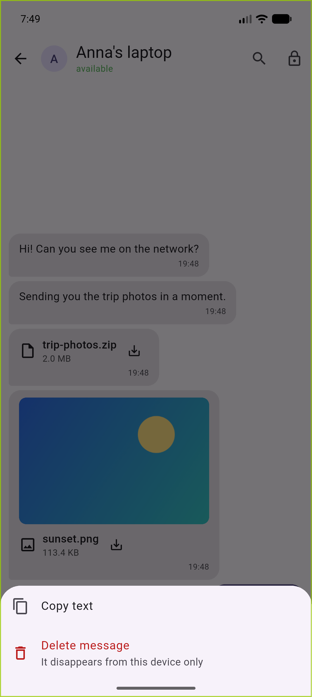
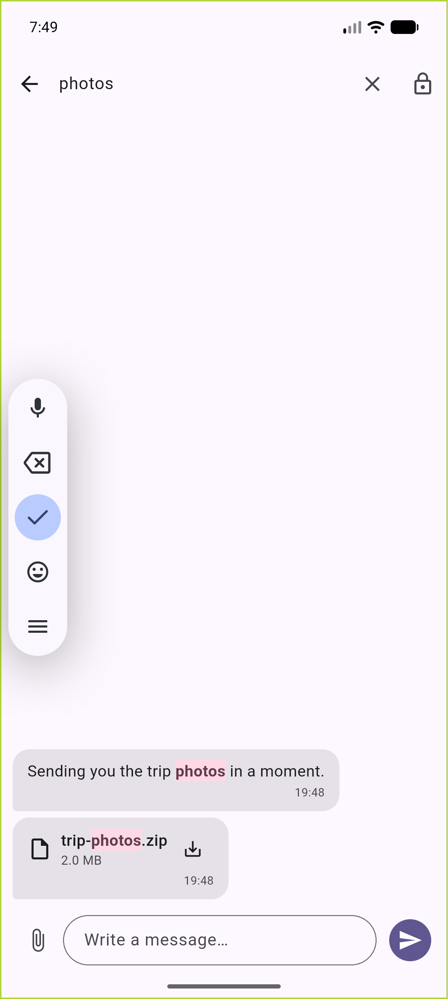
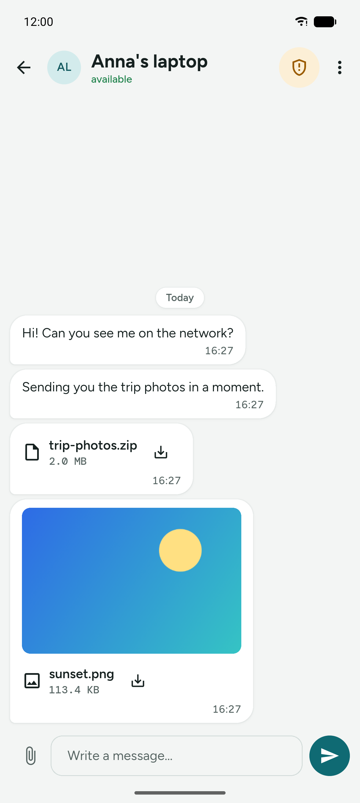
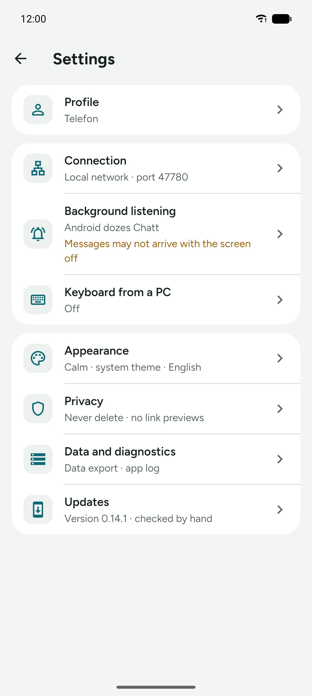
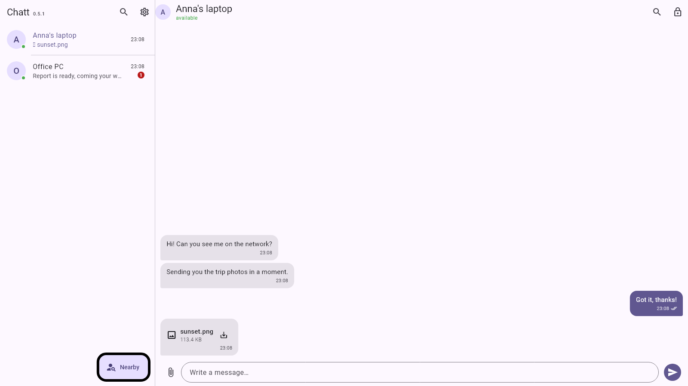
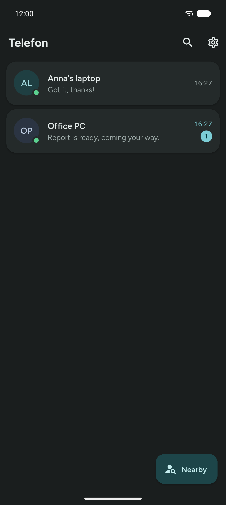

# User guide

Chatt joins two devices on the same Wi-Fi network: a Windows PC and an Android
phone. There is no account, no login and no server in the middle. Messages and
files go straight from one device to the other.

## First run

1. Start Chatt on both devices and put them on **the same Wi-Fi network**. The
   PC may sit on a cable, as long as it is in the same subnet as the phone.
2. On Windows the firewall asks about incoming traffic the first time. Tick the
   private network and allow it: without that the other device has no way in.
3. Open **Settings** and set the nickname that identifies this device in the
   other side's list.

## Finding the other device

**Nearby** button, then **Search for devices on the network**. A scan sends one
query across the network and collects answers for two seconds. One scan teaches
both sides: the device that answered also remembers the one that asked.


When a scan finds nothing:

- check that both devices really are on the same network (not: the phone on
  mobile data);
- some routers and guest networks isolate clients from each other. Broadcasts
  do not get through and the device has to be added by hand;
- **Add by IP address**: the address and port of the other device are in its
  Settings, under "This device".

Long-pressing an entry in the list removes that device. The "Clear unused
devices" button in Settings sweeps out entries that have no messages and have
not been seen for an hour.

## Messages

Tapping a device opens the conversation. Under the name you can see whether it
is reachable right now.


Status shown on a sent message:

| Icon | Meaning |
|---|---|
| clock | saved on your side, not delivered yet |
| double check | the other side confirmed receipt |
| "Not delivered, retry" | the attempt failed, tap to try again |

A message is never lost on the way: it is saved locally first and only then
sent. If the other device changed its IP in the meantime, the app searches the
network for its identity and retries at the new address.

**Long-press a bubble** for a menu: copy the text, delete the message. Deleting
works on your side only. The protocol has no way to make the other side forget
something it already received, and the app says that outright instead of
promising "delete for everyone".



**The magnifier in the bar** searches the open conversation: the list keeps
only matching messages and the hit is highlighted. The same magnifier on the
conversation list filters it by name and last message.



## Files

The paperclip next to the text field opens the system file picker, and
**several files can be selected at once**. On a PC you can also **drag files
onto the conversation window**. The recipient **is asked first** whether to
take the file; bytes flow only after that. With several files the question
comes separately for each one, in turn.


- A refusal means zero bytes transferred. The sender sees "not delivered" and
  can try again later.
- No answer within two minutes counts as a refusal.
- An interrupted transfer (Wi-Fi dropped, phone asleep) stays on disk as a
  part file. The next attempt **sends only the missing piece**, and once the
  whole file is together the app checks the checksum. If anything does not
  match, the file is rejected instead of landing quietly corrupted.
- A retry after a lost confirmation does not ask a second time and does not
  transfer a single byte: the recipient answers "already have it".

Received files land in the app directory. Tapping the bubble opens the file;
long-pressing gives "Show folder", "Share", "Copy path" and "Delete message".

The down arrow on a received file **saves a copy where you will look for it**:
on Android images go to `Pictures/Chatt` (the gallery picks them up) and
everything else to `Downloads`; on a PC the system save dialog opens. Without
that the file sits in the app directory, which no file manager shows and which
disappears when the app is uninstalled.

Images get a **thumbnail** in the conversation, but only once the file has been
accepted. Decoding an image from a stranger is attack surface, so the decoder
only ever sees what you agreed to and what already lies on disk.



## Encryption and identity confirmation

**A conversation is encrypted from the first message**, including with a device
you have not confirmed yet. Confirmation answers a different question: not "can
anyone read this" (nobody can), but "is the person on the other side who I
think it is".

The shield in the conversation header opens the security panel: encryption
state and both key fingerprints. A fingerprint follows from the device key and
never changes, so you can read it out loud and check it against the other
screen at any time.

There are two ways to confirm an identity:

- **QR code** (faster and stronger). One device shows the code, the other scans
  it. The scanning side is certain right away, because it saw that screen. The
  device that showed the code also asks "was that you scanning": confirm only
  if it really was.
- **Code comparison** (when there is no camera, PC to PC for example). **Both
  devices show the same six-digit code.** Compare them by eye and tap "They
  match" on both.

- The code is not a password and does not travel over the network: it comes out
  of the key agreement the two devices run between themselves. There is nothing
  secret in the QR code either. What counts is that the other device saw it on
  your screen.
- If the codes **differ**, someone is sitting in the middle of the connection.
  Tap "They do not match" and check the network.
- After confirmation the shield turns green. Encryption was already working;
  what changes is that from now on you know whose key is on the other side.
- A device name is just a label, and anyone can set it to anything. That is why
  a file request from a device with an unconfirmed identity carries a warning,
  and a request to confirm an already known device again is marked in red.

## Background listening on Android

Closing the window does not stop reception. The app keeps a foreground service
with a permanent "Chatt is listening" notification, so messages and files
arrive with the screen off too, and a new message raises a notification.

In Settings, under **Background listening**, the app reports whether the system
is putting it to sleep. If it warns, tap "Disable battery optimisation". On
most phones the foreground service is enough by itself, but some manufacturers
add their own app killing on top.



## Background listening on Windows

Closing the window with the X **hides Chatt in the tray** instead of ending the
program: listening keeps working and the window comes back with a click on the
icon. Quitting is in that icon's menu (right click, then "Close Chatt").

Windows 11 hides new icons behind the "show hidden icons" arrow. To keep Chatt
visible on the taskbar, drag it out of there or pin it in the system tray
settings.

In Settings, under **Windows**, there is a **"Start with Windows"** switch.
Turned on, the app comes up after login and goes straight to the tray without
opening a window. Underneath it is an ordinary user-account autostart entry:
no service, no administrator rights, so it can also be removed by hand.

## The window on a PC

From 900 pixels wide the window shows **two panes**: the conversation list on
the left, the open conversation on the right, with no jumping between screens.
A narrower window works as before, one screen at a time.



Content has an upper width limit: bubbles up to 560 pixels, forms up to 760. On
a 27 inch monitor a line running half a metre across is unreadable, and the eye
loses the start of the next one.

## Installing on Windows

A release gives you two things to choose from:

- **`chatt-X.Y.Z-windows-instalator.exe`**: an ordinary installer, with a Start
  menu shortcut, uninstall from the system settings and one place to update.
  It installs for your account, so it does not ask for an administrator
  password.
- **`chatt-X.Y.Z-windows.zip`**: the portable version. Unpack it anywhere and
  run `chatt.exe`. It writes nothing into the system beyond its own data.

Uninstalling removes the autostart entry but **does not touch the conversation
history**: the database lives in Documents and is still there after a
reinstall. To really get rid of it, use "Clear history" before uninstalling.

The installer is not signed with a certificate, so SmartScreen shows a
"Windows protected your PC" warning. "More info", then "Run anyway". A
code-signing certificate costs a few hundred zloty a year and would change
nothing about what the program does.

## Appearance and language

Settings is where you pick the theme (system, light, dark), the **background**
and the language (system, Polish, English). Every choice lives in the database,
so it survives a restart.

Backgrounds are ready-made sets: "No background" (the plain theme colour),
Dusk, Ocean, Forest and Sand. Each has separate colours for the light and dark
theme, and all of them are deliberately muted: cards and bubbles sit on top and
have to stay readable. Background service notifications follow the app
language, not the system one.



## Privacy: what lies on disk

Conversation history lies on disk **encrypted**, and the key is held by the
system keystore (Keystore on Android, DPAPI on Windows). Copying the database
file alone gets you nothing. Settings says so outright, together with a warning
for the case where the keystore did not work on a given device.

The same place has two things you can do by hand:

- **Delete messages older than**: 7, 30, 90 or 365 days. Off by default. The
  app sweeps at startup, after the setting changes, and every six hours.
- **Clear history**: deletes every message and conversation at once. It cannot
  be undone, so it asks for confirmation. Devices keep their confirmed
  identities, so there is no need to pair again.

In both cases **received files stay on disk**. The app deletes its own entries,
not content that the user opens with other programs.

## Two instances on one PC

For testing without a second device: the second instance needs its own data
directory, and it will pick a free port by itself.

```powershell
$env:CHATT_DATA_DIR = "$env:TEMP\chatt-b"
$env:CHATT_INSTANCE_NAME = "Instance B"
.\build\windows\x64\runner\Release\chatt.exe
```
