# Instrukcja obsługi

*English version: [guide.md](guide.md)*

Chatt łączy dwa urządzenia w tej samej sieci Wi‑Fi: komputer z Windows
i telefon z Androidem. Nie ma konta, logowania ani serwera pośredniczącego:
wiadomości i pliki idą prosto z jednego urządzenia do drugiego.

## Pierwsze uruchomienie

1. Uruchom Chatt na obu urządzeniach i podłącz je do **tej samej sieci Wi‑Fi**.
   Komputer może być na kablu, o ile jest w tej samej podsieci co telefon.
2. Na Windows przy pierwszym starcie zapora zapyta o zgodę na ruch
   przychodzący. Zaznacz sieć prywatną i pozwól, bo bez tego drugie urządzenie
   nie ma jak się połączyć.
3. Wejdź w **Ustawienia** i ustaw nick, po którym rozpoznasz to urządzenie
   na liście u rozmówcy.

Numer wersji stoi w pasku nad listą rozmów, a Ustawienia powtarzają go
w sekcji „To urządzenie". Przydaje się przy zgłaszaniu problemu.

## Znajdowanie drugiego urządzenia

Przycisk **W pobliżu** → **Szukaj urządzeń w sieci**. Skan rozsyła po sieci
jedno zapytanie i zbiera odpowiedzi przez dwie sekundy. Jeden skan uczy obie
strony nawzajem: urządzenie, które odpowiedziało, też zapamiętuje szukającego.

Ekran otwiera się bez listy. Pojawia się na nim to, co odpowiedziało na
ostatni skan, więc opisuje sieć taką, jaka jest w tej chwili.

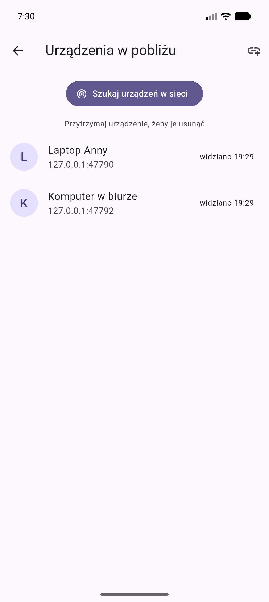

Gdy skan nic nie znajduje:

- sprawdź, czy oba urządzenia są w tej samej sieci (nie: telefon na LTE);
- niektóre routery i sieci gościnne izolują klientów od siebie, wtedy
  rozgłoszenia nie przechodzą i trzeba dodać urządzenie ręcznie;
- **Dodaj po adresie IP**: adres i port drugiego urządzenia znajdziesz u niego
  w Ustawieniach, w sekcji „To urządzenie".

Przytrzymanie wpisu na liście usuwa urządzenie. Przycisk „Wyczyść nieużywane
urządzenia" w Ustawieniach sprząta wpisy, z którymi nie ma żadnej wiadomości
i których nie widać od godziny.

## Wiadomości

Kliknięcie urządzenia otwiera rozmowę. Pod nazwą rozmówcy widać, czy jest
w tej chwili dostępny.

Wpisy na liście rozmów niosą dwa znaki: zieloną kropkę na awatarze, dopóki
urządzenie odpowiada w sieci, i zieloną tarczę przy nazwie, gdy jego tożsamość
jest potwierdzona. Lista pyta każde znane urządzenie co 30 sekund, tylko przy
otwartym ekranie.

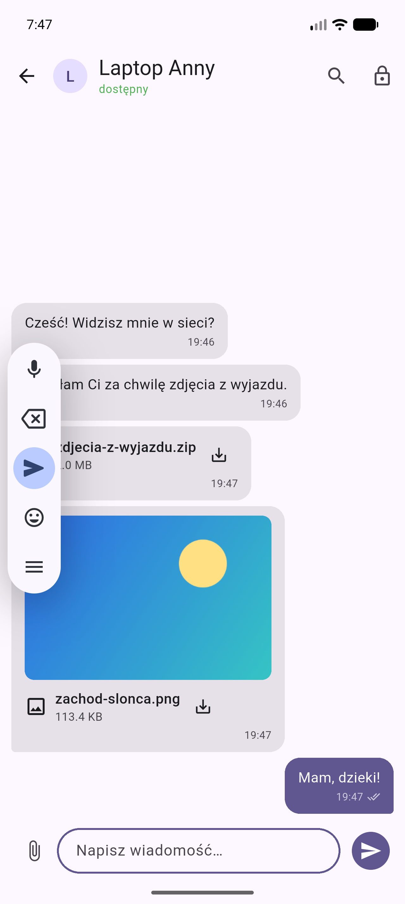

Statusy przy wysłanej wiadomości:

| Ikona | Znaczenie |
|---|---|
| zegarek | zapisana u Ciebie, jeszcze niedostarczona |
| podwójny check | rozmówca potwierdził odbiór |
| „Nie dostarczono, ponów" | próba się nie udała, kliknij, żeby powtórzyć |

Wiadomość nigdy nie ginie po drodze: najpierw zapisuje się lokalnie, a dopiero
potem leci do rozmówcy. Jeśli w międzyczasie zmienił mu się adres IP,
aplikacja sama przeszuka sieć po jego identyfikatorze i ponowi wysyłkę pod
nowym adresem.

**Zaznaczanie tekstu.** Na komputerze przeciągnij kursorem po wiadomości albo
po kilku naraz i skopiuj przez Ctrl+C. Na telefonie ten gest jest zajęty przez
menu, więc zaznaczanie siedzi w środku: przytrzymaj dymek i wybierz „Zaznacz
tekst".

**Przytrzymanie dymka** daje menu: skopiowanie całej treści, zaznaczenie
fragmentu i skasowanie wiadomości. Na komputerze to samo menu otwiera prawy
przycisk myszy. Kasowanie działa tylko u Ciebie: protokół nie ma jak kazać drugiej stronie
zapomnieć czegoś, co już dostała, i aplikacja mówi to wprost.

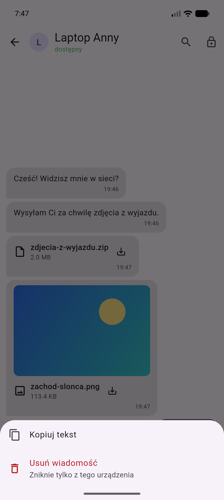

**Lupa w pasku** szuka w otwartej rozmowie: lista zostawia same pasujące
wiadomości, a trafienie jest podświetlone. Ta sama lupa na liście rozmów
filtruje ją po nazwie rozmówcy i ostatniej wiadomości.

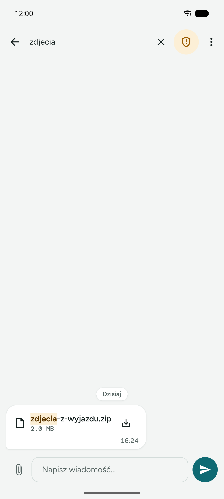

## Pliki

Spinacz przy polu tekstowym otwiera systemowy wybór pliku; **można zaznaczyć
kilka naraz**. Na komputerze pliki da się też po prostu **przeciągnąć na okno
rozmowy**. Odbiorca **najpierw dostaje pytanie**, czy chce ten plik przyjąć,
i dopiero po zgodzie lecą bajty. Przy kilku plikach pytanie przychodzi osobno
dla każdego, po kolei.

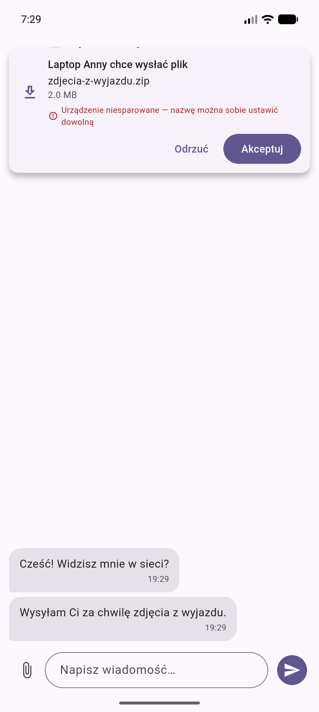

- Odmowa oznacza zero przesłanych danych; nadawca widzi „nie dostarczono"
  i może spróbować później.
- Brak odpowiedzi przez dwie minuty liczy się jak odmowa.
- Przerwany transfer (zerwane Wi‑Fi, uśpiony telefon) zostaje na dysku jako
  część. Kolejna próba **dokłada tylko brakujący kawałek**, a po złożeniu
  całości aplikacja sprawdza sumę kontrolną. Gdy coś się nie zgadza, plik
  jest odrzucany.
- Ponowienie po zgubionym potwierdzeniu nie pyta o zgodę drugi raz i nie
  przesyła ani bajtu: odbiorca odpowiada „już to mam".

Odebrane pliki lądują w katalogu aplikacji. Kliknięcie w dymek otwiera plik,
a przytrzymanie daje „Pokaż folder", „Udostępnij", „Kopiuj ścieżkę"
i „Usuń wiadomość". Na Windowsie obrazek dostaje dodatkowo **„Kopiuj obraz"**,
które kładzie go do schowka i jako obraz (wkleisz do dokumentu albo do edytora
grafiki), i jako plik (wkleisz w Eksploratorze).

Strzałka w dół przy odebranym pliku **zapisuje jego kopię tam, gdzie będziesz
go szukać**: na Androidzie obrazki trafiają do `Pictures/Chatt` (widzi je
galeria), reszta do `Pobrane`; na komputerze otwiera się systemowe okno
zapisu. Bez tego plik siedzi w katalogu aplikacji, którego nie widzi żaden
menedżer plików i który znika przy odinstalowaniu.

Obrazki dostają w rozmowie **miniaturę**, ale dopiero po przyjęciu pliku.
Dekodowanie obrazka od obcego to powierzchnia ataku, więc dekoder dostaje
wyłącznie to, na co sam się zgodziłeś i co już leży na dysku.

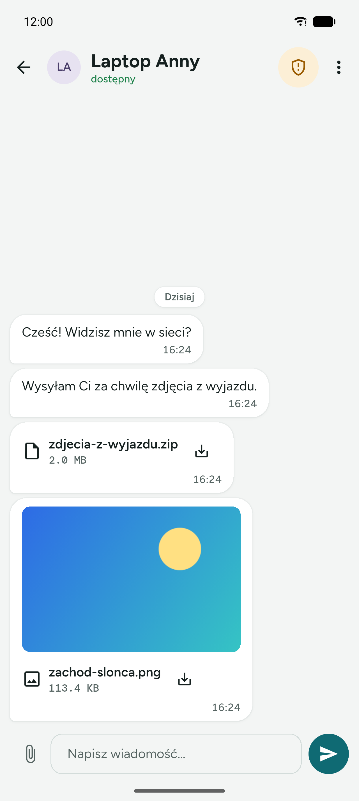

## Szyfrowanie i potwierdzanie tożsamości

**Rozmowa jest szyfrowana od pierwszej wiadomości**, także z urządzeniem,
którego jeszcze nie potwierdziłeś. Potwierdzenie odpowiada na jedno pytanie:
czy po drugiej stronie jest ta osoba, o której myślę. Treści i tak nikt inny
nie przeczyta.

Tarcza w nagłówku rozmowy otwiera panel bezpieczeństwa: stan szyfrowania
i odciski obu kluczy. Odcisk wynika z klucza urządzenia i nigdy się nie
zmienia, więc możesz go odczytać na głos i sprawdzić na drugim ekranie
w dowolnym momencie.

Do potwierdzenia tożsamości są dwie drogi:

- **Kod QR** (szybsza i pewniejsza). Jedno urządzenie pokazuje kod, drugie go
  skanuje. Skanujący ma pewność od razu, bo widział tamten ekran. Urządzenie,
  które kod pokazywało, zapyta jeszcze „czy to Ty właśnie skanowałeś":
  potwierdź tylko wtedy, gdy faktycznie Ty.
- **Porównanie kodu** (gdy nie ma aparatu, np. komputer z komputerem). **Oba
  urządzenia pokazują ten sam sześciocyfrowy kod.** Porównaj je wzrokiem
  i kliknij „Zgadza się" na obu.

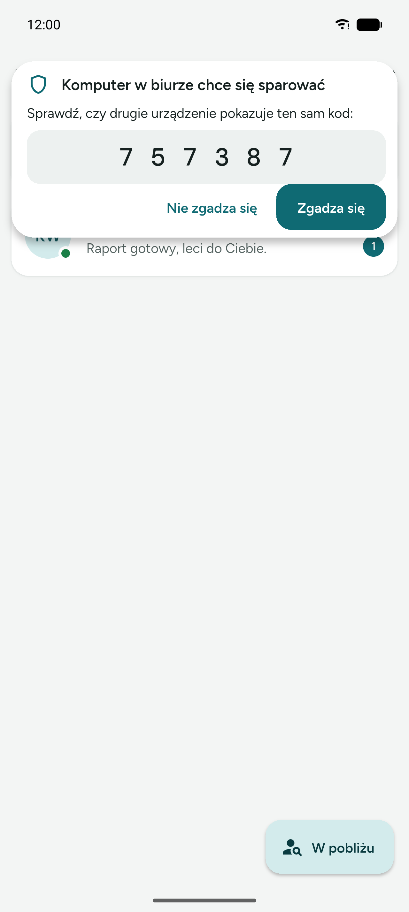

- Kod nie jest hasłem i nie idzie przez sieć: wychodzi z uzgodnienia kluczy,
  które robią między sobą oba urządzenia. W kodzie QR też nie ma nic tajnego,
  liczy się to, że drugie urządzenie zobaczyło go na Twoim ekranie.
- Jeśli kody się **różnią**, ktoś siedzi w środku połączenia. Kliknij „Nie
  zgadza się" i sprawdź sieć.
- Po potwierdzeniu tarcza robi się zielona. Szyfrowanie działało już wcześniej;
  zmienia się to, że od teraz wiadomo, do kogo należy klucz po drugiej
  stronie.
- Nazwa urządzenia to tylko napis, który każdy może sobie ustawić dowolnie.
  Dlatego prośba o plik od urządzenia bez potwierdzonej tożsamości wyświetla
  ostrzeżenie, a prośba o ponowne potwierdzenie znanego już urządzenia jest
  oznaczona na czerwono.

W tym samym panelu siedzą dwie rzeczy, które należą do rozmówcy:

- **Zmień nazwę.** Urządzenie rozgłasza własną nazwę, więc komputer trafia na
  listę jako coś w rodzaju `DESKTOP-8F2A1C`. Nadaj mu swoją i to ją zobaczysz
  wszędzie. Nazwa zostaje na tym urządzeniu, nigdzie nie jedzie, a rozgłaszana
  wyświetla się pod nią, żeby dało się zauważyć, że druga strona się
  przemianowała. Puste pole wraca do rozgłaszanej.
- **Przyjmuj pliki bez pytania.** Pliki od tego urządzenia trafiają wtedy prosto
  do rozmowy, bez karty z pytaniem. Przełącznik działa wyłącznie przy zielonej
  tarczy i gaśnie sam, gdy potwierdzenie zniknie: zgoda dotyczyła potwierdzonej
  tożsamości.

## Nasłuch w tle na Androidzie

Zamknięcie okna nie wyłącza odbierania. Aplikacja trzyma usługę
pierwszoplanową ze stałym powiadomieniem „Chatt nasłuchuje", dzięki czemu
wiadomości i pliki dochodzą też przy zgaszonym ekranie, a o nowej wiadomości
dostajesz powiadomienie.

W Ustawieniach, w sekcji **Nasłuch w tle**, aplikacja mówi, czy system jej nie
usypia. Jeśli ostrzega, kliknij „Wyłącz optymalizację baterii". Na większości
telefonów usługa pierwszoplanowa wystarcza sama z siebie, ale część
producentów dokłada własne mechanizmy ubijania aplikacji.

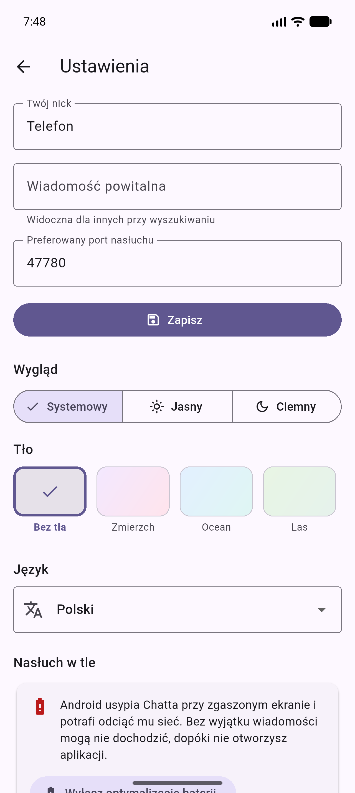

## Nasłuch w tle na Windowsie

Zamknięcie okna krzyżykiem **chowa Chatta do zasobnika**: nasłuch działa
dalej, a okno wraca kliknięciem ikony. Wyjście
z programu jest w menu tej ikony (prawy przycisk → „Zamknij Chatt").

Windows 11 chowa nowe ikony pod strzałkę „pokaż ukryte ikony". Żeby Chatt
siedział widocznie na pasku, przeciągnij go stamtąd na pasek albo przypnij
w ustawieniach zasobnika systemu.

W Ustawieniach, w sekcji **Windows**, jest przełącznik **„Uruchamiaj razem
z Windowsem"**. Włączony sprawia, że aplikacja wstaje po zalogowaniu i od razu
siada w zasobniku, bez otwierania okna. Pod spodem to zwykły wpis autostartu
konta użytkownika: bez usług i bez uprawnień administratora, więc da się go
skasować także ręcznie.

## Okno na komputerze

Od 900 pikseli szerokości okno pokazuje **dwa panele**: listę rozmów po lewej
i otwartą rozmowę po prawej, bez przeskakiwania między ekranami. Węższe okno
działa jak dotąd, jeden ekran naraz.

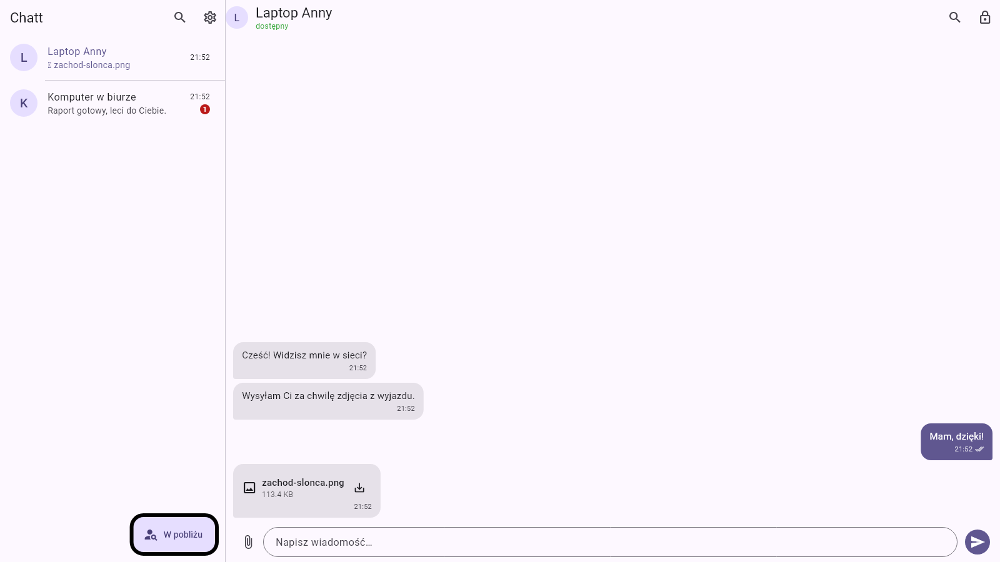

Treść ma górną granicę szerokości: dymki do 560 pikseli, formularze do 760.
Na monitorze 27 cali linia ciągnąca się przez pół metra jest nie do czytania,
a oko gubi początek następnej.

## Instalacja na Windowsie

Wydanie daje dwie rzeczy do wyboru:

- **`chatt-X.Y.Z-windows-instalator.exe`**: zwykły instalator, ze skrótem
  w menu Start, odinstalowaniem z ustawień systemu i jednym miejscem na
  aktualizację. Instaluje dla Twojego konta, więc nie pyta o hasło
  administratora.
- **`chatt-X.Y.Z-windows.zip`**: wersja przenośna. Rozpakuj gdziekolwiek
  i uruchom `chatt.exe`. Nic nie zapisuje w systemie poza własnymi danymi.

Odinstalowanie kasuje wpis autostartu, ale **nie rusza historii rozmów**:
baza leży w Dokumentach i po ponownej instalacji jest na miejscu. Żeby
naprawdę się jej pozbyć, użyj „Wyczyść historię" przed odinstalowaniem.

## Nadążanie za wersjami

W Ustawieniach jest sekcja **Aktualizacje**. Przy pierwszym wejściu stoi
wyłączona i dopóki taka jest, aplikacja nie odzywa się nigdzie poza Twoją
sieć. Włączona pyta GitHuba raz na dobę, czy wyszło nowsze wydanie, a przycisk
**Sprawdź teraz** pyta od razu, niezależnie od przełącznika.

Gdy coś nowszego jest, pokazuje się numer, opis wydania i przycisk **Pobierz
i zainstaluj**. Na Windowsie rusza instalator, a Chatt zamyka się, żeby mu nie
przeszkadzać, i wraca sam. Na Androidzie pobrany plik trafia do systemowego
instalatora, który pyta o zgodę. Wersja przenośna z zipa dostaje zamiast
przycisku adres strony wydania, bo instalator zostawiłby katalog, z którego
właśnie chodzi, bez zmian.

Historia rozmów i odebrane pliki zostają nietknięte w obu przypadkach.

Gdy coś zawiedzie przed pokazaniem okna, Chatt mówi to na własnym ekranie
i zapisuje `chatt-startup-error.txt` obok bazy w Dokumentach. Historia rozmów
i odebrane pliki zostają nietknięte, a treść tego pliku jest tym, co warto
dołączyć do zgłoszenia.

Instalator nie jest podpisany certyfikatem, więc SmartScreen pokaże
ostrzeżenie „Windows chronił Twój komputer". „Więcej informacji" → „Uruchom
mimo to". Certyfikat do podpisu kodu kosztuje kilkaset złotych rocznie i nie
zmieniłby nic w tym, co robi program.

## Wygląd i język

W Ustawieniach wybierasz motyw (systemowy, jasny, ciemny), **tło** i język
(systemowy, polski, angielski). Wszystkie wybory siedzą w bazie, więc
przeżywają restart. Świeża instalacja startuje po angielsku, polski jest
o jedno dotknięcie dalej.

Krótkie komunikaty („Skopiowano", „Usunięto rozmowę") pokazują się w prawym
górnym rogu, z paskiem odliczającym czas do zniknięcia. Kliknięcie zamyka je od
razu. Na górze nie zasłaniają przycisku ani pola tekstowego, którego przed
chwilą użyłeś.

Tła to gotowe zestawy: „Bez tła" (zwykły kolor motywu), Zmierzch, Ocean,
Las i Piasek. Każdy ma osobne kolory na motyw jasny i ciemny, a wszystkie są
celowo przygaszone: na tle leżą dymki i karty, które muszą zostać czytelne.
Powiadomienia usługi w tle też idą za językiem aplikacji.

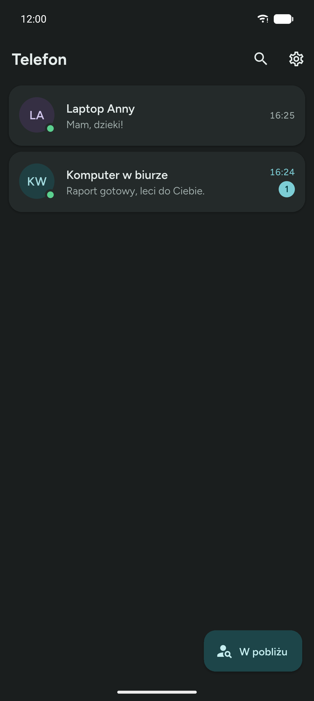

## Prywatność: co leży na dysku

Historia rozmów leży na dysku **zaszyfrowana**, a klucz do niej trzyma schowek
systemowy (Keystore na Androidzie, DPAPI na Windowsie). Skopiowanie samego
pliku bazy nic nie daje. Ustawienia mówią o tym wprost, razem z ostrzeżeniem,
gdyby na danym urządzeniu schowek nie zadziałał.

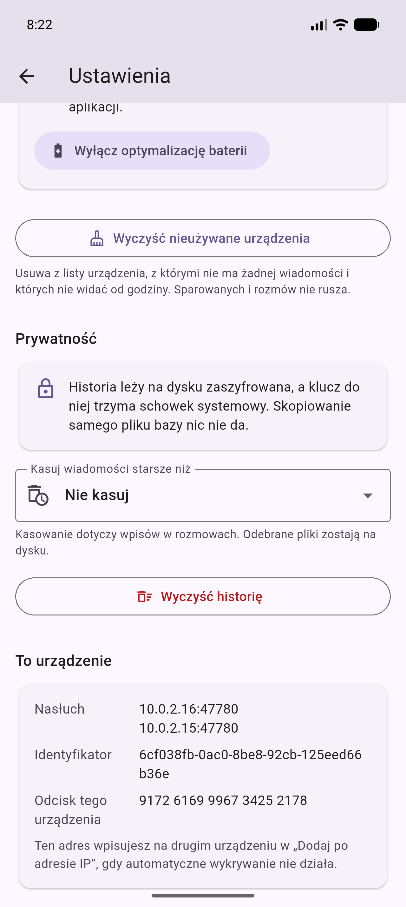

Tam samym są dwie rzeczy do zrobienia ręcznie:

- **Kasuj wiadomości starsze niż**: do wyboru 7, 30, 90 albo 365 dni.
  Domyślnie wyłączone. Aplikacja sprząta przy starcie, po zmianie ustawienia
  i co sześć godzin.
- **Wyczyść historię**: kasuje wszystkie wiadomości i rozmowy od razu.
  Nieodwracalne, więc pyta o potwierdzenie. Urządzenia razem z potwierdzoną
  tożsamością zostają, więc nie trzeba się parować od nowa.

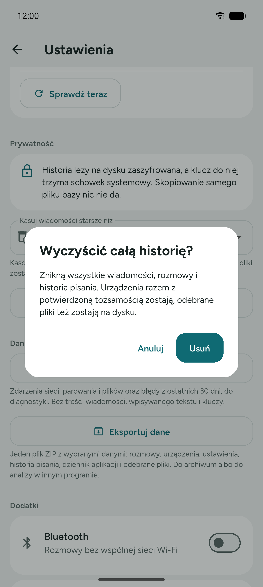

W obu przypadkach **odebrane pliki zostają na dysku**. Aplikacja kasuje własne
wpisy; pliki, które otwierasz innymi programami, zostają.

## Dwie instancje na jednym komputerze

Do testów bez drugiego urządzenia: druga instancja musi dostać własny katalog
danych, port dobierze sobie sama.

```powershell
$env:CHATT_DATA_DIR = "$env:TEMP\chatt-b"
$env:CHATT_INSTANCE_NAME = "Instancja B"
.\build\windows\x64\runner\Release\chatt.exe
```
