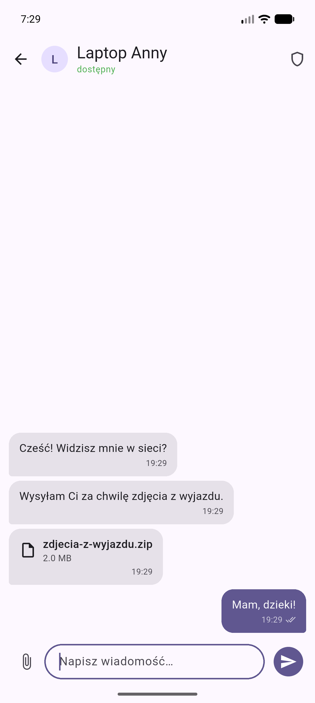
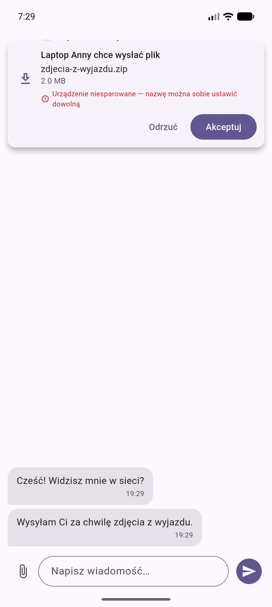
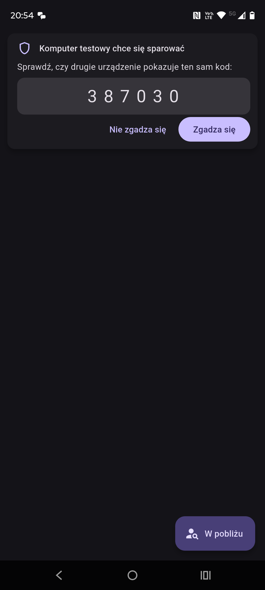
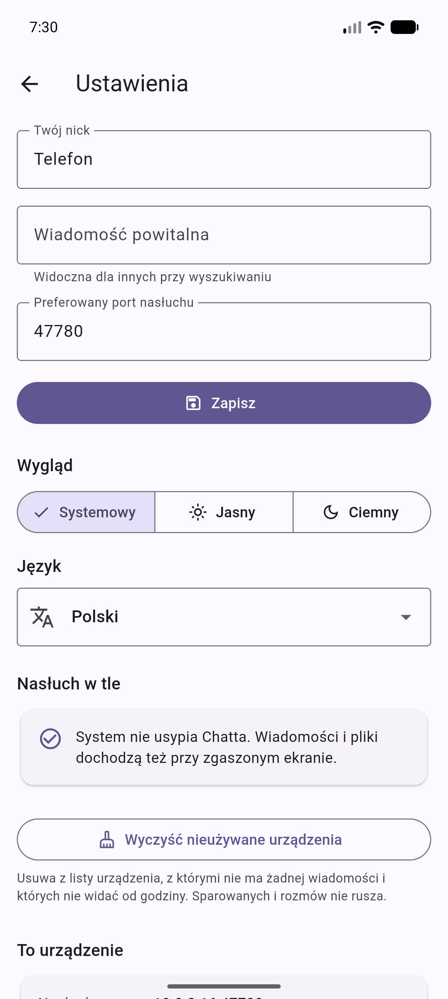
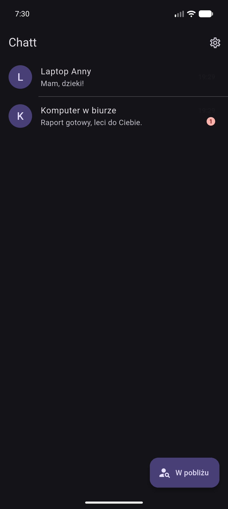

# Instrukcja obsługi

Chatt łączy dwa urządzenia w tej samej sieci Wi‑Fi: komputer z Windows
i telefon z Androidem. Nie ma konta, logowania ani serwera pośredniczącego —
wiadomości i pliki idą prosto z jednego urządzenia do drugiego.

## Pierwsze uruchomienie

1. Uruchom Chatt na obu urządzeniach i podłącz je do **tej samej sieci Wi‑Fi**.
   Komputer może być na kablu, o ile jest w tej samej podsieci co telefon.
2. Na Windows przy pierwszym starcie zapora zapyta o zgodę na ruch
   przychodzący. Zaznacz sieć prywatną i pozwól — bez tego drugie urządzenie
   nie ma jak się połączyć.
3. Wejdź w **Ustawienia** i ustaw nick, po którym rozpoznasz to urządzenie
   na liście u rozmówcy.

## Znajdowanie drugiego urządzenia

Przycisk **W pobliżu** → **Szukaj urządzeń w sieci**. Skan rozsyła po sieci
jedno zapytanie i zbiera odpowiedzi przez dwie sekundy. Jeden skan uczy obie
strony nawzajem: urządzenie, które odpowiedziało, też zapamiętuje szukającego.


Gdy skan nic nie znajduje:

- sprawdź, czy oba urządzenia są w tej samej sieci (nie: telefon na LTE);
- niektóre routery i sieci gościnne izolują klientów od siebie — wtedy
  rozgłoszenia nie przechodzą i trzeba dodać urządzenie ręcznie;
- **Dodaj po adresie IP**: adres i port drugiego urządzenia znajdziesz u niego
  w Ustawieniach, w sekcji „To urządzenie".

Przytrzymanie wpisu na liście usuwa urządzenie. Przycisk „Wyczyść nieużywane
urządzenia" w Ustawieniach sprząta wpisy, z którymi nie ma żadnej wiadomości
i których nie widać od godziny.

## Wiadomości

Kliknięcie urządzenia otwiera rozmowę. Pod nazwą rozmówcy widać, czy jest
w tej chwili dostępny.



Statusy przy wysłanej wiadomości:

| Ikona | Znaczenie |
|---|---|
| zegarek | zapisana u Ciebie, jeszcze niedostarczona |
| podwójny check | rozmówca potwierdził odbiór |
| „Nie dostarczono — ponów" | próba się nie udała, kliknij, żeby powtórzyć |

Wiadomość nigdy nie ginie po drodze: najpierw zapisuje się lokalnie, a dopiero
potem leci do rozmówcy. Jeśli w międzyczasie zmienił mu się adres IP,
aplikacja sama przeszuka sieć po jego identyfikatorze i ponowi wysyłkę pod
nowym adresem.

## Pliki

Spinacz przy polu tekstowym otwiera systemowy wybór pliku. Odbiorca **najpierw
dostaje pytanie**, czy chce ten plik przyjąć — dopiero po zgodzie lecą bajty.



- Odmowa oznacza zero przesłanych danych; nadawca widzi „nie dostarczono"
  i może spróbować później.
- Brak odpowiedzi przez dwie minuty liczy się jak odmowa.
- Przerwany transfer (zerwane Wi‑Fi, uśpiony telefon) zostaje na dysku jako
  część. Kolejna próba **dokłada tylko brakujący kawałek**, a po złożeniu
  całości aplikacja sprawdza sumę kontrolną. Gdy coś się nie zgadza, plik
  jest odrzucany zamiast trafić do Ciebie po cichu uszkodzony.
- Ponowienie po zgubionym potwierdzeniu nie pyta o zgodę drugi raz i nie
  przesyła ani bajtu — odbiorca odpowiada „już to mam".

Odebrane pliki lądują w katalogu aplikacji. Kliknięcie w dymek otwiera plik,
a przytrzymanie daje „Pokaż folder", „Udostępnij" i „Kopiuj ścieżkę".

## Parowanie i szyfrowanie

Dopóki urządzenia nie są sparowane, rozmawiają jawnym tekstem, a nazwa
urządzenia jest tylko napisem — każdy może sobie ustawić dowolny. Dlatego
prośba o plik od niesparowanego urządzenia wyświetla ostrzeżenie.

Tarcza w nagłówku rozmowy zaczyna parowanie. **Oba urządzenia pokazują wtedy
ten sam sześciocyfrowy kod.** Porównaj je wzrokiem i kliknij „Zgadza się" na
obu.



- Kod nie jest hasłem i nie idzie przez sieć: wychodzi z uzgodnienia kluczy,
  które robią między sobą oba urządzenia.
- Jeśli kody się **różnią**, ktoś siedzi w środku połączenia. Kliknij „Nie
  zgadza się" i sprawdź sieć.
- Po sparowaniu tarcza robi się zielona, a cały ruch (wiadomości, zapowiedzi
  plików i treść plików) jest szyfrowany. Od sparowanego urządzenia aplikacja
  **nie przyjmie już ruchu jawnego**, więc zielona tarcza czegoś dowodzi.
- Prośba o ponowne sparowanie znanego już urządzenia jest wyraźnie oznaczona
  na czerwono, bo zgoda podmieniłaby klucz.

## Nasłuch w tle na Androidzie

Zamknięcie okna nie wyłącza odbierania. Aplikacja trzyma usługę
pierwszoplanową ze stałym powiadomieniem „Chatt nasłuchuje" — dzięki temu
wiadomości i pliki dochodzą też przy zgaszonym ekranie, a o nowej wiadomości
dostajesz powiadomienie.

W Ustawieniach, w sekcji **Nasłuch w tle**, aplikacja mówi, czy system jej nie
usypia. Jeśli ostrzega, kliknij „Wyłącz optymalizację baterii" — na większości
telefonów usługa pierwszoplanowa wystarcza sama z siebie, ale część
producentów dokłada własne mechanizmy ubijania aplikacji.



## Wygląd i język

W Ustawieniach wybierasz motyw (systemowy, jasny, ciemny) i język (systemowy,
polski, angielski). Oba wybory siedzą w bazie, więc przeżywają restart.
Powiadomienia usługi w tle też idą za językiem aplikacji, a nie systemu.



## Dwie instancje na jednym komputerze

Do testów bez drugiego urządzenia: druga instancja musi dostać własny katalog
danych, port dobierze sobie sama.

```powershell
$env:CHATT_DATA_DIR = "$env:TEMP\chatt-b"
$env:CHATT_INSTANCE_NAME = "Instancja B"
.\build\windows\x64\runner\Release\chatt.exe
```
