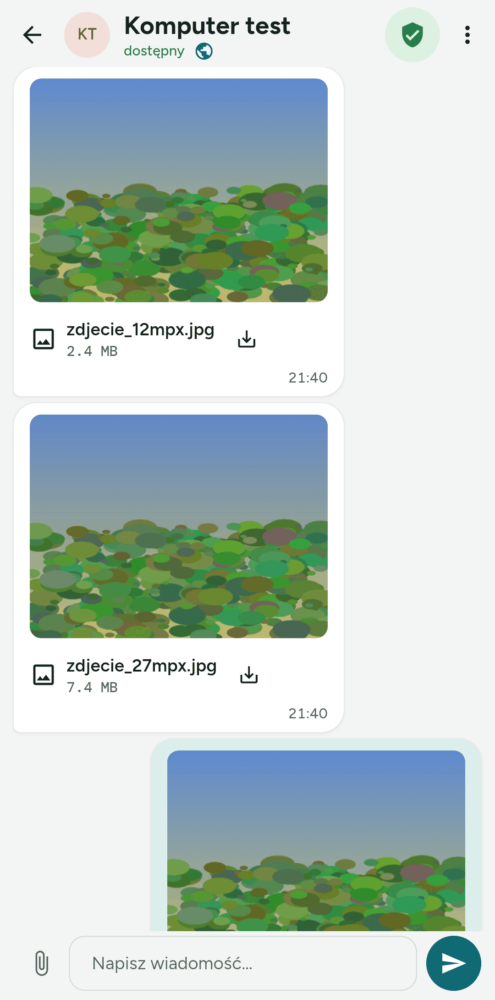
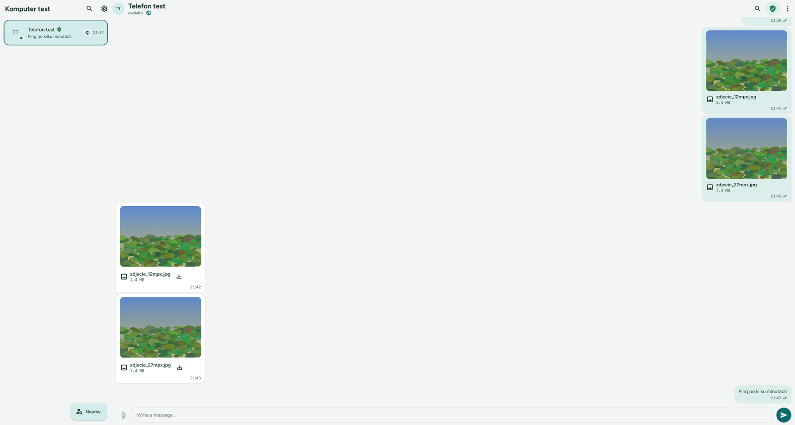
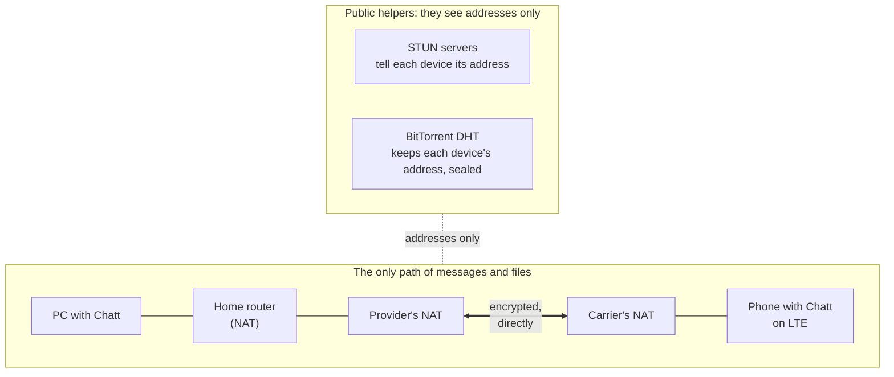
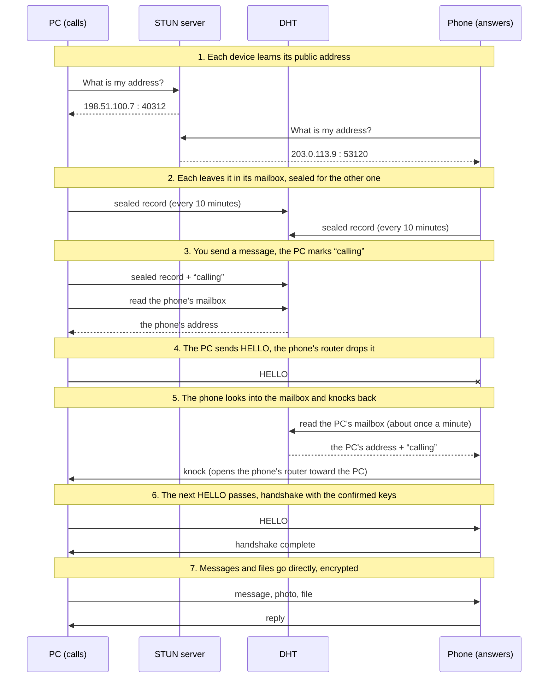

# Talking over the internet

*[Polski](internet.pl.md)*

The PC is at home, the phone is out on mobile data, and the two still talk. The **Internet** add-on connects two Chatt devices on different networks
directly, device to device, across the whole internet.

**Your messages and files never pass through a server and are never stored on
one.** Chatt has no server of its own and rents none. Everything you send goes
straight from one of your devices to the other, encrypted twice over, and is
kept only on those two devices.

The add-on is off by default and is experimental: it works between the
networks tested so far and some networks block it (see
[Where it does not work](#where-it-does-not-work)).

## Contents

- [Nothing lands on a server](#nothing-lands-on-a-server)
- [What you need](#what-you-need)
- [Turning it on](#turning-it-on)
- [How two devices find each other without a server](#how-two-devices-find-each-other-without-a-server)
- [What others can see](#what-others-can-see)
- [How fast it is](#how-fast-it-is)
- [Where it does not work](#where-it-does-not-work)
- [Battery and data](#battery-and-data)
- [When something does not work](#when-something-does-not-work)
- [For developers](#for-developers)

## Nothing lands on a server

This is the most important property of the add-on, so it comes first.

- **No server in between.** A message or a file travels from one device to the
  other in packets addressed to the other device. No relay, no mailbox for
  messages, no queue for offline devices, no cloud copy. When the other device
  is unreachable, the message stays on your device, marked as not delivered.
- **Two layers of encryption.** The connection itself is encrypted: every
  packet is sealed with AES-256-GCM and numbered, and a repeated or altered
  packet is thrown away. Inside the connection the message or the file is
  sealed once more with the session keys of the conversation, the same as on
  Wi-Fi. A router, a mobile carrier or anyone listening on the way sees only
  random-looking bytes.
- **Only a confirmed device gets in.** The connection opens only after a
  handshake with the keys you confirmed by comparing the code or scanning the
  QR (the green shield). A device without that key gets no answer at all: no
  error, no refusal, silence, so it cannot even tell whether Chatt is
  listening.
- **The helpers on the way never see content.** To find each other, the
  devices use two public services, described below: STUN servers and the
  BitTorrent DHT. They help with the address, and that is all they get.
  None of them ever receives a message, a file, a name or a key.

## What you need

- **Both devices confirmed.** The identity is confirmed with the code or the
  QR, the green shield in the conversation. For that the two devices meet once
  on the same network or within Bluetooth range; after that each can be
  anywhere with internet access.
- **The add-on on, on both devices.**
- **Networks that let UDP through.** Most home networks and mobile networks
  do. Some offices, schools and hotels do not.

## Turning it on

**Settings → Add-ons → Internet**, on both devices. The add-on's card shows:

- **This device is seen at**: the public address the network gives this
  device right now;
- **Check reachability**: asks two STUN servers and tells whether the network
  you are on can take part (see
  [When something does not work](#when-something-does-not-work)).

Nothing else changes. Conversations with a confirmed device simply gain a third
road: when the other device is neither on your network nor within radio range,
Chatt reaches it over the internet. A small globe next to the name in the
conversation says that the conversation goes over the internet.

## How two devices find each other without a server

On the internet a phone on mobile data and a PC at home are both hidden behind
routers that translate addresses (NAT). The phone in our measurements sits
behind the mobile carrier's NAT; the PC behind the home router, the provider's
modem and the provider's own NAT, three layers in all. None of these routers
lets in a packet from an address the device behind it has not sent to first.
So neither device can simply call the other: both have to send toward each
other at about the same time. This is called **hole punching**.

The lower box is the only path of your messages and files. The helpers above
take part only in finding the address.

The whole exchange, in seven steps. The addresses below are examples from the
ranges reserved for documentation.

1. **Each device learns its address.** It asks a public STUN server: "from
   which address and port do you see me?" The answer is the address the
   routers on the way gave this device's connection.
2. **Each leaves that address in its mailbox.** The mailbox is a small record
   in the BitTorrent DHT, the network of millions of computers that BitTorrent
   clients use to find each other. The record holds the address and the time,
   sealed with a key that only your two devices can compute: it comes from
   both devices' keys, the ones you confirmed. Without that key the record is
   unreadable, and nobody can even tell which mailbox belongs to whom: its
   location in the DHT and its signing key change every day.
3. **You send a message.** The PC writes "calling" into its mailbox and reads
   the phone's mailbox to learn the phone's current address.
4. **The PC sends HELLO** to that address, about twice a second, for up to
   90 seconds. At first the phone's router drops these packets, because the
   phone has not sent anything to the PC yet.
5. **The phone looks into the mailboxes** of its confirmed devices about once a
   minute. When it sees "calling", it sends a few tiny packets toward the PC.
   The PC's router lets them in, because the PC has already sent to the phone,
   and on their way out they do the important part: the phone's router now
   knows that the phone talks to the PC and lets the PC's packets in.
6. **The next HELLO passes**, and the two devices complete a handshake. It
   succeeds only with the keys you confirmed when pairing: someone who
   copied an address from a mailbox has no key and gets nowhere.
7. **From now on messages and files go directly**, both ways, encrypted. The
   connection stays open while both devices are online: a tiny packet every 25
   seconds of silence keeps the routers' doors open.

When both devices call at the same moment, one of them yields and one
connection remains. When a device changes network (the phone leaves Wi-Fi),
the address in its mailbox goes stale. The device writes the new one when it
answers the next call, and the caller rereads the mailbox every 15 seconds
while it calls, so it finds the new address.

## What others can see

| Who | What they learn | What they never learn |
|---|---|---|
| STUN servers (public, run by others) | your IP address and that a device asked for it | anything about the other device, any content |
| DHT nodes (computers of BitTorrent users) | your IP address and that it reads or writes a small sealed record, about once a minute for each confirmed device | whose record it is, what address is inside, any content |
| Your internet provider and the mobile carrier | that two IP addresses exchange encrypted UDP packets, when and how much | what is inside |
| The other device | your current address, as on Wi-Fi | |
| The author of Chatt | nothing: there is no server to log to | |

## How fast it is

Measured on 6 November 2026 between a Windows PC at home on Ethernet and an
Android phone on LTE with Wi-Fi off, lying next to each other.

**Connecting.** Hole punching between these two networks worked 7 times out of
7, and the app connected 6 calls out of 6, three each way. The first message
after a quiet spell waits for the other device's next look into its mailbox,
so it takes up to about a minute: in those calls 60 to 73 seconds from a cold
start, and 40 seconds for the first message after the phone left Wi-Fi.
Messages after it go at once.

**Delay.** Half the packets made the round trip in under 37 ms over the
internet, against 11 ms between the same two devices in one Wi-Fi network.

**Files.** Two photos sent in the app, timed from Chatt's own log on the PC:

| Path | Photo 2.5 MB | Photo 7.7 MB |
|---|---|---|
| PC at home to phone on LTE, over the internet | 15.0 s | 45.4 s |
| Phone on LTE to PC at home, over the internet | 6.9 s | 16.1 s |
| PC to phone in one Wi-Fi network | 0.5 s | |
| Phone to PC in one Wi-Fi network | 0.3 s | |

Over the internet that is about 170 kB/s from the PC and 370 to 480 kB/s from
the phone. Every photo arrived whole: the copies on the PC have the same
SHA-256 as the originals, and Chatt checks every file against its checksum
before it shows it. Large files are much faster on a shared Wi-Fi network,
and a transfer that breaks off resumes from where it stopped.

## Where it does not work

- **A symmetric NAT** gives a device a different address for every
  destination, so the address in the mailbox is wrong for the other device.
  Some corporate and hotel networks work this way. **Check reachability**
  reports it.
- **A network that blocks UDP or the DHT**, often at work, at school or in a
  hotel.
- **Devices that are not confirmed.** Without the green shield there is no key
  to seal the mailbox or open the connection.

There is no server to fall back on, by design. When the two devices cannot
reach each other, the message ends as not delivered, the same as with a device
that is off, and you can retry it later from another network.

## Battery and data

- With the add-on on, a phone looks into the mailboxes of its confirmed devices
  about once a minute (less often for a device that has not been online for a
  while, down to every 15 minutes) and refreshes its own record every 10
  minutes. Each look is a few small packets.
- While a connection is open, a tiny packet goes out after 25 seconds of
  silence, which wakes the radio.
- Messages and files cost the same data as their size, plus a few percent for
  packet headers.

The add-on's card says so before you turn it on. Turn it off when you do not
need it: off, it sends nothing at all.

## When something does not work

1. **Both devices have the add-on on** and the conversation shows the green
   shield.
2. **Check reachability** on both devices. When it says the network cannot take
   part, try another one: mobile data, for example, when a hotel Wi-Fi blocks
   it.
3. **Wait a minute** after the first message: the other device may be between
   two looks into its mailbox.
4. **The other device is online** and Chatt is running there. On Android
   **Background listening** keeps it reachable with the screen off.
5. Still nothing: **Settings → App log** shows the internet road's events
   (`Internet link up`, `Internet link ... ended` with the reason).

## For developers

- The design, piece by piece: [architecture](architecture.md#the-internet-add-on-issue-68-experimental).
- The measurements on real networks and the tool that made them
  (`app/tool/nat_spike.dart`): [spike-nat.md](spike-nat.md).
- The tests over a simulated internet with NATs shaped like the measured ones:
  [testing.md](testing.md).
- The risks that stay: [threat model](architecture.md#threat-model) and the
  [security policy](SECURITY.md).
