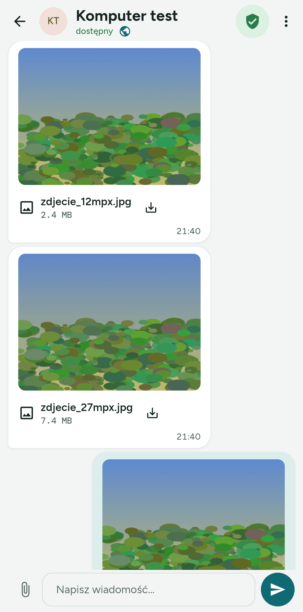
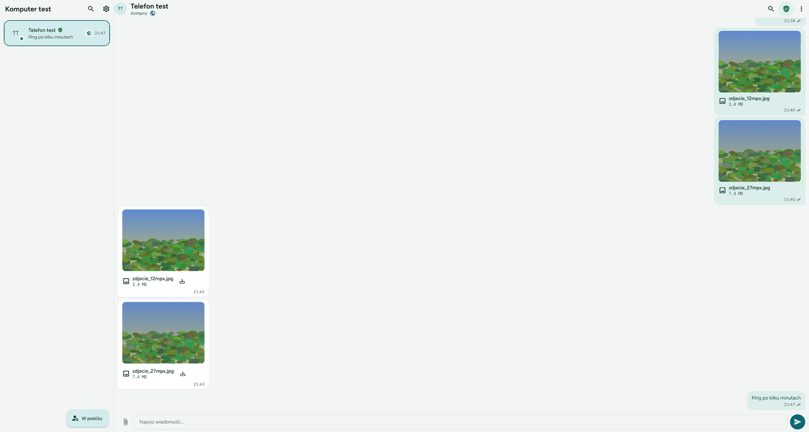
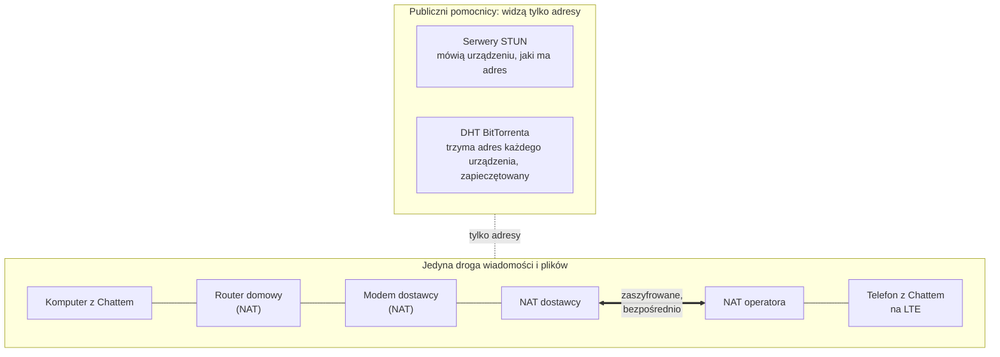
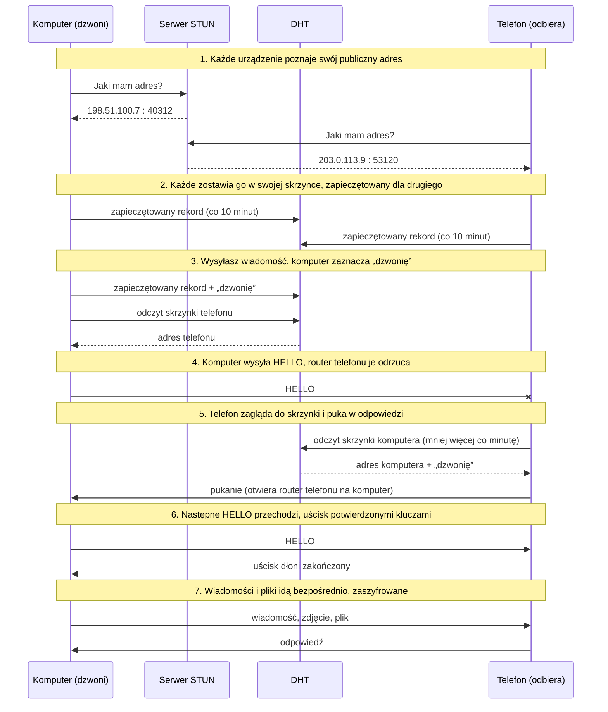

# Rozmowy przez internet

*[English](internet.md)*

Komputer jest w domu, telefon poza domem na danych komórkowych, a mimo to oba
ze sobą rozmawiają. Dodatek **Internet** łączy dwa urządzenia z Chattem
w różnych sieciach bezpośrednio, od urządzenia do urządzenia, przez cały
internet.

**Wiadomości i pliki nigdy nie przechodzą przez żaden serwer i nigdy nie są na
żadnym przechowywane.** Chatt nie ma własnego serwera i nie wynajmuje cudzego.
Wszystko, co wysyłasz, idzie prosto z jednego Twojego urządzenia na drugie,
zaszyfrowane podwójnie, i leży tylko na tych dwóch urządzeniach.

Dodatek jest domyślnie wyłączony i eksperymentalny: działa między sieciami
sprawdzonymi do tej pory, a niektóre sieci go blokują (patrz
[Gdzie to nie działa](#gdzie-to-nie-działa)).

## Spis treści

- [Nic nie ląduje na serwerze](#nic-nie-ląduje-na-serwerze)
- [Czego trzeba](#czego-trzeba)
- [Włączanie](#włączanie)
- [Jak dwa urządzenia znajdują się bez serwera](#jak-dwa-urządzenia-znajdują-się-bez-serwera)
- [Co widzą inni](#co-widzą-inni)
- [Jak szybko to działa](#jak-szybko-to-działa)
- [Gdzie to nie działa](#gdzie-to-nie-działa)
- [Bateria i dane](#bateria-i-dane)
- [Gdy coś nie działa](#gdy-coś-nie-działa)
- [Dla programistów](#dla-programistów)

## Nic nie ląduje na serwerze

To najważniejsza cecha dodatku, więc idzie na początek.

- **Żadnego serwera pośrodku.** Wiadomość albo plik jedzie z jednego
  urządzenia na drugie w pakietach zaadresowanych do tego drugiego urządzenia.
  Nie ma przekaźnika, skrzynki na wiadomości, kolejki dla urządzeń poza siecią
  ani kopii w chmurze. Gdy drugie urządzenie jest nieosiągalne, wiadomość
  zostaje na Twoim urządzeniu ze znacznikiem „niedostarczona”.
- **Dwie warstwy szyfrowania.** Szyfrowane jest samo połączenie: każdy pakiet
  jest zapieczętowany AES-256-GCM i ponumerowany, a powtórzony albo zmieniony
  pakiet ląduje w koszu. Wewnątrz połączenia wiadomość albo plik jest
  zapieczętowany drugi raz kluczami sesji rozmowy, tak samo jak przez Wi-Fi.
  Router, operator komórkowy i każdy, kto podsłuchuje po drodze, widzą tylko
  bajty wyglądające na losowe.
- **Wchodzi tylko potwierdzone urządzenie.** Połączenie otwiera się dopiero po
  uścisku dłoni kluczami, które potwierdzono porównaniem kodu albo skanem QR
  (zielona tarcza). Urządzenie bez tego klucza nie dostaje żadnej odpowiedzi:
  ani błędu, ani odmowy, sama cisza, więc nie wie nawet, czy Chatt słucha.
- **Pomocnicy po drodze nie widzą treści.** Żeby się odnaleźć, urządzenia
  korzystają z dwóch publicznych usług opisanych niżej: serwerów STUN i DHT
  BitTorrenta. Pomagają z adresem i nic więcej od nas nie dostają. Żadna z nich
  nie dostaje wiadomości, pliku, nazwy ani klucza.

## Czego trzeba

- **Oba urządzenia potwierdzone.** Tożsamość potwierdza się kodem albo QR,
  w rozmowie widać wtedy zieloną tarczę. Do tego urządzenia muszą raz spotkać
  się w tej samej sieci albo w zasięgu Bluetooth; potem każde może być
  gdziekolwiek z dostępem do internetu.
- **Dodatek włączony na obu urządzeniach.**
- **Sieci, które przepuszczają UDP.** Większość sieci domowych i komórkowych
  przepuszcza. Część sieci w biurach, szkołach i hotelach nie.

## Włączanie

**Ustawienia → Dodatki → Internet**, na obu urządzeniach. Karta dodatku
pokazuje:

- **To urządzenie widać pod**: publiczny adres, który sieć daje teraz temu
  urządzeniu;
- **Sprawdź osiągalność**: pyta dwa serwery STUN i mówi, czy sieć, w której
  jesteś, może wziąć w tym udział (patrz [Gdy coś nie działa](#gdy-coś-nie-działa)).

Poza tym nic się nie zmienia. Rozmowy z potwierdzonym urządzeniem dostają po
prostu trzecią drogę: gdy drugiego urządzenia nie ma ani w Twojej sieci, ani
w zasięgu radia, Chatt dociera do niego przez internet. Mała kula ziemska przy
nazwie w rozmowie mówi, że rozmowa idzie przez internet.

## Jak dwa urządzenia znajdują się bez serwera

W internecie telefon na danych komórkowych i komputer w domu chowają się za
routerami, które tłumaczą adresy (NAT). Telefon z naszych pomiarów siedzi za
NAT-em operatora komórkowego, komputer za routerem domowym, modemem dostawcy
i NAT-em samego dostawcy, razem trzy warstwy. Żaden z tych routerów nie wpuści
pakietu z adresu, do którego urządzenie za nim samo wcześniej nie wysłało.
Żadne z urządzeń nie może więc po prostu zadzwonić do drugiego: oba muszą
nadawać do siebie mniej więcej w tej samej chwili. Nazywa się to **przebijaniem
dziury w NAT-cie** (hole punching).

Dolna ramka to jedyna droga Twoich wiadomości i plików. Pomocnicy nad nią
biorą udział tylko w szukaniu adresu.

Całość w siedmiu krokach. Adresy poniżej to przykłady z puli zarezerwowanej do
dokumentacji.

1. **Każde urządzenie poznaje swój adres.** Pyta publiczny serwer STUN: „spod
   jakiego adresu i portu mnie widzisz?”. Odpowiedź to adres, który routery po
   drodze nadały połączeniu tego urządzenia.
2. **Każde zostawia ten adres w swojej skrzynce.** Skrzynka to mały rekord
   w DHT BitTorrenta, sieci milionów komputerów, w której programy BitTorrent
   szukają się nawzajem. Rekord zawiera adres i czas, zapieczętowane kluczem,
   który umieją policzyć tylko Twoje dwa urządzenia: powstaje z kluczy obu
   urządzeń, tych potwierdzonych przy parowaniu. Bez tego klucza rekordu nie da
   się odczytać, a nikt nie wie nawet, do kogo należy skrzynka: jej miejsce
   w DHT i klucz podpisu zmieniają się co dobę.
3. **Wysyłasz wiadomość.** Komputer wpisuje do swojej skrzynki „dzwonię” i czyta
   skrzynkę telefonu, żeby poznać jego bieżący adres.
4. **Komputer wysyła HELLO** pod ten adres, mniej więcej dwa razy na sekundę,
   najwyżej przez 90 sekund. Na początku router telefonu wyrzuca te pakiety, bo
   telefon nic jeszcze do komputera nie wysłał.
5. **Telefon zagląda do skrzynek** potwierdzonych urządzeń mniej więcej co
   minutę. Gdy zobaczy „dzwonię”, wysyła w stronę komputera kilka malutkich
   pakietów. Router komputera je wpuszcza, bo komputer już wysłał coś do
   telefonu, a najważniejsze robią po drodze: router telefonu wie już, że
   telefon rozmawia z komputerem, i wpuszcza pakiety komputera.
6. **Następne HELLO przechodzi** i urządzenia kończą uścisk dłoni. Udaje się
   on tylko z kluczami potwierdzonymi przy parowaniu: ktoś, kto przepisał adres
   ze skrzynki, nie ma klucza i nic nie wskóra.
7. **Od tej chwili wiadomości i pliki idą bezpośrednio**, w obie strony,
   zaszyfrowane. Połączenie trzyma, dopóki oba urządzenia są w sieci: malutki
   pakiet po każdych 25 sekundach ciszy trzyma furtki w routerach otwarte.

Gdy oba urządzenia dzwonią w tej samej chwili, jedno ustępuje i zostaje jedno
połączenie. Gdy urządzenie zmienia sieć (telefon wychodzi z Wi-Fi), adres w jego
skrzynce się starzeje. Nowy urządzenie wpisuje, gdy odbiera następne
dzwonienie, a dzwoniący w trakcie dzwonienia czyta skrzynkę co 15 sekund,
więc trafia na nowy adres.

## Co widzą inni

| Kto | Co poznaje | Czego nie pozna nigdy |
|---|---|---|
| Serwery STUN (publiczne, prowadzone przez innych) | Twój adres IP i to, że urządzenie o niego zapytało | nic o drugim urządzeniu, żadnej treści |
| Węzły DHT (komputery użytkowników BitTorrenta) | Twój adres IP i to, że czyta albo zapisuje mały zapieczętowany rekord, mniej więcej co minutę dla każdego potwierdzonego urządzenia | czyj to rekord, jaki adres jest w środku, żadnej treści |
| Twój dostawca internetu i operator komórkowy | to, że dwa adresy IP wymieniają zaszyfrowane pakiety UDP, kiedy i ile | co jest w środku |
| Drugie urządzenie | Twój bieżący adres, jak przez Wi-Fi | |
| Autor Chatta | nic: nie ma serwera, który mógłby cokolwiek zapisać | |

## Jak szybko to działa

Pomiar z 6 listopada 2026 między komputerem z Windows w domu, na kablu,
a telefonem z Androidem na LTE z wyłączonym Wi-Fi, leżącymi obok siebie.

**Łączenie.** Przebicie dziury między tymi dwiema sieciami udało się 7 razy na
7, a aplikacja połączyła 6 dzwonień na 6, po trzy w każdą stronę. Pierwsza
wiadomość po dłuższej ciszy czeka na najbliższe zajrzenie drugiego urządzenia
do skrzynki, więc idzie do około minuty: w tych dzwonieniach od 60 do 73 sekund
od zimnego startu, a 40 sekund dla pierwszej wiadomości po wyjściu telefonu
z Wi-Fi. Następne wiadomości idą od razu.

**Opóźnienie.** Połowa pakietów obiegła drogę w mniej niż 37 ms przez internet,
wobec 11 ms między tymi samymi urządzeniami w jednej sieci Wi-Fi.

**Pliki.** Dwa zdjęcia wysłane w aplikacji, czasy z dziennika Chatta na
komputerze:

| Droga | Zdjęcie 2,5 MB | Zdjęcie 7,7 MB |
|---|---|---|
| Komputer w domu do telefonu na LTE, przez internet | 15,0 s | 45,4 s |
| Telefon na LTE do komputera w domu, przez internet | 6,9 s | 16,1 s |
| Komputer do telefonu w jednej sieci Wi-Fi | 0,5 s | |
| Telefon do komputera w jednej sieci Wi-Fi | 0,3 s | |

Przez internet to około 170 kB/s z komputera i od 370 do 480 kB/s z telefonu.
Te czasy są sprzed zmiany w tym, jak łącze odzyskuje zgubione pakiety:
w symulowanej sieci z 1% strat przesył wzrósł z 434 do 779 kB/s
([szczegóły](spike-nat.md#files-over-the-punched-path), po angielsku).
Zdjęć nie zmierzono jeszcze ponownie na sprzęcie.
Każde zdjęcie doszło w całości: kopie na komputerze mają ten sam SHA-256 co
oryginały, a Chatt sprawdza każdy plik z jego sumą kontrolną, zanim go pokaże.
Duże pliki idą dużo szybciej we wspólnej sieci Wi-Fi, a przerwany przesył
wznawia się od miejsca, w którym stanął.

## Gdzie to nie działa

- **Symetryczny NAT** daje urządzeniu inny adres dla każdego celu, więc adres
  w skrzynce nie pasuje dla drugiego urządzenia. Tak działają niektóre sieci
  firmowe i hotelowe. **Sprawdź osiągalność** to pokazuje.
- **Sieć, która blokuje UDP albo DHT**, często w pracy, w szkole albo w hotelu.
- **Urządzenia bez potwierdzenia.** Bez zielonej tarczy nie ma klucza, którym
  da się zapieczętować skrzynkę i otworzyć połączenie.

Serwera w zapasie nie ma i tak ma zostać. Gdy dwa urządzenia nie mogą się
dosięgnąć, wiadomość kończy się jako niedostarczona, jak przy wyłączonym
urządzeniu, i można ją ponowić później z innej sieci.

## Bateria i dane

- Z włączonym dodatkiem telefon zagląda do skrzynek potwierdzonych urządzeń
  mniej więcej co minutę (rzadziej dla urządzenia, którego dawno nie było
  w sieci, aż do raz na 15 minut) i co 10 minut odświeża własny rekord. Każde
  zajrzenie to kilka małych pakietów.
- Gdy połączenie stoi, po 25 sekundach ciszy wychodzi malutki pakiet, który
  budzi radio.
- Wiadomości i pliki kosztują tyle danych, ile ważą, plus kilka procent na
  nagłówki pakietów.

Karta dodatku mówi o tym przed włączeniem. Wyłącz dodatek, gdy go nie
potrzebujesz: wyłączony nie wysyła niczego.

## Gdy coś nie działa

1. **Dodatek jest włączony na obu urządzeniach**, a w rozmowie widać zieloną
   tarczę.
2. **Sprawdź osiągalność** na obu urządzeniach. Gdy wynik mówi, że sieć nie
   może wziąć udziału, spróbuj innej: na przykład danych komórkowych, gdy
   hotelowe Wi-Fi blokuje połączenie.
3. **Odczekaj minutę** po pierwszej wiadomości: drugie urządzenie może być
   akurat między dwoma zajrzeniami do skrzynki.
4. **Drugie urządzenie jest w sieci** i działa na nim Chatt. Na Androidzie
   **Nasłuch w tle** trzyma je osiągalne przy zgaszonym ekranie.
5. Dalej nic: **Ustawienia → Dziennik aplikacji** pokazuje zdarzenia drogi
   internetowej (`Internet link up`, `Internet link ... ended` z powodem).

## Dla programistów

- Budowa, kawałek po kawałku: [architektura](architecture.md#the-internet-add-on-issue-68-experimental)
  (po angielsku).
- Pomiary w prawdziwych sieciach i narzędzie, które je zrobiło
  (`app/tool/nat_spike.dart`): [spike-nat.md](spike-nat.md).
- Testy w symulowanym internecie z NAT-ami takimi jak zmierzone:
  [testing.md](testing.md).
- Ryzyka, które zostają: [model zagrożeń](architecture.md#threat-model)
  i [polityka bezpieczeństwa](SECURITY.md).
