# Keyboard from a PC

*[Polski](keyboard.pl.md)*

A phone, a tablet or a PC run by touch alone has no keyboard worth the name.
**Keyboard from a PC** lends it the PC's. You point at a field on that device
with a tap or a click, and what you type on the PC lands in that field, in any
app: a message in a messenger, a long address in a browser, a password in a
login form, a note. Chatt shows nothing of the other screen and moves nothing
on it.

It is an add-on: off by default, and while it is off no other screen shows it
and it starts nothing. A session starts with consent on the device being typed
on, unless "Don't ask again" was chosen there for the typing device, and Stop
is at hand there for as long as it lasts.

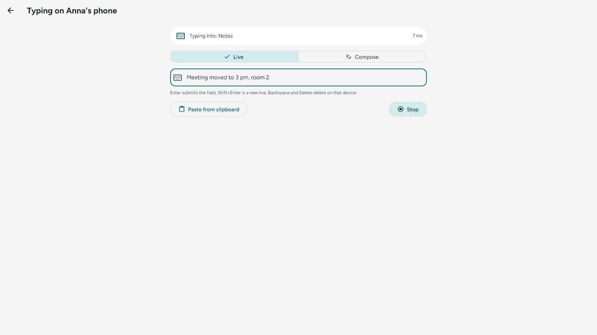

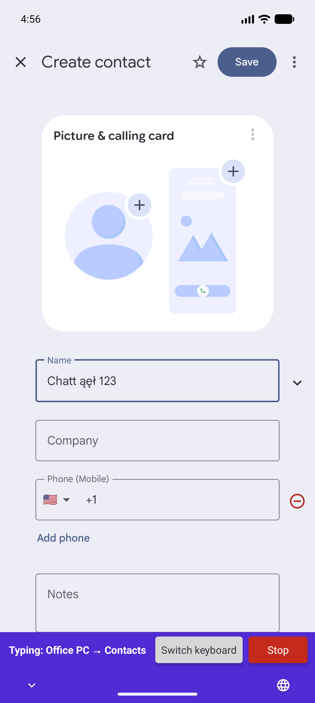

## Contents

- [What travels and what does not](#what-travels-and-what-does-not)
- [What you need](#what-you-need)
- [Turning it on](#turning-it-on)
- [Starting a session](#starting-a-session)
- [Typing](#typing)
- [What the device being typed on shows](#what-the-device-being-typed-on-shows)
- [The status line](#the-status-line)
- [Lock screens](#lock-screens)
- [Stopping](#stopping)
- [Typing without asking](#typing-without-asking)
- [Typing history](#typing-history)
- [Over Bluetooth](#over-bluetooth)
- [Security and privacy](#security-and-privacy)
- [What does not work](#what-does-not-work)
- [How fast it is](#how-fast-it-is)
- [When something does not work](#when-something-does-not-work)
- [For developers](#for-developers)

## What travels and what does not

| Travels | Stays on the PC |
|---|---|
| Text: letters, digits, Polish and other letters, emoji, new lines | Other shortcuts with Ctrl, Alt or Win |
| Backspace and Delete | Tab, Esc, the arrows, Home, End, Page Up and Page Down |
| Enter, and on Android the field's own action (Search, Send, Go, Next, Previous, Done) | The mouse and the touchpad |
| The text on the PC's clipboard | Files, pictures and anything else on the clipboard that is not text |

A tab inside pasted or composed text arrives as a space, and other control
characters are dropped. A new line lands as a new line only in a field that
holds several lines on Android; on Windows, and in a one-line field on
Android (a search box, a form field), it arrives as Enter, which can submit
the field (see [A new line](#a-new-line)).

The typing side sends only what you type on the typing screen. No text from
the other device's fields comes back, and nothing of its screen: only the app
in front (its name and its package or program file), the kind of field (an
ordinary text field, a password field, no field), on Android the field's
Enter action, and whether typing can land there now (and if it cannot, why:
a locked or dark screen, a window running as administrator, a question card
waiting there for an answer).

## What you need

- **Two devices with Chatt that know each other**, on the same network, or
  within radio range with the [Bluetooth add-on](guide.md#talking-over-bluetooth)
  on both.
- **A confirmed identity on both sides**: the green shield in the
  conversation. Typing includes passwords, so it goes only between devices
  that have compared a code (see
  [Encryption and identity confirmation](guide.md#encryption-and-identity-confirmation)).
- **The device being typed on runs Android or Windows.** An Android phone or
  tablet types through a keyboard of Chatt's own, the Chatt keyboard. A
  Windows 10 or 11 PC, touch screen or not, types into the window in front.
- **The typing side** is any device with Chatt and the add-on on. It is made
  for a PC with a real keyboard.
- **Both devices have a Chatt with the add-on.** An older Chatt on the other
  side answers "X has an older Chatt, without the remote keyboard".

## Turning it on

### On the PC that types

Settings, **Add-ons**, **Keyboard from a PC**. That one switch is all. To
type on another device, open the conversation with it and pick the keyboard
button at the top (on a phone: the **⋮** menu, **Type on that device**).

### On the device you want to type on

The same add-on, and on its card, under the add-on's switch, a second one:
**Allow typing on this device**, also off from the start and shown only
with the add-on on. Only this switch lets others type on this device. With it
on, the card warns plainly that the other device types like an ordinary
keyboard: it can send a message, submit a form, enter a password.

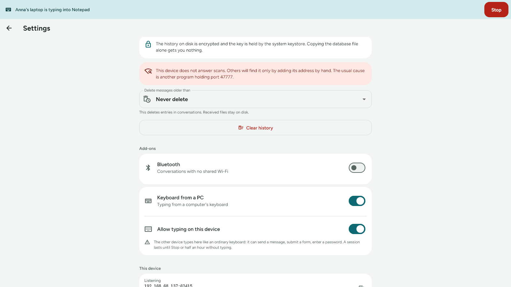

Turning the add-on off turns receiving off in the same step, so switching the
add-on on again later does not quietly bring receiving back.

The card holds one more switch on both devices, **Save typing history**, on
from the start: see [Typing history](#typing-history).

### The Chatt keyboard on Android, once

On Android the add-on types into the fields of other apps through a keyboard
of its own: the Chatt keyboard, which has no keys. It
is on the system's list of keyboards only while the add-on is on, and it has
to be turned on once in the system. With receiving on, the add-on's card says
so and offers **Turn on the Chatt keyboard**, which opens the system's list of
keyboard apps.

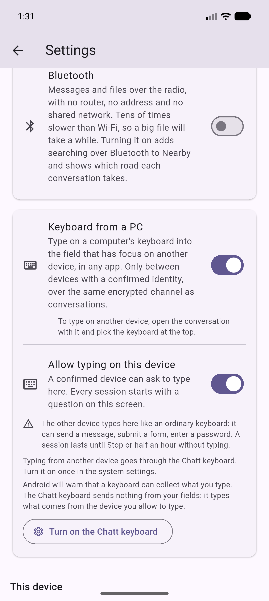

Turn on **Chatt keyboard** there. Android shows two warnings on the way:

| | |
|---|---|
| 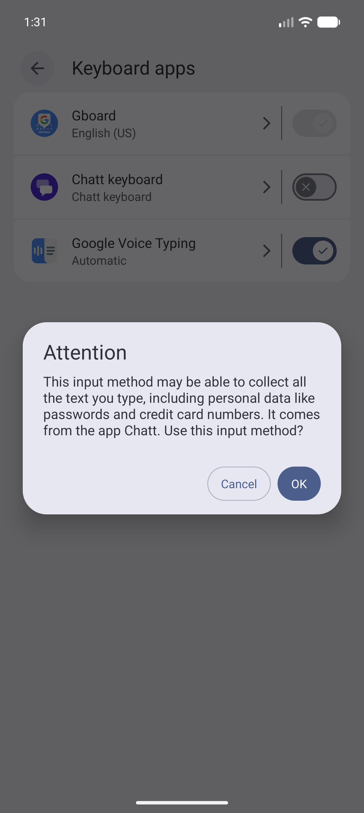 | 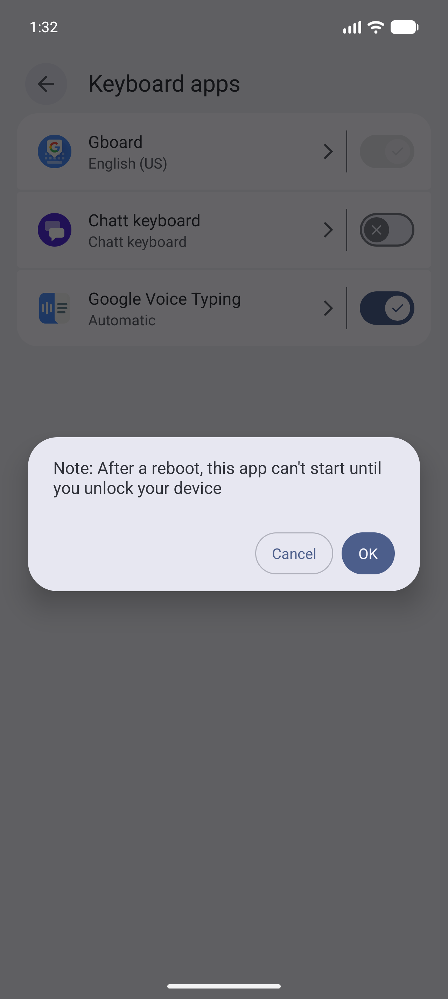 |

- **"This input method may be able to collect all the text you type"**:
  Android says this about every keyboard that does not come with the system.
  The Chatt keyboard sends no text from your fields: it types what comes from
  the device you allowed, during a session you accepted. The
  [privacy policy](privacy-policy.md) lists what it looks at (the kind of
  field, its Enter action, the app it belongs to and whether something is
  selected). The app's name and the kind of field go, encrypted, to the
  device that types, so it can show where the typing goes.
- **"After a reboot, this app can't start until you unlock your device"**:
  Android says this about every keyboard that cannot start before the first
  unlock, and the Chatt keyboard is one of them. Until the first unlock after
  a restart, nothing can be typed from a PC anyway.

Back in Chatt, the card says "Pick the Chatt keyboard for the time of typing.
The previous one comes back after the session." and shows **Pick keyboard**.
You do not need it now: **Accept** on the consent card opens the keyboard
picker when a session starts. Your usual keyboard stays the one you type
with; the Chatt keyboard takes over only for a session and gives the place
back when it ends. While the Chatt keyboard is the current one, the card says
"The Chatt keyboard is on."

## Starting a session

1. **On the PC**, open the conversation with the other device and pick the
   keyboard button at the top (on a phone: the **⋮** menu, **Type on that
   device**). It is there only with the add-on on, and it works only with a
   green shield; without one its tooltip, or the line under the menu entry,
   says "Typing on that device needs a confirmed identity".

   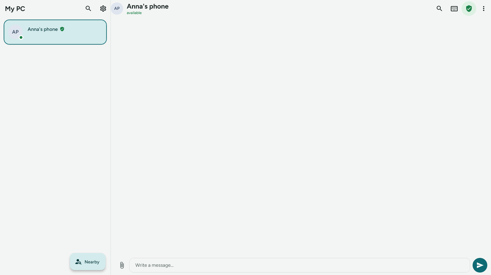

2. The **Typing on X** screen asks the other device and waits: "Waiting for
   consent on X. Open Chatt there." **Cancel** withdraws the request, and the
   card over there goes away.

   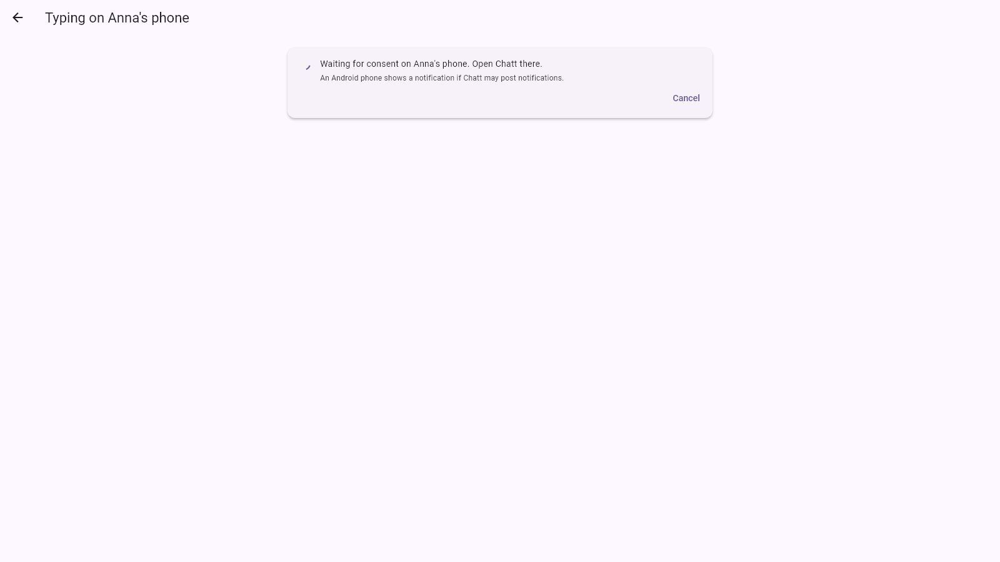

3. **On the other device** a card appears: "X wants to type on this device",
   with the green shield, **Reject**, **Accept** and a **Don't ask again for
   this device** box. The focus sits on Reject, so an Enter pressed by
   accident refuses. Without an answer the request ends after two minutes.

   | Android | Windows |
   |---|---|
   | 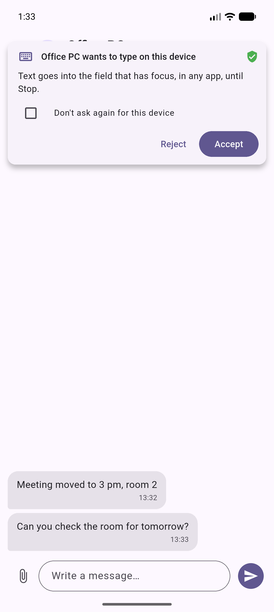 | 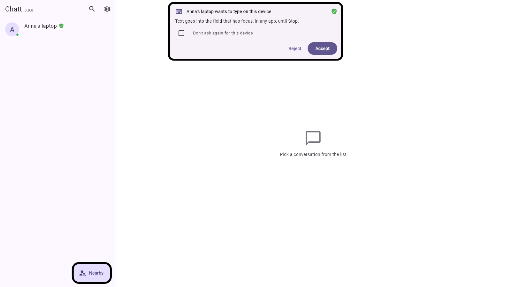 |

   When Chatt is not on screen on Android (closed, or behind another app), a
   notification brings the card (Chatt needs permission to post
   notifications for that). On Windows, a card that comes while Chatt hides
   in the tray brings the window out and sends it back after you answer.

4. **On Android, Accept** opens the keyboard picker, unless the Chatt keyboard
   is already the current one: pick **Chatt keyboard**. Chatt then steps
   aside, back to the app you were in.

   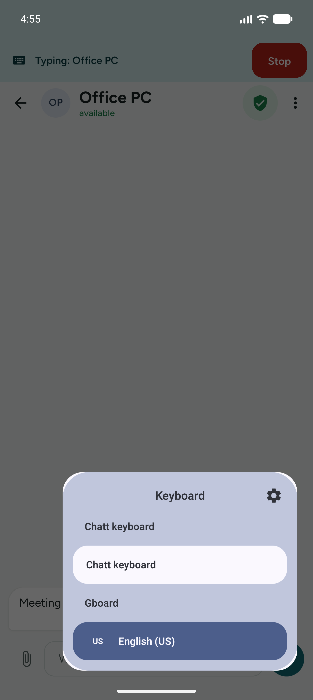

5. **Tap or click the field** you want to fill. The status line on the PC
   says where the typing goes ("Typing into: Contacts"), and you can type.

Only one device types on a device at a time: a second one hears "Someone else
is already typing on X". The same device asking again replaces its own
session.

## Typing

The typing screen has two modes, Live and Compose, and both have **Paste from
clipboard** and **Stop**.

### Live

Every character goes out as you type it.

| Key | On the other device |
|---|---|
| Letters, digits, space | typed into the field |
| Enter | the field's Enter, or its action on Android (Search, Send, Go, Next, Previous, Done) |
| Shift+Enter | a new line in a field with several lines on Android; Enter on Windows and in a one-line Android field |
| Backspace, Delete | delete there, one character at a time. On Android, Backspace on an emoji still in the echo removes it whole; Delete, and Backspace on an empty echo, remove one piece per press, so an emoji with a skin tone, a flag or a heart takes several presses. On Windows the app over there decides how much each key removes |
| Ctrl+Backspace | deletes there the echo's last word, the whole echo while it shows dots, one character when the echo is empty |
| Alt+Backspace | deletes there the whole echo, one character when the echo is empty |
| Ctrl+V, Shift+Insert | the PC's clipboard text, typed |
| Ctrl+Enter, Alt+Enter, Ctrl+Delete, Alt+Delete | the same as Enter or Delete alone; with Shift added, Enter acts as Shift+Enter |
| Tab, Esc, arrows, Home, End, Page Up, Page Down, other shortcuts | nothing |

The field on your screen is an echo of what you typed in it since the last
Enter or Shift+Enter, with the cursor held at its end: moving it would not
move the cursor over there. A paste, a switch of mode and a packet the other
device did not type (paused, no field) also empty it, so pasted text never
shows in it. Backspace in an empty echo deletes on the other device all the
same. Spell checking, suggestions and undo are off in this field, so the
field itself remembers nothing of what you typed. What went out is kept in
the [typing history](#typing-history) while **Save typing history** is on.

### Compose

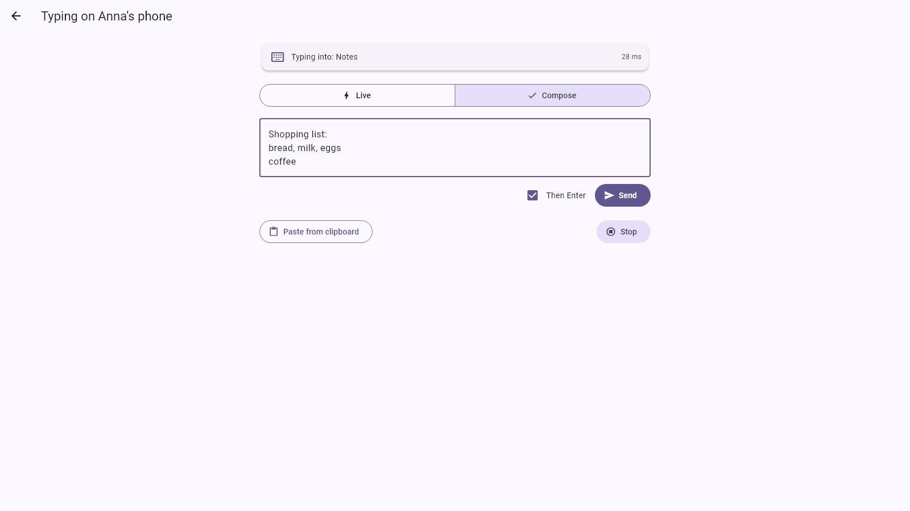

Write the whole text first, look it over, and send it with **Send** or
Ctrl+Enter. Tick **Then Enter** when the field should be submitted after the
text (a search box, a chat that sends on Enter). While the field shows dots
(see [Passwords](#passwords)) it holds a single line, and Enter sends it as
**Send** does, with an Enter after it when **Then Enter** is ticked.

Compose is also the mode that sends nothing while you think: the whole text
goes out when you press Send. On Android it lands in the field at once; on
Windows it is typed out at the paste pace (see below).

### Paste from clipboard

Sends the text on the PC's clipboard, in either mode. Long texts are split
into packets of up to 4096 characters and typed one after another; up to
65,536 characters can wait to be sent, and more than that is refused whole
("Too much text at once. Send it in parts."). On Windows a paste types one
character every 10 ms and waits 40 ms after every space and line break: about
100 characters a second for text without spaces, roughly 60 to 70 for
ordinary prose (see [How fast it is](#how-fast-it-is)).

### Passwords

Until the other side reports an ordinary text field, the echo and the Compose
field show dots: for a password field, and for a field Chatt cannot tell,
which happens in some Windows apps. For a password field the status line adds
"· password field"; for a field Chatt cannot tell it stays a plain "Typing
into: *app*", and the field shows dots all the same.

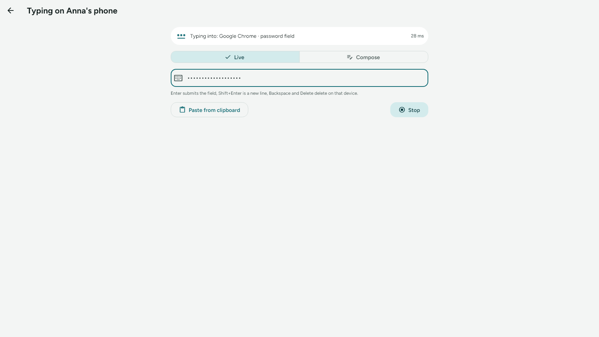

In Live, once anything went out under the dots, the echo stays dotted until
it starts afresh (Enter, Shift+Enter, a paste, a switch of mode, or a packet
the other side did not type), even after you delete all of it and even if the
focus over there moves to an ordinary field meanwhile. In Compose the dots
stay until the field is empty.

### A new line

A new line arrives on a Windows PC as a plain Enter. In a text editor that is
a new line; in a chat app where Enter sends, it sends. On Android a field
with several lines gets a real new line, and a one-line field (a search box,
a form field) gets Enter, which can submit it.

### Following the focus

A session covers the whole device. On Android the Chatt keyboard stays the
current keyboard as you go from app to app, so the typing follows you: the
Settings search, a calendar event's title, a contact form, with no new
consent and no new picker. The exception is a password field while the
screen is locked, the lock screen's own text password included: your usual
keyboard comes back for it, and a tap on the "Switch the keyboard to Chatt"
notification with one pick in the picker brings the Chatt keyboard back (see
[Lock screens](#lock-screens)).
On Windows the typing goes into whichever window is in front.

Chatt's own text fields take typing like any other app's. On Windows a
remote Enter in Chatt's message field sends the message, as in any
messenger. On Android that field holds several lines, so a remote Enter
starts a new line there, and the message goes out with the Send button next
to the field. Chatt's question cards are out of reach: see
[Security and privacy](#security-and-privacy).

## What the device being typed on shows

### On Android

- **The Chatt keyboard's bar**, where the keyboard usually is, while a field
  takes the typing: who is typing and into which app ("Typing: Office PC →
  Contacts"), with **Switch keyboard** and **Stop**.
- **A bar over every Chatt screen** while Chatt is open, with Stop: "Office
  PC is typing into Chatt" while a Chatt field takes the typing, "Typing:
  Office PC" otherwise.
- **The permanent Chatt notification** repeats the keyboard bar's text for
  the whole session: "Typing: Office PC → Contacts" while a field takes the
  typing, "Typing: Office PC" without one.

| The keyboard bar | The bar in Chatt |
|---|---|
|  | 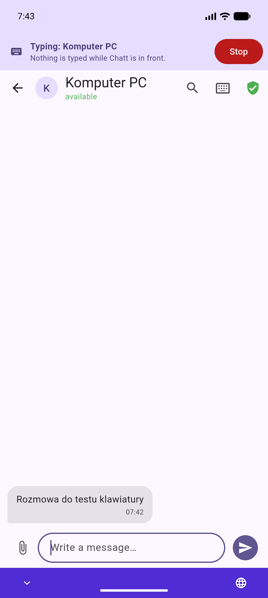 |

**Switch keyboard** opens the keyboard picker, if you want to type something
yourself for a moment; the session goes on, and picking the Chatt keyboard
again brings the typing back.

A session from a device with "Don't ask again" starts without the card. If
Chatt is in the background then and another keyboard is the current one,
Chatt posts a notification "Switch the keyboard to Chatt" (it needs
permission to post notifications for that). One tap on it opens the keyboard
picker, and once the picker closes Chatt steps aside, back to the app you
were in.

### On Windows

- **A floating bar** at the top of the screen with the foreground window:
  "Typing: Anna's laptop → Notepad" and **Stop**. It stays on top for the
  whole session, also with Chatt hidden in the tray, and never takes the
  focus from your field, like the on-screen keyboard: a Stop tapped with a
  finger leaves the cursor where it was.

  

- **The tray icon** gets a badge, and its menu gains **Stop remote keyboard**.
- **A bar over every Chatt screen**, with Stop. It names the program in
  front ("Anna's laptop is typing into Notepad", see the picture under
  [Turning it on](#on-the-device-you-want-to-type-on)). Over an
  administrator's window it reads "Typing: Anna's laptop" with a second
  line: "A window running as administrator. Nothing is typed there."

On a touch PC the touch keyboard may slide out when you tap a field. It does
not get in the way, and you can close it.

## The status line

The line at the top of the typing screen says where the typing goes, or why
nothing gets typed. While nothing can land, the fields take no typing, so
nothing piles up to land later in the wrong place. On Windows any ordinary
window in front counts as a place to land: the line says "Typing into:
*program*" and the keys go to whatever has the focus in that window, so click
the field you want first.

| The line says | What it means | What to do |
|---|---|---|
| Typing into: *app* | on Android the typing lands in that app's focused field; on Windows in whatever has the focus in that window | type |
| Typing into: *app* · password field | the same, a password field; the echo shows dots | type |
| No field to type into | on Android no field has the focus there, or the Chatt keyboard is not the current one; on Windows no window is in front | tap a field there; on Android pick the Chatt keyboard |
| That device is locked or its screen is off | a lock screen, or on Android a screen that is off | unlock it |
| A window running as administrator. Nothing is typed there. | Windows refuses ordinary programs there | use another window, or run that program normally |
| Paused: a question is waiting on that device | a card waits over there (a file, a pairing code, a typing request) | answer it there; typing resumes by itself |
| Answer the question at the top, then go on typing | a card waits on this PC | answer it here |
| The connection dropped | the link went down | **Reconnect** asks again |
| The session was ended on X | the device being typed on ended it: Stop there, the add-on or **Allow typing on this device** turned off there, this device deleted from the list there, or the time ran out (half an hour without typing, eight hours in all) | **Reconnect** asks again |

The small number at the right is how long the last packet took there and back.
With the Bluetooth add-on on, a badge shows which road the session takes.

| Paused by a card over there | An administrator's window | The link dropped |
|---|---|---|
| 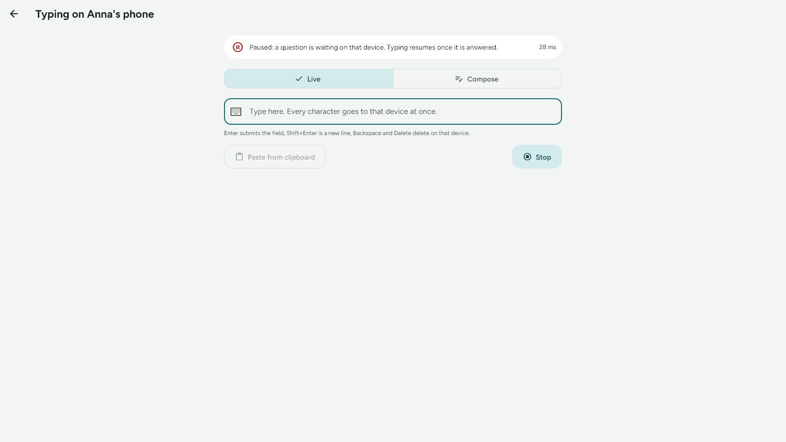 | 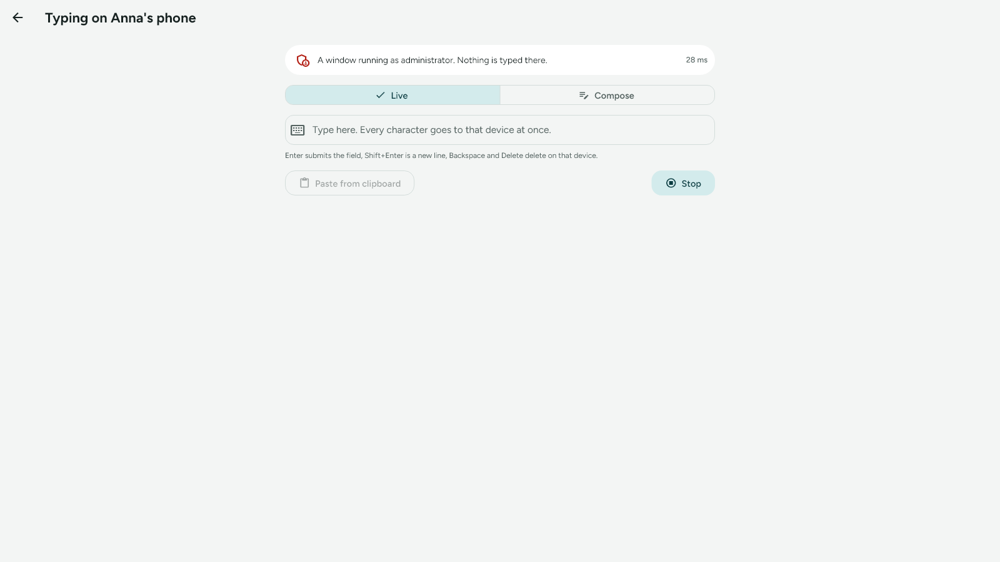 | 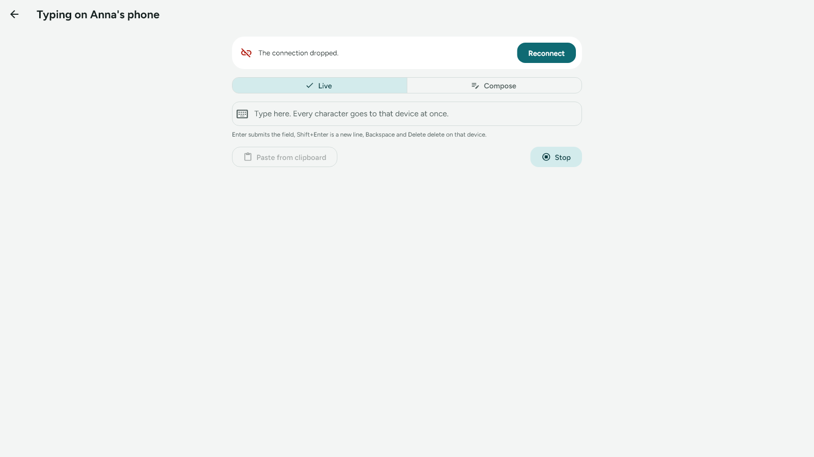 |

A request can also end before the session starts, with a short message:
"X declined", "Typing is off on X" (the add-on or **Allow typing on this
device** is off there), "X did not answer the request", "Someone else is
already typing on X", "X has an older Chatt", "Could not reach X", "Confirm
this device's identity first".

## Lock screens

Nothing is typed while a device is locked, and on Android while its screen is
off; the status line says so.

**On Android**, a lock screen with a PIN or a pattern keeps the Chatt keyboard:
a PIN pad is not a keyboard. A lock screen with a **text password** is typed
into with the current keyboard, and the Chatt keyboard has no keys, so it
steps aside at once and your usual keyboard comes back for the password.
During a session Chatt then posts "Switch the keyboard to Chatt"; the
notification waits until you unlock, and one tap on it with one pick in the
picker brings the typing back.

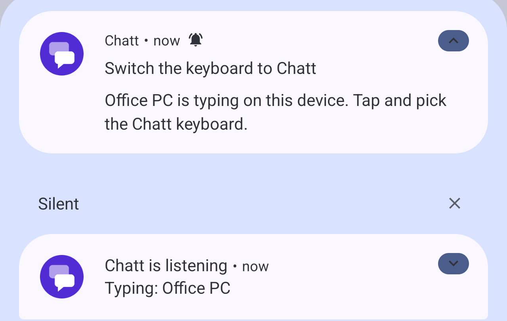

A field of an app shown over a locked screen keeps the Chatt keyboard, and
typing waits until the screen is unlocked and then goes on. A password field
in such an app works like the lock screen's password: the Chatt keyboard
steps aside, and the "Switch the keyboard to Chatt" notification brings the
typing back.

**On Windows**, the lock screen, the sign-in screen and User Account Control
prompts are a separate desktop that no ordinary program can type into. The
status line says the device is locked.

## Stopping

A session ends with:

- **Stop** anywhere: on the floating bar, on the Chatt keyboard's bar, in the
  tray menu, on the bar over Chatt, or on the typing screen;
- closing the typing screen on the PC;
- turning off the add-on on either device, or **Allow typing on this device**
  on the device being typed on;
- deleting the conversation with the other device on either side (a long
  press on it in the list): the device leaves the list with it;
- half an hour without typing, and eight hours in any case.

Stop on the device being typed on (the floating bar, the tray menu, the
Chatt keyboard's bar, the bar over Chatt) cuts even a long paste short at
once: what was not typed yet is dropped. Stop on the typing screen, and
closing that screen, end the session once the text already waiting on the PC
has been typed. When the session ends, the bars go away, and on Android your
previous keyboard comes back by itself. When the session ends while you are
still on the typing screen (the link went down, the other device ended it),
the screen stays open with **Reconnect**.

## Typing without asking

"Don't ask again for this device" on the card, or **Typing without asking** in
the conversation's security sheet (there only with the add-on on), lets that
one device start typing without the card. The bars and Stop show as always.
It works only with a green shield and with **Allow typing on this device** on,
and it goes away with the device when you delete it from the list.

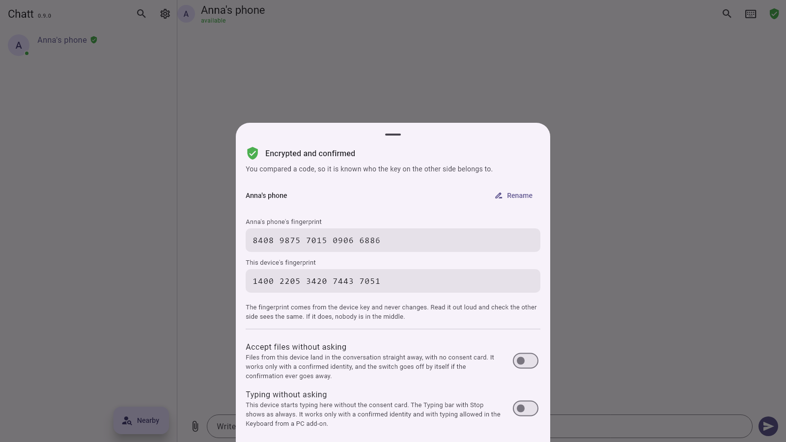

## Typing history

With **Save typing history** on, both devices keep a record of every session
in their encrypted database: the PC what it sent and what the other device
answered, the device being typed on what came in and what its keyboard typed.
The switch is on the add-on's card, on from the start, and it counts only
while the add-on is on: an add-on that is off records nothing. Each device
keeps its own history under its own switch. Turning the switch off keeps what
is already saved.

A session in the history shows:

- which device typed on which, when the session started and ended, how the
  request was answered (accepted, declined, no answer, someone else typing,
  typing off there, withdrawn, an older Chatt, unreachable) and why the
  session ended (Stop on either side, the time ran out, the link dropped, a
  switch turned off, the device removed from the list, a new session in its
  place, the app closed);
- what was typed, piece by piece, with the time and the app it went into:
  the text, Backspace, Delete and Enter;
- whether each piece landed: typed, not typed (the field went away, the
  screen locked, Stop came first), paused by a card, refused, unconfirmed
  (the PC got no answer, or a refusal after an attempt with no answer, so
  nobody knows whether it landed) or not sent (it was still waiting on the PC
  when the session ended).

**Password fields.** Text typed into a password field, or into a field
Chatt cannot tell, is kept as a number of characters and shows as dots. The
kind of field is known only once the other device answers, so a piece counts
as hidden when the field was not an ordinary text field before it or after it:
the first characters in a password field you have just tapped stay hidden,
and so do the first ones in an ordinary field right after a password field.
On the PC, a piece whose answer did not say where it went (unconfirmed,
refused or not sent) is kept as a number of characters too, since the field
it was bound for is unknown. A password field that its app does not mark as one
looks like an ordinary field to Chatt, and what you type into it is kept as
text.

**The text is rebuilt from the keys.** Backspace takes the last character
away and Enter starts a new line. Delete changes nothing in it, because Chatt
does not know where the cursor was over there, and text that was in the field
before the session does not show. The keys themselves are the exact record,
and an export carries them.

**Where to find it.** Settings, **Data and diagnostics**, **Typing history**,
shown there once a session is saved, or the **Typing history** button on the
add-on's card. Both devices write a session under the same identifier, so the
record on the PC and the one on the device being typed on can be laid side by
side.

**Deleting it.** **Delete messages older than** and **Clear history** in
Settings, Privacy, take the typing history along, and **Clear typing history**
deletes it alone. A session still running when the history is cleared goes on
without a record. **Export data** can take the typing history along in a file
(see the [user guide](guide.md#data-and-diagnostics)).

The app log never holds what you type: it notes that a session started, how
it ended, and how many packets failed.

## Over Bluetooth

With the Bluetooth add-on on at both ends, a session can also go over the
radio. The request first tries the road that last worked with that device;
with nothing remembered, the network goes first and the radio when the
network does not answer. The whole session then stays on the road that
answered: if that road goes down during a session, the session drops, and
**Reconnect** tries the roads again, the radio included. Over the radio it
works the same way, with the same consent and the same encryption; a
character simply takes longer (see below), which shows while typing fast,
and fast typing does not pile up: what comes in while a packet is on its way
leaves in the next one.

## Security and privacy

- **Only between devices with a confirmed identity.** A device without the
  green shield cannot even learn whether the add-on is on: it hears the same
  refusal in every case.
- **Consent for every session**, on the device being typed on, unless you
  chose "Don't ask again" for that one device. The device receiving the
  request checks the shield, the add-on and **Allow typing on this device**
  again on every packet, from the database, so turning the add-on or the
  permission off, or deleting the device from the list, stops the typing at
  once.
- **A session is bound to a token** that the receiving device draws. A packet
  recorded on the network and sent again later types nothing, and a request
  id works once.
- **Encrypted like messages**: the same session keys, and every packet and
  every answer padded, so one keystroke looks like any other on the network.
- **A typing history on both sides**, with **Save typing history** on (the
  default): each device keeps in its encrypted database what was typed, into
  which app, when, and whether it landed. Text for a password field or a
  field of unknown kind is kept as a number of characters, and the app log
  holds no typed text. Whoever has one of the devices unlocked in hand can
  read that history, so turn the switch off on each device that should not
  keep it (see [Typing history](#typing-history)).
- **Chatt's question cards stay out of reach.** While a card waits on the
  device being typed on, packets are answered "paused" and nothing is typed.
  On Windows, a long packet that is being typed into Chatt's own window stops
  before its next key when a card comes up, and a file card that appears
  during a session puts the focus on Reject, so a remote Enter can at most
  refuse.
- **A device that is itself typing on another one** takes no typing into
  Chatt's own window meanwhile, so its typing screen never relays or echoes
  what it receives.
- **What it means**: a confirmed device with typing allowed can type on your
  unlocked device like a keyboard plugged into it, including sending a
  message or entering a password. Keep **Allow typing on this device** off
  when you do not need it, and delete a device that was lost or stolen from
  the list (a long press on its conversation); its conversation goes with it,
  and any typing from it stops at once. The
  [architecture notes](architecture.md) and the
  [security policy](SECURITY.md) go into the threat model.

## What does not work

- Other shortcuts with Ctrl, Alt or Win, Tab, Esc, the arrows, Home, End and
  the mouse.
- Lock screens, and on Android a screen that is off.
- On Windows: windows running as administrator, User Account Control prompts
  and the sign-in screen. Windows lets no ordinary program type there, and the
  PC that types says so.
- Pictures and files from the clipboard: only its text travels.

## How fast it is

Measured on 16 October 2026 with a Pixel 9 Pro (Android 17) and a PC with
Windows 11 on Ethernet in the same network, 100 characters a run:

| Road | A character, p50 | A character, p95 |
|---|---|---|
| Wi-Fi 2.4 GHz | 28 to 29 ms | 34 to 39 ms |
| Wi-Fi 5 GHz | 28 to 30 ms | 33 to 38 ms |
| Bluetooth (the PC's built-in radio) | 70 to 78 ms | 187 to 243 ms |

Typing into a Windows PC goes one character every 10 ms, and 40 ms after a
space or an Enter: faster than that, the Windows 11 Notepad lost or repeated
characters. A paste of 600 digits with no spaces took about 6.5 seconds
there; ordinary text of that length takes about 9 to 10 seconds.

## When something does not work

| What you see | Why, and what to do |
|---|---|
| No keyboard button in the conversation, and no entry in its ⋮ menu | The add-on is off on this PC: Settings, Add-ons, Keyboard from a PC. |
| The keyboard button, or the menu entry, is grey | No green shield: compare the code in the conversation's security sheet. |
| "Typing is off on X" | Turn on the add-on and **Allow typing on this device** over there. |
| "X did not answer the request" | Nobody answered the card within two minutes. On Android, let Chatt post notifications so the request shows while Chatt is not on screen. |
| "No field to type into" on Android | Tap a field over there, and check that the Chatt keyboard is the current one (the bar at the bottom says "Typing: …"). |
| The Chatt keyboard is not in the picker | It is not turned on in the system: the add-on's card, **Turn on the Chatt keyboard**. |
| The text lands in the wrong window on Windows | Typing goes into the window in front. Click the field you want first; the floating bar never takes the focus. |
| A message got sent by Enter | Enter is the field's Enter. On Android, Shift+Enter gives a new line in a field with several lines, and so does a line break in Compose with **Then Enter** unticked. On Windows every new line arrives as Enter (see [A new line](#a-new-line)), so in an app where Enter sends, keep the text on one line. |
| Letters missing in a slow Windows app | Report it with the app's name: Chatt types at a pace that even the Windows 11 Notepad keeps up with, and a slower app may need more. |
| You want to know what reached the other device | Settings, **Data and diagnostics**, **Typing history**: every piece says whether it was typed. |
| You are reporting a problem | Settings, **Data and diagnostics**, **Export data** with only **App log** ticked gives a file to attach. It holds no typed text. |

## For developers

- How it works inside, the protocol (`/input-session`, `/input`), the
  `chatt/remoteinput` channel, the Android keyboard and the Windows sink:
  [architecture.md](architecture.md), section on the Keyboard from a PC
  add-on. The typing history, with its statuses, the rule that hides
  password text and the end reasons, is in its
  [Typing history](architecture.md#typing-history) part.
- The tests and the scenarios on live hardware (`tool/klawiatura_*`), with
  the runs behind the numbers above: [testing.md](testing.md).
- The screenshots here come from `tool/windows_shots.dart` (Windows, both
  languages), `tool/klawiatura_android_e2e_test.dart` with `CHATT_SHOTS=1`
  (Android, on an emulator) and a capture of the live floating bar.
