# Klawiatura z PC

*[English](keyboard.md)*

Telefon, tablet albo komputer obsługiwany samym dotykiem nie ma porządnej
klawiatury. **Klawiatura z PC** pożycza mu klawiaturę komputera. Wskazujesz
pole na tamtym urządzeniu stuknięciem albo kliknięciem, a to, co piszesz na
komputerze, trafia do tego pola, w dowolnej aplikacji: wiadomość
w komunikatorze, długi adres w przeglądarce, hasło w formularzu logowania,
notatka. Chatt nie pokazuje niczego z tamtego ekranu i niczego na nim nie
przesuwa.

To dodatek: domyślnie wyłączony, a wyłączony nie pokazuje się na żadnym innym
ekranie i niczego nie uruchamia. Sesja zaczyna się od zgody na urządzeniu, na
którym się pisze, chyba że wybrano tam dla urządzenia piszącego „Nie pytaj
więcej”, a Stop jest tam pod ręką, dopóki sesja trwa.

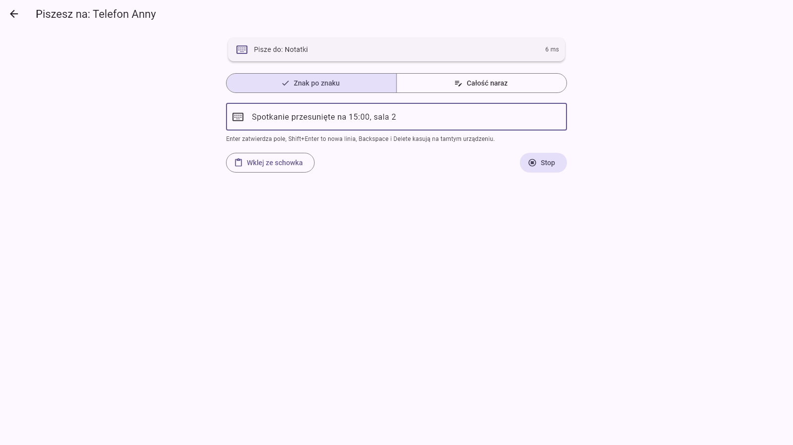

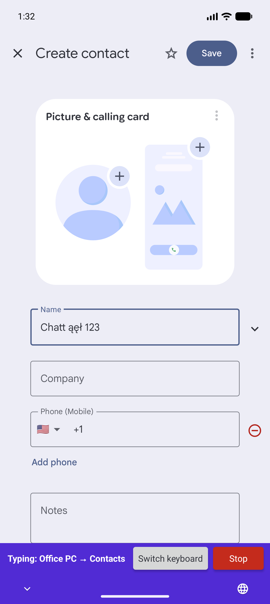

## Spis treści

- [Co jedzie, a co zostaje](#co-jedzie-a-co-zostaje)
- [Czego trzeba](#czego-trzeba)
- [Włączanie](#włączanie)
- [Początek sesji](#początek-sesji)
- [Pisanie](#pisanie)
- [Co widać na urządzeniu, na którym się pisze](#co-widać-na-urządzeniu-na-którym-się-pisze)
- [Wiersz stanu](#wiersz-stanu)
- [Ekran blokady](#ekran-blokady)
- [Zatrzymanie](#zatrzymanie)
- [Pisanie bez pytania](#pisanie-bez-pytania)
- [Przez Bluetooth](#przez-bluetooth)
- [Bezpieczeństwo i prywatność](#bezpieczeństwo-i-prywatność)
- [Czego nie da się zrobić](#czego-nie-da-się-zrobić)
- [Jak szybko to działa](#jak-szybko-to-działa)
- [Gdy coś nie działa](#gdy-coś-nie-działa)
- [Dla programistów](#dla-programistów)

## Co jedzie, a co zostaje

| Jedzie | Zostaje na komputerze |
|---|---|
| Tekst: litery, cyfry, polskie i inne znaki, emoji, nowe linie | Inne skróty z Ctrl, Alt albo Win |
| Backspace i Delete | Tab, Esc, strzałki, Home, End, Page Up i Page Down |
| Enter, a na Androidzie akcja samego pola (Szukaj, Wyślij, Idź, Dalej, Wstecz, Gotowe) | Mysz i touchpad |
| Tekst ze schowka komputera | Pliki, obrazki i wszystko w schowku, co nie jest tekstem |

Tabulator we wklejonym albo złożonym tekście dochodzi jako spacja, a inne
znaki sterujące odpadają. Nowa linia trafia jako nowa linia tylko do pola
wielowierszowego na Androidzie; na Windows i w polu jednowierszowym na
Androidzie (wyszukiwarka, pole formularza) dochodzi jako Enter, który może to
pole zatwierdzić (patrz [Nowa linia](#nowa-linia)).

Strona, która pisze, wysyła tylko to, co piszesz na ekranie pisania. Żaden
tekst z pól tamtego urządzenia ani nic z jego ekranu nie wraca: tylko
aplikacja na wierzchu (jej nazwa i pakiet albo plik programu), rodzaj pola
(zwykłe pole tekstowe, pole hasła, brak pola), na Androidzie akcja Entera
w tym polu i to, czy pisanie może tam teraz trafić (a jeśli nie, to dlaczego:
ekran zablokowany albo wygaszony, okno uruchomione jako administrator, karta
z pytaniem czekająca tam na odpowiedź).

## Czego trzeba

- **Dwóch urządzeń z Chatt, które się znają**, w tej samej sieci albo
  w zasięgu radia z [dodatkiem Bluetooth](guide.pl.md#dodatek-bluetooth)
  włączonym po obu stronach.
- **Potwierdzonej tożsamości po obu stronach**: zielonej tarczy w rozmowie.
  Pisze się także hasła, więc pisanie idzie wyłącznie między urządzeniami,
  które porównały kod (patrz
  [Szyfrowanie i potwierdzanie tożsamości](guide.pl.md#szyfrowanie-i-potwierdzanie-tożsamości)).
- **Urządzenie, na którym się pisze, ma Androida albo Windows.** Telefon albo
  tablet z Androidem pisze przez własną klawiaturę Chatt. Komputer
  z Windows 10 albo 11, z ekranem dotykowym albo bez, pisze do okna na
  wierzchu.
- **Strona, która pisze**, to dowolne urządzenie z Chatt i włączonym
  dodatkiem. Pomyślana jest dla komputera z prawdziwą klawiaturą.
- **Na obu urządzeniach Chatt z tym dodatkiem.** Starszy Chatt po drugiej
  stronie odpowiada „Urządzenie X ma starszą wersję Chatt, bez zdalnej
  klawiatury.”

## Włączanie

### Na komputerze, który pisze

Ustawienia, **Dodatki**, **Klawiatura z PC**. Wystarczy ten jeden przełącznik.
Karta podpowiada też, od czego zacząć: „Żeby pisać na innym urządzeniu, otwórz
z nim rozmowę i wybierz klawiaturę u góry ekranu.”

### Na urządzeniu, na którym chcesz pisać

Ten sam dodatek, a na jego karcie, pod przełącznikiem dodatku, drugi
przełącznik: **Pozwól pisać na tym urządzeniu**, też wyłączony od początku
i widoczny dopiero przy włączonym dodatku. Tylko ten przełącznik pozwala
innym pisać na tym urządzeniu. Po jego włączeniu karta mówi wprost, że drugie
urządzenie pisze jak zwykła klawiatura: może wysłać wiadomość, zatwierdzić
formularz, wpisać hasło.

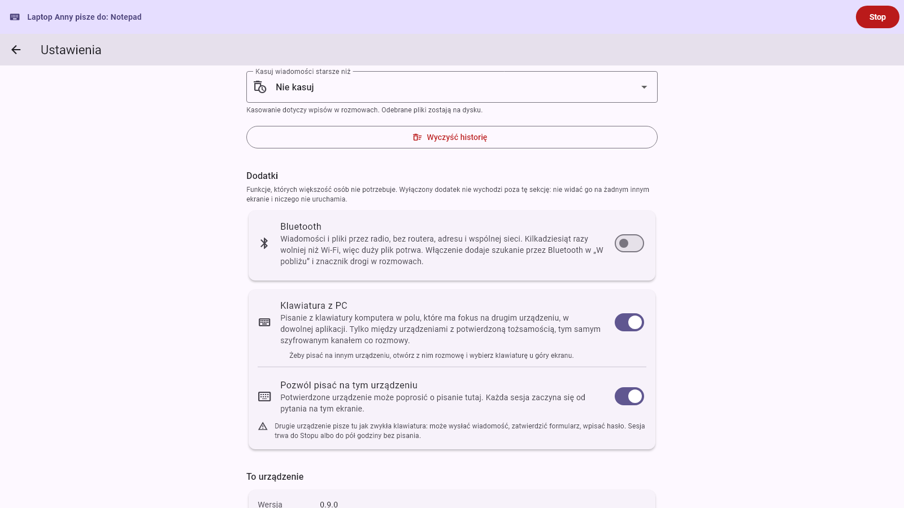

Wyłączenie dodatku wyłącza w tym samym kroku przyjmowanie pisania, więc
późniejsze ponowne włączenie dodatku nie przywraca go po cichu.

### Klawiatura Chatt na Androidzie, raz

Na Androidzie dodatek pisze w polach innych aplikacji przez własną
klawiaturę: klawiaturę Chatt, która nie ma klawiszy. Jest na systemowej liście klawiatur tylko przy włączonym dodatku
i trzeba ją raz włączyć w systemie. Przy włączonym przyjmowaniu pisania karta
dodatku o tym mówi i podaje przycisk **Włącz klawiaturę Chatt**, który
otwiera systemową listę aplikacji klawiatury.

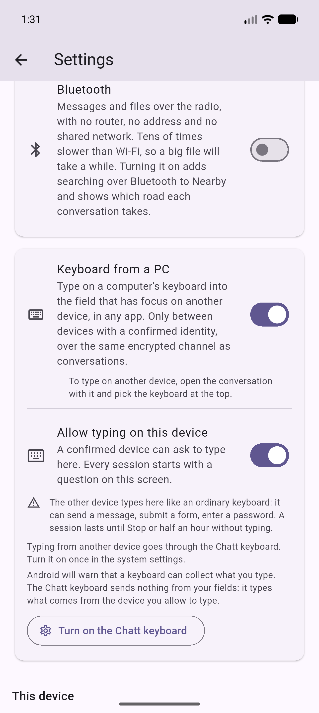

Włącz tam **Klawiatura Chatt** (na telefonie po angielsku **Chatt keyboard**,
jak na zrzutach). Po drodze Android pokazuje dwa ostrzeżenia:

| | |
|---|---|
| 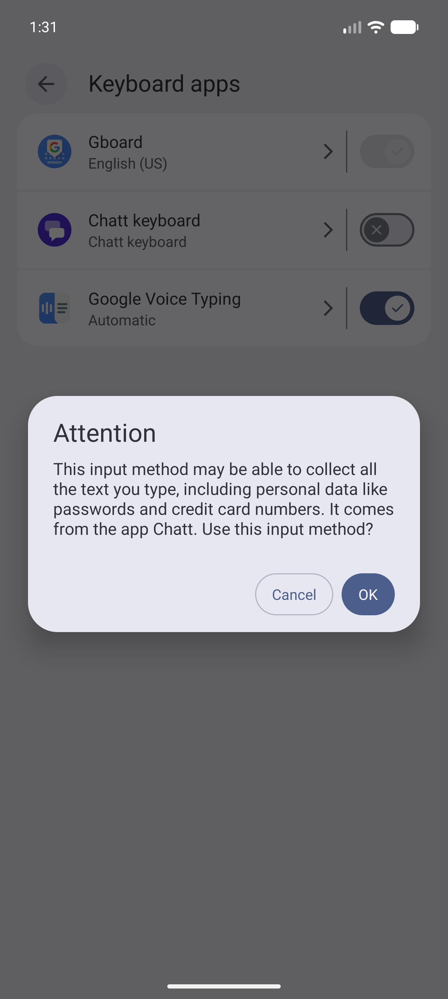 | 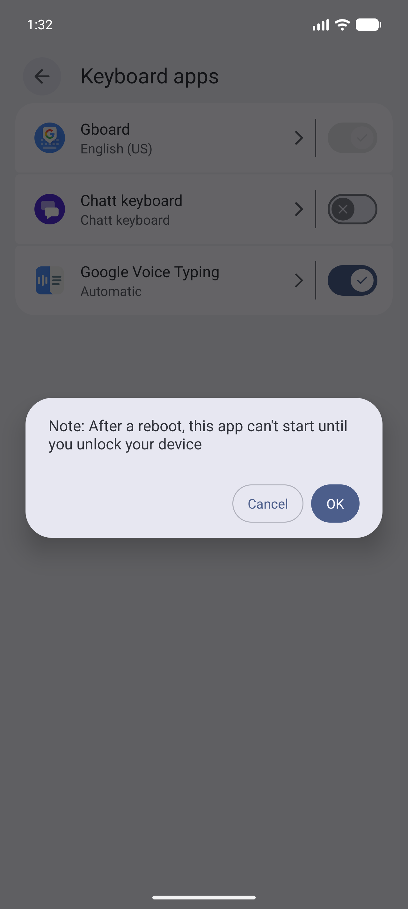 |

- **Pierwsze: ta metoda wprowadzania może zbierać cały wpisywany tekst,
  także hasła.** Android mówi to o każdej klawiaturze spoza systemu.
  Klawiatura Chatt nie wysyła tekstu z Twoich pól: wpisuje to, co przyjdzie
  od urządzenia, któremu pozwolisz, w trakcie sesji, którą przyjmiesz.
  [Polityka prywatności](privacy-policy.md) wymienia, na co patrzy (rodzaj
  pola, jego działanie Entera, aplikację, do której należy, i to, czy coś
  jest zaznaczone). Nazwa aplikacji i rodzaj pola idą, zaszyfrowane, do
  urządzenia, które pisze, żeby mogło pokazać, dokąd trafia pisanie.
- **Drugie: po ponownym uruchomieniu aplikacja nie ruszy, dopóki nie
  odblokujesz urządzenia.** Android pisze tak o każdej klawiaturze, która nie
  umie ruszyć przed pierwszym odblokowaniem, i klawiatura Chatt do nich
  należy. Do pierwszego odblokowania po restarcie i tak nic nie da się
  wpisać z komputera.

Po powrocie do Chatt karta mówi „Na czas pisania wybierz klawiaturę Chatt. Po
sesji wraca poprzednia.” i pokazuje przycisk **Wybierz klawiaturę**. Teraz
nie jest potrzebny: **Akceptuj** na karcie zgody sam otwiera okno wyboru
klawiatury na początku sesji. Zwykła klawiatura zostaje tą, którą piszesz;
klawiatura Chatt przejmuje miejsce tylko na czas sesji i po niej je oddaje.
Gdy klawiatura Chatt jest bieżąca, karta mówi „Klawiatura Chatt jest
włączona.”

## Początek sesji

1. **Na komputerze** otwórz rozmowę z drugim urządzeniem i wybierz przycisk
   klawiatury u góry. Jest tylko przy włączonym dodatku i działa tylko przy
   zielonej tarczy; bez niej podpowiedź mówi „Pisanie na tamtym urządzeniu
   wymaga potwierdzonej tożsamości”.

   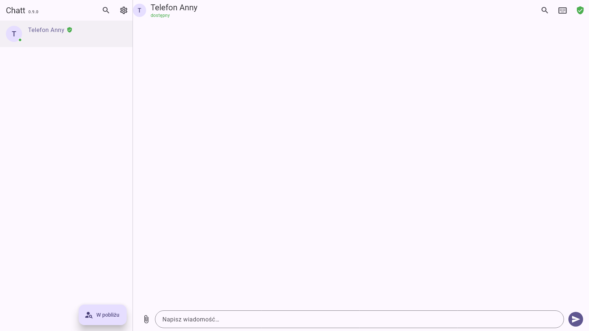

2. Ekran **Piszesz na: X** prosi tamto urządzenie i czeka: „Czekam na zgodę
   na urządzeniu X. Otwórz tam Chatt.” **Anuluj** wycofuje prośbę, a karta po
   drugiej stronie znika.

   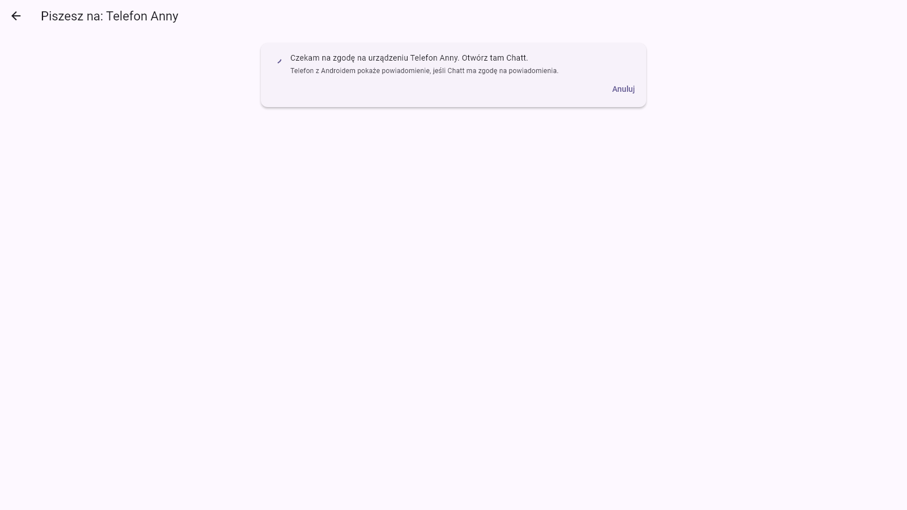

3. **Na drugim urządzeniu** pojawia się karta: „X chce pisać na tym
   urządzeniu”, z zieloną tarczą, przyciskami **Odrzuć** i **Akceptuj** oraz
   polem **Nie pytaj więcej dla tego urządzenia**. Fokus stoi na Odrzuć, więc
   przypadkowy Enter odmawia. Bez odpowiedzi prośba kończy się po dwóch
   minutach.

   | Android | Windows |
   |---|---|
   | 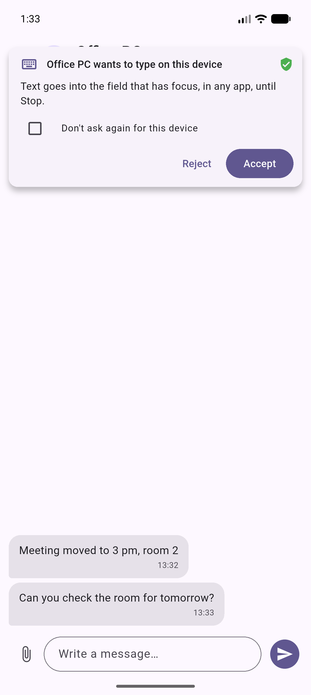 | 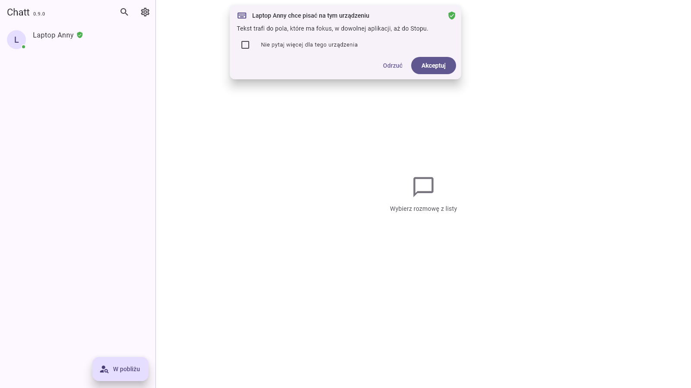 |

   Gdy Chatt nie jest na ekranie Androida (zamknięty albo za inną aplikacją),
   kartę przynosi powiadomienie (Chatt potrzebuje do tego zgody na
   powiadomienia). Na Windows karta, która przyjdzie, gdy Chatt siedzi
   w zasobniku, wyciąga okno na wierzch i po odpowiedzi odsyła je z powrotem.

4. **Na Androidzie Akceptuj** otwiera okno wyboru klawiatury, chyba że
   klawiatura Chatt już jest bieżąca: wybierz **Klawiatura Chatt** (po
   angielsku **Chatt keyboard**, jak na zrzucie). Chatt schodzi wtedy na bok,
   z powrotem do poprzedniej aplikacji.

   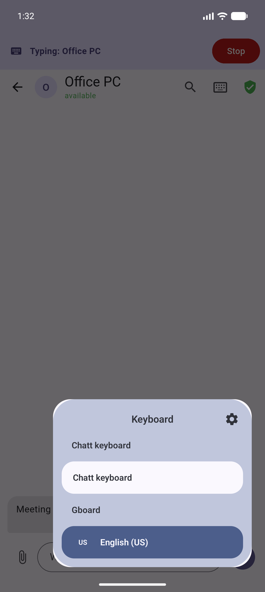

5. **Stuknij albo kliknij pole**, które chcesz wypełnić. Wiersz stanu na
   komputerze mówi, dokąd idzie pisanie („Pisze do: Kontakty”), i można
   pisać.

Na jednym urządzeniu pisze naraz jedno urządzenie: drugie słyszy „Na
urządzeniu X pisze już ktoś inny.” Ponowna prośba od tego samego urządzenia
zastępuje jego własną sesję.

## Pisanie

Ekran pisania ma dwa tryby, Znak po znaku i Całość naraz, a w obu są **Wklej
ze schowka** i **Stop**.

### Znak po znaku

Każdy znak wychodzi w chwili napisania.

| Klawisz | Na drugim urządzeniu |
|---|---|
| Litery, cyfry, spacja | wpisane do pola |
| Enter | Enter pola, a na Androidzie jego akcja (Szukaj, Wyślij, Idź, Dalej, Wstecz, Gotowe) |
| Shift+Enter | nowa linia w polu wielowierszowym na Androidzie; Enter na Windows i w polu jednowierszowym na Androidzie |
| Backspace, Delete | kasują tam po jednym znaku. Na Androidzie Backspace na emoji, które jest jeszcze w echu, zabiera je w całości; Delete oraz Backspace przy pustym echu zdejmują po kawałku, więc emoji z odcieniem skóry, flaga albo serce potrzebują kilku naciśnięć. Na Windows o tym, ile znika, decyduje aplikacja po drugiej stronie |
| Ctrl+Backspace | kasuje tam ostatnie słowo echa, całe echo, gdy pokazuje kropki, jeden znak przy pustym echu |
| Alt+Backspace | kasuje tam całe echo, jeden znak przy pustym echu |
| Ctrl+V, Shift+Insert | wpisany tekst ze schowka komputera |
| Ctrl+Enter, Alt+Enter, Ctrl+Delete, Alt+Delete | to samo co sam Enter albo Delete; z dodanym Shiftem Enter działa jak Shift+Enter |
| Tab, Esc, strzałki, Home, End, Page Up, Page Down, inne skróty | nic |

Pole na Twoim ekranie to echo tego, co w nim wpisano od ostatniego Entera
albo Shift+Enter, z kursorem przypiętym na końcu: przesunięcie go nie
przesunęłoby kursora po drugiej stronie. Wklejenie, zmiana trybu i paczka,
której drugie urządzenie nie wpisało (pauza, brak pola), też je opróżniają,
więc wklejony tekst nigdy się w nim nie pokazuje. Backspace w pustym echu
i tak kasuje na drugim urządzeniu. W tym polu nie ma sprawdzania pisowni,
podpowiedzi ani cofania, więc ekran pisania nie trzyma historii pisania.

### Całość naraz

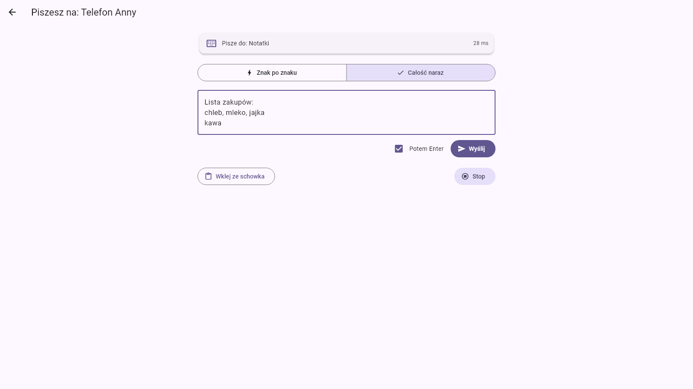

Najpierw napisz cały tekst, przejrzyj go i wyślij przyciskiem **Wyślij** albo
Ctrl+Enter. Zaznacz **Potem Enter**, gdy pole ma zostać zatwierdzone po
tekście (wyszukiwarka, komunikator wysyłający Enterem). Gdy pole pokazuje
kropki (patrz [Hasła](#hasła)), ma jeden wiersz, a Enter wysyła tekst tak
jak **Wyślij**, z Enterem na końcu, gdy zaznaczone jest **Potem Enter**.

To także tryb, który nic nie wysyła, gdy się zastanawiasz: cały tekst
wychodzi po naciśnięciu Wyślij. Na Androidzie trafia do pola od razu, na
Windows pisze się w tempie wklejenia (patrz niżej).

### Wklej ze schowka

Wysyła tekst ze schowka komputera, w obu trybach. Długi tekst dzieli się na
paczki po najwyżej 4096 znaków, wpisywane jedna po drugiej; na wysyłkę może
czekać do 65 536 znaków, a więcej jest odrzucane w całości („Za dużo tekstu
naraz. Wyślij go w częściach.”). Na Windows wklejony tekst pisze się po
jednym znaku co 10 ms, z przerwą 40 ms po każdej spacji i każdym końcu linii:
około 100 znaków na sekundę dla tekstu bez spacji, mniej więcej od 60 do 70
na sekundę dla zwykłego tekstu (patrz
[Jak szybko to działa](#jak-szybko-to-działa)).

### Hasła

Dopóki druga strona nie zgłosi zwykłego pola tekstowego, echo i pole „Całość
naraz” pokazują kropki: przy polu hasła i przy polu, którego Chatt nie umie
rozpoznać, co zdarza się w niektórych aplikacjach na Windows. Przy polu hasła
wiersz stanu dopisuje „· pole hasła”; przy polu nierozpoznanym zostaje samo
„Pisze do: *aplikacja*”, a pole i tak pokazuje kropki.

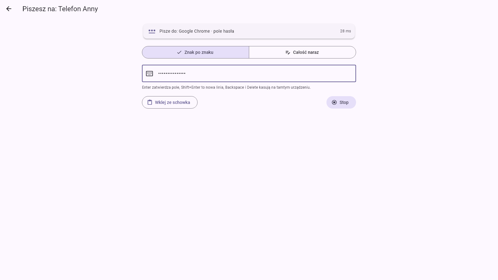

W trybie Znak po znaku, gdy cokolwiek poszło pod kropkami, echo zostaje
zakryte, dopóki nie zacznie od nowa (Enter, Shift+Enter, wklejenie, zmiana
trybu albo paczka, której druga strona nie wpisała), także po skasowaniu
całego tekstu i także gdy fokus po drugiej stronie przejdzie w tym czasie do
zwykłego pola. W trybie Całość naraz kropki zostają, dopóki pole nie będzie
puste.

### Nowa linia

Nowa linia dociera do komputera z Windows jako zwykły Enter. W edytorze
tekstu to nowa linia; w komunikatorze, w którym Enter wysyła, wysyła. Na
Androidzie pole wielowierszowe dostaje prawdziwą nową linię, a pole
jednowierszowe (wyszukiwarka, pole formularza) dostaje Enter, który może je
zatwierdzić.

### Pisanie idzie za fokusem

Sesja obejmuje całe urządzenie. Na Androidzie klawiatura Chatt zostaje
bieżącą przy przechodzeniu z aplikacji do aplikacji, więc pisanie idzie za
Tobą: szukanie w Ustawieniach, tytuł wydarzenia w kalendarzu, formularz
kontaktu, bez nowej zgody i bez nowego okna wyboru. Wyjątkiem jest pole
hasła przy zablokowanym ekranie, w tym hasło tekstowe samego ekranu blokady:
wraca do niego Twoja zwykła klawiatura, a klawiaturę Chatt przywracają
dotknięcie powiadomienia „Przełącz klawiaturę na Chatt” i jeden wybór w oknie
wyboru (patrz [Ekran blokady](#ekran-blokady)). Na Windows pisanie trafia do okna, które
jest na wierzchu.

Pola tekstowe samego Chatt przyjmują pisanie jak pola każdej innej
aplikacji. Na Windows zdalny Enter w polu wiadomości Chatt wysyła wiadomość,
jak w każdym komunikatorze. Na Androidzie to pole jest wielowierszowe, więc
zdalny Enter zaczyna w nim nową linię, a wiadomość wychodzi przyciskiem
Wyślij obok pola. Karty z pytaniami Chatt są poza zasięgiem: patrz
[Bezpieczeństwo i prywatność](#bezpieczeństwo-i-prywatność).

## Co widać na urządzeniu, na którym się pisze

### Na Androidzie

- **Pasek klawiatury Chatt**, tam gdzie zwykle jest klawiatura, gdy pole
  przyjmuje pisanie: kto pisze i do której aplikacji („Pisze: Office PC →
  Kontakty”, na zrzucie po angielsku), z przyciskami **Przełącz klawiaturę**
  i **Stop**.
- **Pasek nad każdym ekranem Chatt**, gdy Chatt jest otwarty, ze Stopem:
  „Office PC pisze do: Chatt”, gdy pisanie trafia do pola Chatt, w pozostałych
  chwilach „Pisze: Office PC”.
- **Stałe powiadomienie Chatt** przez całą sesję powtarza tekst paska
  klawiatury: „Pisze: Office PC → Kontakty”, gdy pole przyjmuje pisanie,
  i „Pisze: Office PC” bez pola.

| Pasek klawiatury | Pasek w Chatt |
|---|---|
|  | 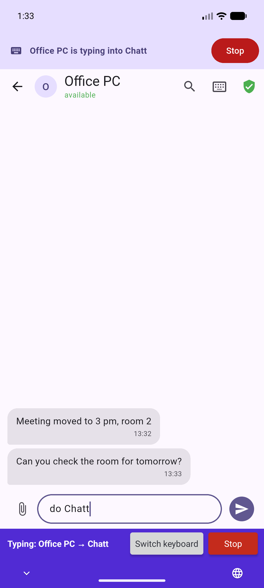 |

**Przełącz klawiaturę** otwiera okno wyboru klawiatury, gdy chcesz na chwilę
napisać coś sam; sesja trwa dalej, a ponowny wybór klawiatury Chatt przywraca
pisanie.

Sesja z urządzenia z zaznaczonym „Nie pytaj więcej” zaczyna się bez karty.
Gdy Chatt jest wtedy w tle, a bieżąca jest inna klawiatura, Chatt wysyła
powiadomienie „Przełącz klawiaturę na Chatt” (potrzebuje do tego zgody na
powiadomienia). Jedno jego dotknięcie otwiera okno wyboru klawiatury, a po
zamknięciu okna wyboru Chatt schodzi na bok, z powrotem do poprzedniej
aplikacji.

### Na Windows

- **Pływający pasek** u góry ekranu z oknem na wierzchu: „Pisze: Laptop Anny →
  Notepad” i **Stop**. Stoi na wierzchu przez całą sesję, także przy Chatt
  schowanym w zasobniku, i nigdy nie zabiera fokusu Twojemu polu, jak
  klawiatura ekranowa: Stop stuknięty palcem zostawia kursor tam, gdzie był.

  

- **Ikona w zasobniku** dostaje plakietkę, a jej menu pozycję **Zatrzymaj
  zdalną klawiaturę**.
- **Pasek nad każdym ekranem Chatt**, ze Stopem. Podaje program na wierzchu
  („Laptop Anny pisze do: Notepad”, patrz obrazek
  we [Włączaniu](#na-urządzeniu-na-którym-chcesz-pisać)). Nad oknem
  administratora mówi „Pisze: Laptop Anny” i dodaje drugą linię: „Okno
  z uprawnieniami administratora. Tam nic się nie wpisze.”

Na komputerze z ekranem dotykowym po stuknięciu pola może wysunąć się
klawiatura dotykowa. Nie przeszkadza i można ją zamknąć.

## Wiersz stanu

Wiersz u góry ekranu pisania mówi, dokąd idzie pisanie, albo czemu nic się
nie wpisze. Dopóki nic nie może trafić na miejsce, pola nie przyjmują pisania,
więc nic się nie zbiera, żeby trafić później w złe miejsce. Na Windows każde
zwykłe okno na wierzchu jest miejscem, do którego trafia pisanie: wiersz mówi
„Pisze do: *program*”, a klawisze idą do tego, co ma fokus w tym oknie, więc
najpierw kliknij pole, o które chodzi.

| Wiersz mówi | Co to znaczy | Co zrobić |
|---|---|---|
| Pisze do: *aplikacja* | na Androidzie pisanie trafia do pola z fokusem w tej aplikacji; na Windows do tego, co ma fokus w tym oknie | pisać |
| Pisze do: *aplikacja* · pole hasła | to samo, pole hasła; echo w kropkach | pisać |
| Brak pola do pisania | na Androidzie żadne pole nie ma tam fokusu albo klawiatura Chatt nie jest bieżąca; na Windows nie ma okna na wierzchu | stuknąć tam pole; na Androidzie wybrać klawiaturę Chatt |
| Tamto urządzenie jest zablokowane albo ma wygaszony ekran | ekran blokady albo na Androidzie wygaszony ekran | odblokować |
| Okno z uprawnieniami administratora. Tam nic się nie wpisze. | Windows nie wpuszcza tam zwykłych programów | użyć innego okna albo uruchomić program zwyczajnie |
| Wstrzymane: na tamtym urządzeniu czeka pytanie | po drugiej stronie czeka karta (plik, kod parowania, prośba o pisanie) | odpowiedzieć tam; pisanie wróci samo |
| Odpowiedz na pytanie u góry, potem pisz dalej | karta czeka na tym komputerze | odpowiedzieć tutaj |
| Połączenie zerwane | łącze padło | **Połącz ponownie** pyta jeszcze raz |
| Sesję zakończono na urządzeniu X | zakończyło ją urządzenie, na którym się pisze: Stop tam, wyłączony tam dodatek albo **Pozwól pisać na tym urządzeniu**, usunięcie tam tego urządzenia z listy albo koniec czasu (pół godziny bez pisania, osiem godzin w ogóle) | **Połącz ponownie** pyta jeszcze raz |

Mała liczba po prawej to czas, w jakim ostatnia paczka poszła tam i wróciła.
Przy włączonym dodatku Bluetooth znacznik pokazuje, którą drogą idzie sesja.

| Wstrzymane przez kartę | Okno administratora | Zerwane łącze |
|---|---|---|
| 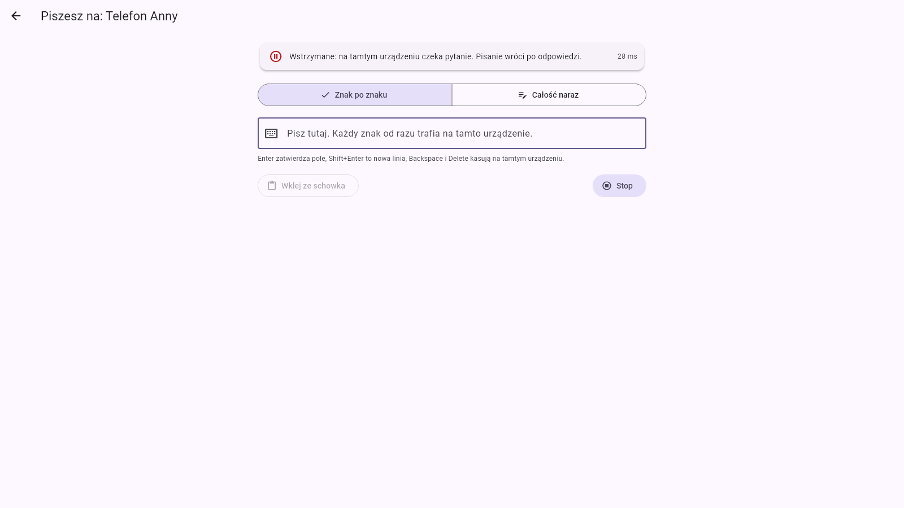 | 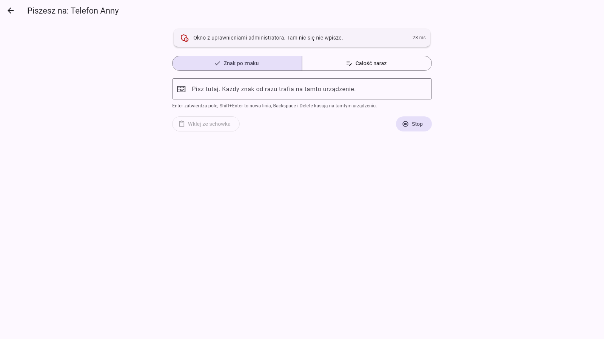 | 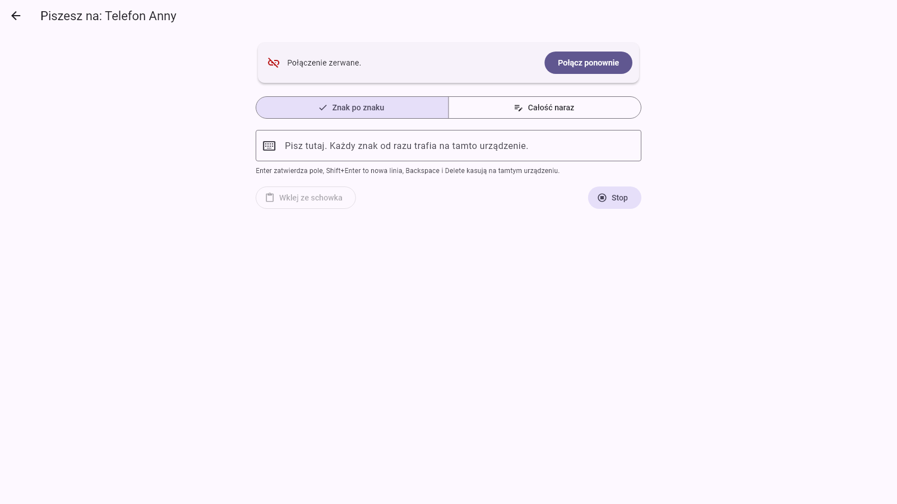 |

Prośba może się też skończyć przed początkiem sesji, krótkim komunikatem:
„Urządzenie X odmówiło.”, „Na urządzeniu X pisanie jest wyłączone.” (dodatek
albo **Pozwól pisać na tym urządzeniu** jest tam wyłączone), „Urządzenie X nie
odpowiedziało na prośbę.”, „Na urządzeniu X pisze już ktoś inny.”,
„Urządzenie X ma starszą wersję Chatt”, „Nie udało się połączyć
z urządzeniem X.”, „Najpierw potwierdź tożsamość tego urządzenia.”

## Ekran blokady

Na zablokowanym urządzeniu nic się nie wpisuje, a na Androidzie także przy
wygaszonym ekranie; wiersz stanu to mówi.

**Na Androidzie** ekran blokady z PIN-em albo wzorem zostawia klawiaturę
Chatt: klawiatura numeryczna PIN-u to nie klawiatura systemowa. Ekran blokady
z **hasłem tekstowym** wpisuje się bieżącą klawiaturą, a klawiatura Chatt nie
ma klawiszy, więc od razu oddaje miejsce i do hasła wraca zwykła klawiatura.
W trakcie sesji Chatt wystawia wtedy „Przełącz klawiaturę na Chatt”;
powiadomienie czeka do odblokowania, a jedno jego dotknięcie i jeden wybór
w oknie wyboru przywracają pisanie.

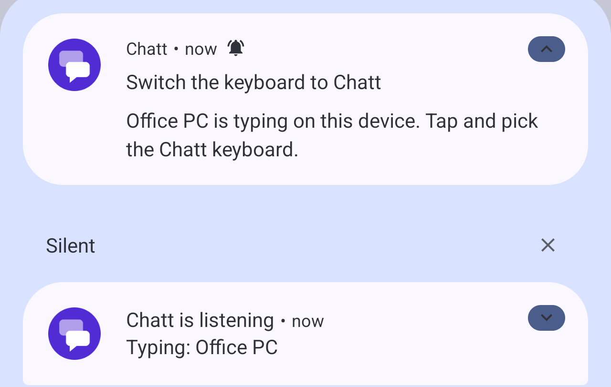

Pole aplikacji pokazanej nad zablokowanym ekranem zostawia klawiaturę
Chatt, a pisanie czeka do odblokowania ekranu i potem trwa dalej. Pole hasła
w takiej aplikacji działa jak hasło ekranu blokady: klawiatura Chatt oddaje
miejsce, a pisanie przywraca powiadomienie „Przełącz klawiaturę na Chatt”.

**Na Windows** ekran blokady, ekran logowania i okna Kontroli konta
użytkownika to osobny pulpit, na którym żaden zwykły program nie pisze.
Wiersz stanu mówi, że urządzenie jest zablokowane.

## Zatrzymanie

Sesja kończy się:

- **Stopem** w dowolnym miejscu: na pływającym pasku, na pasku klawiatury
  Chatt, w menu ikony w zasobniku, na pasku nad Chatt albo na ekranie pisania;
- zamknięciem ekranu pisania na komputerze;
- wyłączeniem dodatku na którymkolwiek urządzeniu albo **Pozwól pisać na tym
  urządzeniu** na urządzeniu, na którym się pisze;
- usunięciem rozmowy z drugim urządzeniem po którejkolwiek stronie (długie
  przytrzymanie rozmowy na liście): urządzenie znika z listy razem z nią;
- po pół godzinie bez pisania, a w każdym razie po ośmiu godzinach.

Stop na urządzeniu, na którym się pisze (pływający pasek, menu ikony
w zasobniku, pasek klawiatury Chatt, pasek nad Chatt), przerywa od razu nawet
długie wklejenie: to, co nie zdążyło się wpisać, przepada. Stop na ekranie
pisania i zamknięcie tego ekranu kończą sesję dopiero wtedy, gdy wpisze się
tekst, który już czeka na komputerze. Po końcu sesji paski znikają, a na
Androidzie wraca sama poprzednia klawiatura. Gdy sesja skończy się bez
wyjścia z ekranu pisania (padło łącze, drugie urządzenie ją zakończyło),
ekran zostaje otwarty z przyciskiem **Połącz ponownie**.

## Pisanie bez pytania

„Nie pytaj więcej dla tego urządzenia” na karcie albo **Pisanie bez pytania**
w panelu bezpieczeństwa rozmowy (widoczne tylko przy włączonym dodatku)
pozwala temu jednemu urządzeniu zaczynać pisanie bez karty. Paski i Stop
pokazują się jak zawsze. Działa tylko przy zielonej tarczy i włączonym
**Pozwól pisać na tym urządzeniu**, a znika razem z urządzeniem, gdy usuniesz
je z listy.

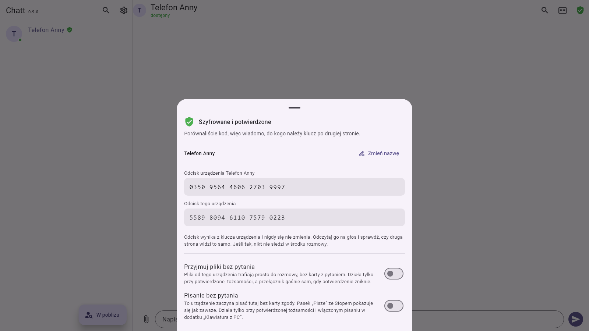

## Przez Bluetooth

Przy dodatku Bluetooth włączonym po obu stronach sesja może iść także przez
radio. Prośba próbuje najpierw drogi, która ostatnio zadziałała z tym
urządzeniem; gdy żadna nie jest zapamiętana, najpierw idzie sieć, a radio,
gdy sieć nie odpowiada. Cała sesja zostaje potem na drodze, która
odpowiedziała: gdy ta droga padnie w trakcie sesji, sesja się zrywa,
a **Połącz ponownie** próbuje dróg od nowa, radia też. Przez radio działa to
tak samo, z tą samą zgodą i tym samym szyfrowaniem; znak po prostu idzie
dłużej (patrz niżej), co widać przy szybkim pisaniu, a szybkie pisanie się
nie piętrzy: to, co przychodzi w czasie paczki w drodze, jedzie następną.

## Bezpieczeństwo i prywatność

- **Tylko między urządzeniami z potwierdzoną tożsamością.** Urządzenie bez
  zielonej tarczy nie może nawet sprawdzić, czy dodatek jest włączony:
  w każdym przypadku słyszy tę samą odmowę.
- **Zgoda na każdą sesję** na urządzeniu, na którym się pisze, chyba że dla
  tego jednego urządzenia wybierzesz „Nie pytaj więcej”. Urządzenie, które
  dostaje prośbę, przy każdej paczce sprawdza od nowa, w bazie, tarczę,
  dodatek i **Pozwól pisać na tym urządzeniu**, więc wyłączenie dodatku albo
  pozwolenia albo usunięcie urządzenia z listy od razu zatrzymuje pisanie.
- **Sesja jest związana z żetonem**, który losuje urządzenie przyjmujące
  pisanie. Paczka nagrana w sieci i wysłana później niczego nie wpisze,
  a identyfikator prośby działa raz.
- **Szyfrowane jak wiadomości**: te same klucze sesji, a każda paczka i każda
  odpowiedź dopełniona, więc w sieci jeden znak wygląda jak każdy inny.
- **Nic nie jest zapisywane**: pisany tekst nie trafia do żadnej bazy, logu
  ani stanu aplikacji, po żadnej stronie.
- **Karty z pytaniami Chatt są poza zasięgiem.** Dopóki na urządzeniu, na
  którym się pisze, czeka karta, paczki dostają odpowiedź „wstrzymane” i nic
  się nie wpisuje. Na Windows długa paczka, która właśnie wpisuje się w okno
  samego Chatt, urywa się przed następnym klawiszem, gdy wyskoczy karta,
  a karta pliku, która pojawi się w trakcie sesji, ustawia fokus na Odrzuć,
  więc zdalny Enter może najwyżej odmówić.
- **Urządzenie, które samo pisze na innym**, w tym czasie nie przyjmuje
  pisania do okna samego Chatt, więc jego ekran pisania nigdy nie przekaże
  dalej ani nie odbije tego, co dostaje.
- **Co to znaczy**: potwierdzone urządzenie z pozwoleniem na pisanie może
  pisać na Twoim odblokowanym urządzeniu jak podłączona do niego klawiatura,
  także wysłać wiadomość albo wpisać hasło. Trzymaj **Pozwól pisać na tym
  urządzeniu** wyłączone, gdy go nie potrzebujesz, a urządzenie, które
  zginęło albo zostało skradzione, usuń z listy (długie przytrzymanie jego
  rozmowy); rozmowa znika razem z nim, a pisanie z niego od razu się kończy.
  Model zagrożeń opisują [notatki o architekturze](architecture.md)
  i [polityka bezpieczeństwa](SECURITY.md).

## Czego nie da się zrobić

- Inne skróty z Ctrl, Alt albo Win, Tab, Esc, strzałki, Home, End i mysz.
- Ekran blokady, a na Androidzie wygaszony ekran.
- Na Windows: okna uruchomione jako administrator, okna Kontroli konta
  użytkownika i ekran logowania. Windows nie pozwala tam pisać żadnemu
  zwykłemu programowi, a komputer, z którego piszesz, o tym mówi.
- Obrazki i pliki ze schowka: jedzie tylko jego tekst.

## Jak szybko to działa

Pomiar z 16 października 2026: Pixel 9 Pro (Android 17) i komputer
z Windows 11 po kablu w tej samej sieci, po 100 znaków na przebieg:

| Droga | Znak, p50 | Znak, p95 |
|---|---|---|
| Wi‑Fi 2,4 GHz | 28 do 29 ms | 34 do 39 ms |
| Wi‑Fi 5 GHz | 28 do 30 ms | 33 do 38 ms |
| Bluetooth (wbudowane radio komputera) | 70 do 78 ms | 187 do 243 ms |

Na komputerze z Windows pisanie idzie po jednym znaku co 10 ms i 40 ms po
spacji albo Enterze: szybciej Notatnik z Windows 11 gubił albo powtarzał
znaki. Wklejenie 600 cyfr bez spacji trwało tam około 6,5 sekundy; zwykły
tekst tej długości zajmuje około 9 do 10 sekund.

## Gdy coś nie działa

| Co widać | Dlaczego i co zrobić |
|---|---|
| W rozmowie nie ma przycisku klawiatury | Dodatek na tym komputerze jest wyłączony: Ustawienia, Dodatki, Klawiatura z PC. |
| Przycisk klawiatury jest szary | Nie ma zielonej tarczy: porównaj kod w panelu bezpieczeństwa rozmowy. |
| „Na urządzeniu X pisanie jest wyłączone.” | Włącz tam dodatek i **Pozwól pisać na tym urządzeniu**. |
| „Urządzenie X nie odpowiedziało na prośbę.” | Nikt nie odpowiedział na kartę w dwie minuty. Na Androidzie daj Chatt zgodę na powiadomienia, żeby prośba pokazała się, gdy Chatt nie jest na ekranie. |
| „Brak pola do pisania” na Androidzie | Stuknij tam pole i sprawdź, czy klawiatura Chatt jest bieżąca (pasek na dole mówi „Pisze: …”). |
| W oknie wyboru nie ma klawiatury Chatt | Nie jest włączona w systemie: karta dodatku, **Włącz klawiaturę Chatt**. |
| Tekst trafia do złego okna na Windows | Pisanie idzie do okna na wierzchu. Najpierw kliknij pole, o które chodzi; pływający pasek nigdy nie zabiera fokusu. |
| Enter wysłał wiadomość | Enter to Enter pola. Na Androidzie nową linię w polu wielowierszowym daje Shift+Enter, a także nowa linia w trybie Całość naraz bez zaznaczonego **Potem Enter**. Na Windows każda nowa linia dochodzi jako Enter (patrz [Nowa linia](#nowa-linia)), więc w aplikacji, w której Enter wysyła, pisz w jednej linii. |
| W wolnej aplikacji na Windows brakuje liter | Zgłoś to z nazwą aplikacji: Chatt pisze w tempie, za którym nadąża nawet Notatnik z Windows 11, a wolniejsza aplikacja może potrzebować więcej. |

## Dla programistów

- Jak to działa w środku, protokół (`/input-session`, `/input`), kanał
  `chatt/remoteinput`, klawiatura na Androidzie i ujście na Windows:
  [architecture.md](architecture.md), sekcja o dodatku Keyboard from a PC.
- Testy i scenariusze na sprzęcie (`tool/klawiatura_*`), z przebiegami,
  z których pochodzą liczby wyżej: [testing.md](testing.md).
- Zrzuty pochodzą z `tool/windows_shots.dart` (Windows, oba języki),
  `tool/klawiatura_android_e2e_test.dart` z `CHATT_SHOTS=1` (Android, na
  emulatorze) i z przechwycenia żywego pływającego paska.
